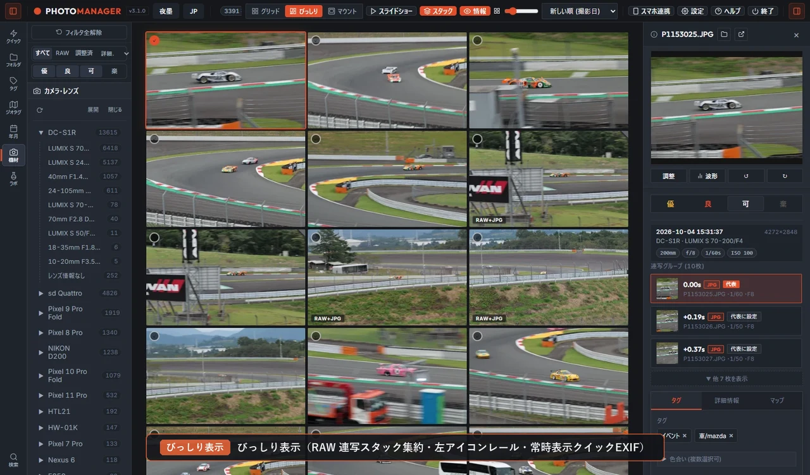
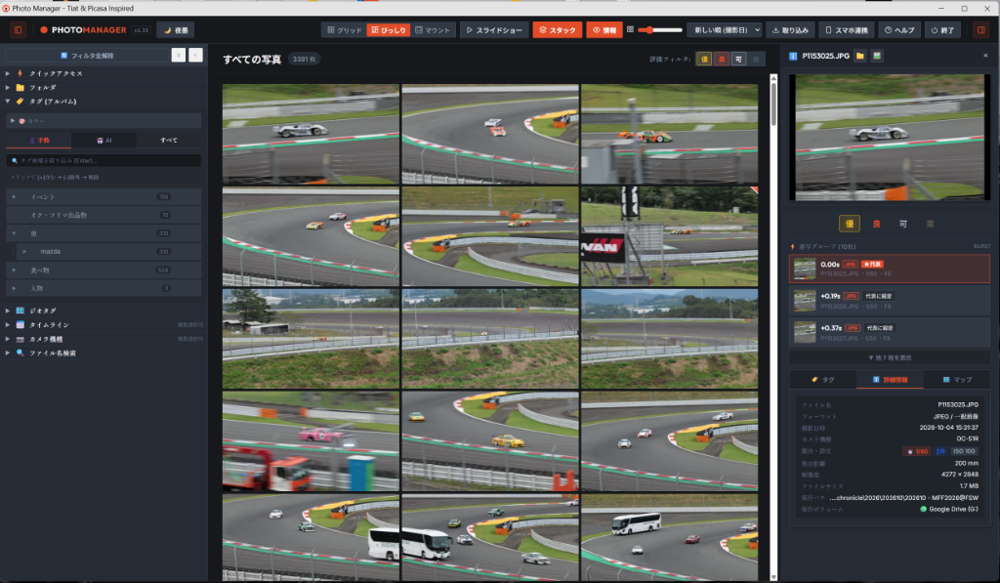
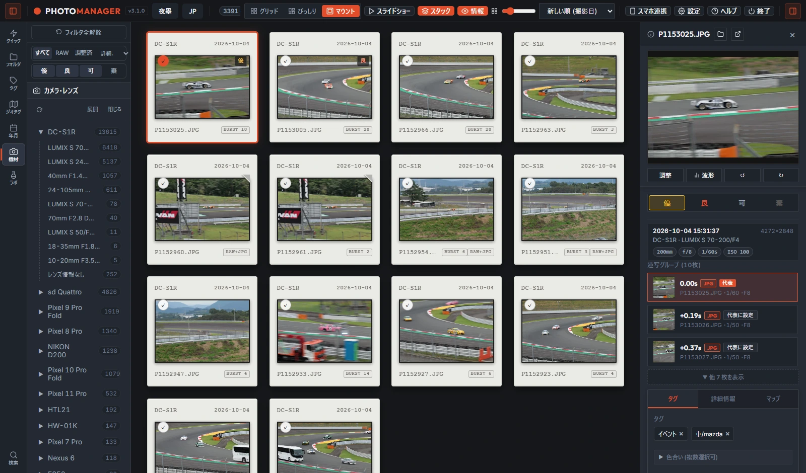
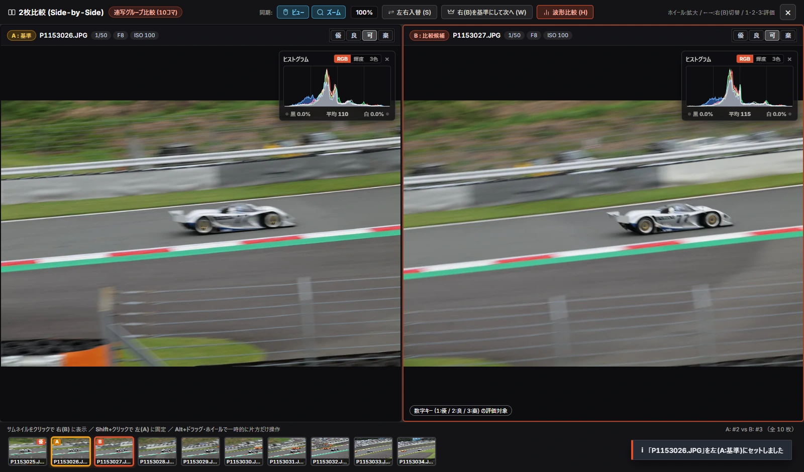
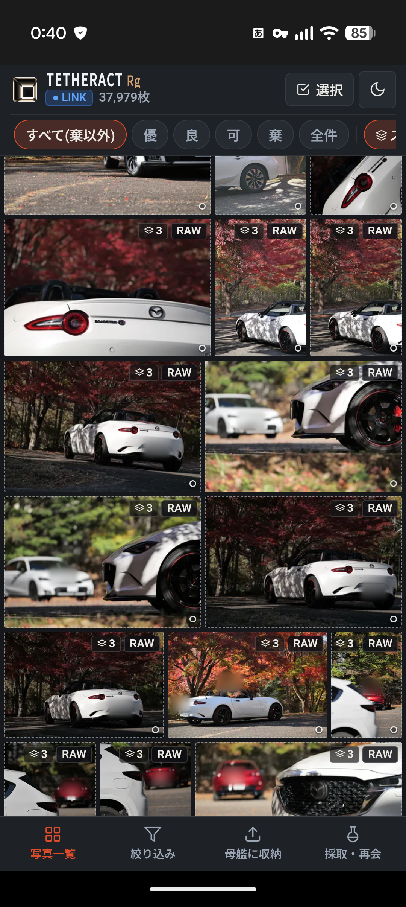
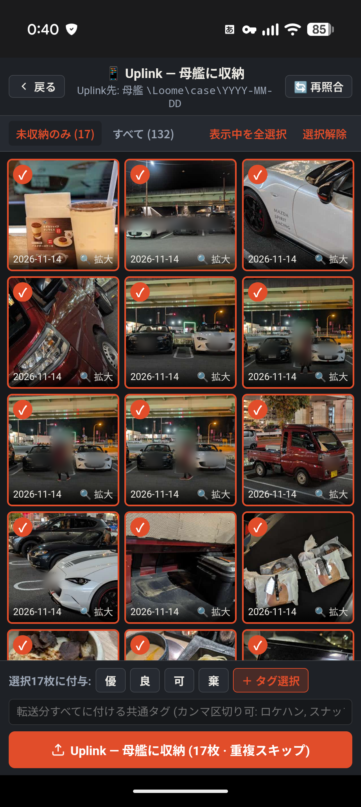
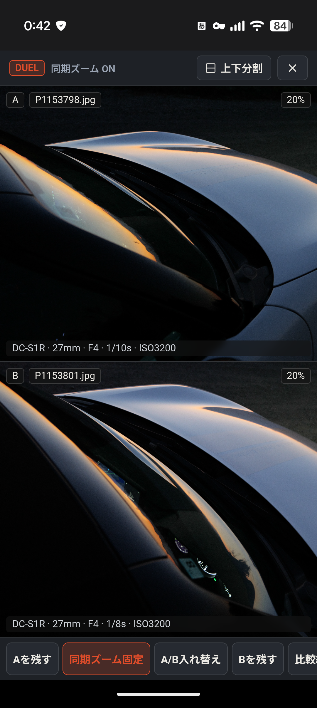

# TETHERACT Photo Manager (TETHERACT pm)

日本語 | [English](README_EN.md)

既存のフォルダ構造や元の写真ファイルに1バイトも触れず、複数のドライブ・SDカード・スマートフォンを横断してRAWやJPEGを軽快に選別・整理できる、Windows / Android 連携対応のローカル写真管理ツールです。  
かつての「Picasa」の軽快な一覧性と、「Tiat」の写真を邪魔しない静かなUI設計に着想を得て開発しています。インストールやクラウド連携は不要で、[GitHub Releases](../../releases) のZIPを解凍して `Tetheract.exe` を開くだけで使い始められます。

### 全体マップ（目次と概要）
- [どんな人に向いているか](#どんな人に向いているか) — 大量RAWの高速選別、元フォルダ非破壊、複数SSD・スマホ連携を求める方へ。
- [1. 保存先に縛られない分類と検索](#1-保存先に縛られない簡単で自由な分類と検索) — 既存フォルダのまま複数ドライブを横断し、包含 `[+]`・除外 `[-]` やEXIFで自在に抽出。
- [2. 元データは汚さず、選別から書き出しまで](#2-元データは汚さず壊さずでも見るだけでは終わらない) — 元ファイルは変更せず、非破壊調整・専用整理部屋 `Loome`・一括書き出しまで完結。
- [3. 作業を邪魔しない Look&Feel](#3-作業を邪魔しないlookfeel) — 静かな画面設計、各社RAWの即時表示・1:1等倍ズーム、片手選別と2枚比較（Duel）。
- [4. クラウド非依存・ポータブル保護](#4-クラウドには頼らないでもポータブル) — USBメモリで持ち歩け、VSNメディア追跡・ローカルAI・3段階エシカル保護を搭載。
- [Android連携とGPSフィールドログ（v2）](#android連携とgpsフィールドログ) — 同梱APKによるWi-Fi双方向同期、USB直挿し閲覧（Read-Only）、GPS軌跡補完。
- [エディションとバージョンの選び方](#エディションとバージョンの選び方) — 統合版 `v2.x` と PC単体安定版 `v1.8.x` の違い、導入手順、動作環境。



| びっしり表示（連写スタック） | マウント表示（スライドフィルム枠） | 2枚比較（Duel）＆波形比較 |
| :---: | :---: | :---: |
|  |  |  |

> [!NOTE]
> コンセプト・データの安全性・開発スタンスについて
> - 名称の由来：映画『インターステラー』の超立方体「Tesseract」に着想を得て、記憶を繋ぎ止める `Tether`、保存場所の次元を超える `Tesseract`、選び抜いて次へ繋げる `Act` を掛け合わせた造語です（旧称 Photo Manager）。
> - 完全非破壊・元フォルダ汚染ゼロ：管理フォルダ内の元ファイルは1バイトも書き換え・移動・削除せず、隠しファイルも作りません（記録は `cache/library.db` 1箇所のみ）。合わなければアプリのフォルダを捨てるだけで元の状態に戻ります。
> - 100% AI バイブコーディング（個人開発）：作者本人が自分のカメラ生活で欲しかった道具を AI との対話だけで作ったツールのため、作者はコードの中身をまったく知りませんｗ 技術的な質問には答えられませんが、「用途にハマったらラッキー」くらいの気楽な感覚でお使いください（画面上の `JP` / `EN` ボタンで英語表示にもワンクリックで切り替えられます）。

---

## どんな人に向いているか

- 大量のRAWや連写のセレクトを素早く終えたい：重いカタログ読み込みを待たず、メーカー純正の色味のまま即座に開き、片手の数字キーと2枚比較でベストカットを絞り込みたい人。
- 自分のフォルダ管理の流儀をソフトに乱されたくない：専用ライブラリへの強制インポートや、既存フォルダへの `.xmp` 大量生成を避けたい人。
- 複数の外付けSSDや何枚ものSDカードに写真が分散している：ドライブを繋ぎ替えたり外したりしても、1つのライブラリとして機材や季節から過去写真を横断検索したい人。
- クラウドに預けずPCとスマホ・タブレットを連携させたい：自宅Wi-Fiでスマホへ同期して移動中に親指でセレクトを進めたり、外付けSSDをスマホへ直挿ししてRAWプレビューを確認したい人。
- GPS非搭載のカメラでも撮影場所の記録を残したい：専用ロガーを持ち歩かず、スマホのワンタップ記録からカメラ写真へ非破壊で位置情報と旅の軌跡を紐付けたい人。

---

## 4つの設計原則と主な機能

### 1. 保存先に縛られない、簡単で自由な分類と検索。
既存のフォルダ構造を作り直すことなく、複数ドライブの写真を多角的な切り口から数ミリ秒で絞り込めます。

- 8つの視点と自然文フィルタ：左端レールの8つの視点（条件保存 `Binder` / フォルダ `Folder` / タグ `Tag` / カレンダー `Historia` / 撮影地 `Place` / 機材 `Gear` / 分析 `Lab` / 検索 `Search`）と、下部ツールバーの表示対象・形式・4段階評価フィルタを自在に組み合わせられます。
- 包含 `[+]` と除外 `[-]` の論理検索：階層タグや「カメラ ＞ レンズ」ツリーで、左クリックの包含 `[+]` と右クリックの除外 `[-]` を直感的に組み合わせ、タグの付け忘れや「スマホ写真を除いた一眼カメラの写真」もワンクリックで抽出できます。
- 撮影傾向の振り返りと発掘（`Lab`）：オフライン逆ジオコーディングによる都道府県・市区町村ツリーに加え、47都道府県の白地図・移動軌跡、高評価率から算出する「勝ちレンズカルテ」、太陽高度計算による「マジックアワー抽出」を備えています。

### 2. 元データは汚さず壊さず。でも、見るだけでは終わらない。
元の写真フォルダは読み取り専用で守りつつ、選別後の調整・整理・書き出しまでをひとつながりで完結できます。

- 専用整理部屋『Loome（ルーム）』：選び抜いた写真だけを実ファイルごと整理したい場面のために、隔離保管庫 `Loome/`（外付け `<ドライブ>:\Loome` 増設可）を備えています。この部屋にコピーした写真だけは、ペアRAWや `.xmp` を自動追従させながらサブフォルダ移動や一括連番リネーム（<kbd>F2</kbd>）を行えます。
- 非破壊調整と外部現像ソフト連携：90°回転、水平出し（±45°）、トリミング、露出・コントラスト・彩度の調整（一括コピペ対応）、カメラの時計ズレ補正を非破壊で行えます。外部現像ソフトでの更新や `.xmp` 出力も自動検知して反映します。
- 用途に合わせた書き出しと SNS 作品仕上げ（`Art Framer`）：プライバシー保護（ローカル AI によるナンバープレート・顔自動検出と不可逆マスク）・プリント枠・EXIF キャプション・3×3 配置マップ式のテキスト／ロゴ透かしを3ステップで確認して書き出す **Art Framer**、調整反映・リサイズ・連番化・EXIF 選択消去を一括実行する「スマート・テイクアウト（`take_out/`）」、暗室風の「ベタ焼き HTML 出力」、クリップボードコピー（<kbd>Ctrl</kbd>+<kbd>C</kbd>）を備えています（`Art Framer` やテイクアウト後に外部レタッチして管理下へ戻した画像も、元写真と自動でスタック編成されタグを引き継ぎます）。

### 3. 作業を邪魔しない、Look&Feel。
装飾や視覚ノイズを引き算し、写真の色彩とセレクト作業だけに集中できる操作感を追求しています。

- 静かな画面設計とモーション調整（`Slap & Sweep`）：カラー絵文字や太枠を排し、視線移動の少ない下部フッター統合ツールバーと4つのテーマ（`Tetheract D / L`・`夜墨`・`和紙`）で統一しています。画面遷移のキレと余韻も `0%`（即応）〜 `100%`（滑らか）で無段階に調整できます。
- 各社RAWの即時表示と原本1:1高精細ズーム：SIGMA Foveon（`.X3F`）やSonyロスレス圧縮RAW（`.ARW`）を含む各社RAWから埋め込みプレビューを直接抽出し、メーカー純正の色味で即座に表示します。拡大時は原本フル解像度（1:1等倍基準）から精細に描画し、2D仮想グリッドにより数万枚規模でも滑らかなスクロールを維持します。
- 片手4段階レーティングと2枚比較（`Duel`）：数字キー（<kbd>1</kbd>: 優 / <kbd>2</kbd>: 良 / <kbd>3</kbd>: 棄 / <kbd>0</kbd>: 可）だけで選別でき、連写・ブラケット・RAW+JPEGペアは自動でスマートスタックに束ねられます（最高評価コマが自動で表紙に昇格）。迷う2枚は <kbd>V</kbd> キーで並べて同期ズーム・波形比較（<kbd>H</kbd>）と勝ち抜き選別（<kbd>W</kbd>）ができます。

### 4. クラウドには頼らない。でもポータブル。
すべての環境を1つのフォルダに封入しており、外付けSSDやUSBメモリに入れてどのPCでも同じライブラリを持ち歩けます。

- VSN個体識別と抜き挿し即時検知：ドライブ文字ではなくボリュームシリアル番号（VSN）でメディアを識別するため、別PCへの接続や複数SDカードの差し替えでもリンクが切れません。複数ドライブに同じ写真があっても一覧上は1枚に統合され、未接続時も保存済みサムネイルで選別を続けられます。
- ローカルAI自動タグ付け：同梱のCLIPモデル（ONNX）により、外部通信ゼロで被写体候補タグと12色カラーラベルを自動判定します。
- 3段階セキュリティとエシカル保護（`Lv.0`〜`Lv.2`）：パスワード不要の標準状態（`Lv.0`）でも、借りたドライブ内の他人の `Loome` へのアクセスを拒否し、`library.db` 単体引き抜き時の無断閲覧を遮断します。パスワード設定により、DBサムネイル暗号化（`Lv.1`）や `Loome` 実ファイルのカプセル化保護（`Lv.2`・鍵自動サルベージ対応）へ引き上げられます。

---

## Android連携とGPSフィールドログ

`v2` 系では、外部アプリストアやクラウドを介さずにPC本体と直接連携する専用Androidネイティブアプリ（`android/Tetheract_Android.apk`）を同梱しています。

| スマホ一覧（`TETHERACT Rg`）＆下部サムバー | 手許『PhoneCase』から母艦 `Loome` へ Uplink 転送 | タッチ2枚比較（Touch Duel・上下分割＆同期ズーム） |
| :---: | :---: | :---: |
|  |  |  |

- 親指ファーストのタッチUI（`TETHERACT Rg / Ld`）：スマホ画面（`Rg`）では下部56pxのモーフィング・サムバー1本が操作状況（一覧・複数選択・拡大）に応じて変形し、ピンチ列数変更、なぞり範囲選択、2枚比較（Touch Duel）を片手で扱えます。モバイル版 **Art Framer**（オンデバイス ONNX プライバシー検出、非破壊調整反映、3×3 配置マップ式ウォーターマーク対応）やクイック SNS 共有も端末単体で完結し、タブレット画面（`Ld`）では自動で3ペイン構成に切り替わります。
- Wi-Fiロッカー双方向同期と『PhoneCase』：自宅Wi-Fiで指定フォルダや条件の写真をスマホ内ロッカーへ同期して外出先でオフライン選別し、帰宅後にワンタップでPCへ双方向マージできます。在宅時はPC接続ドライブの全写真・RAWをLAN経由でライブ閲覧でき、スマホ内の写真を事前選別してPCの `Loome/case/` へ一括転送する『PhoneCase』も備えています。
- 外付けUSBドライブの直挿し閲覧（100% Read-Only）：外出先で `Loome` 入りのUSBメモリやポータブルSSDをAndroid端末へ直挿しすると、ドライブに1バイトも書き込まない完全読み取り専用のままフル解像度画像やRAWプレビューを閲覧できます（`Lv.1` / `Lv.2` 暗号化データのオンメモリ復号にも対応）。
- Context Tether（GPSフィールドログ）：Androidクイック設定パネルの `FieldLog` タイルを1タップするだけで、ポケットの中で省電力・オフラインのまま日次軌跡を記録します。帰宅後にWi-FiでPCへ送信し、時計ズレ補正と線形補間によってGPS非搭載カメラの写真へも非破壊で撮影地を付与できます（一括取り消し・`.gpx` 入出力対応）。

> [!TIP]
> iOS端末やブラウザ単体で使う場合：アプリ導入が不要なWebAssembly内蔵の単一HTMLファイル（`Tetheract_Mobile.html`）および自宅Wi-Fiブラウザ接続モードも同梱しているため、iPhone / iPad やブラウザのみでもオフライン選別・連携が可能です。

---

## エディションとバージョンの選び方

画面サイズに応じた3つのUIエディション（PC版 `TETHERACT Ed` / タブレット版 `TETHERACT Ld` / スマホ版 `TETHERACT Rg`）を備えており、2つのリリース系列から選べます（`cache/library.db` と `Loome` は両系列で完全互換です）。

| 系列 | 内容とおすすめの対象 |
| :--- | :--- |
| `v2.x` 系列（推奨・統合版） | PC本体の高速化（2D仮想グリッド・5ドメイン世代キャッシュ）に加え、専用Androidアプリ・タッチUI・Art Framer・GPSフィールドログを統合した最新ラインです。 |
| `v1.8.x` 系列（PC単体安定版） | PCデスクトップ単体でシンプルに使いたい方向けに並行メンテナンスされている安定ラインです。 |

### ダウンロードと起動・更新方法
1. 初回導入：[GitHub Releases](../../releases) からフル版 `Tetheract_vX.X.X.zip` を解凍し、`Tetheract.exe` を起動します（初回に Windows SmartScreen が出た場合は「詳細情報」→「実行」、または `tools/Build.bat` で平文ソース `tools/Launcher.cs` から自己ビルドできます）。
2. PC版の更新：軽量差分版 `Tetheract_vX.X.Xdiff.zip` を解凍せずそのまま `Tetheract.exe` と同じフォルダへ置いて起動すると、古い不要ファイルを一掃して自動クリーン更新されます（`cache/` や `Loome/` のデータは保たれます）。
3. Android版の導入・更新：PC画面「モバイル同期」のQRコード（または `android/Tetheract_Android.apk`）からインストールし、以降はスマホ設定の「アプリ更新を確認」から自宅Wi-Fi経由でワンタップ更新できます。

---

## 動作環境・対応フォーマット・主要ショートカット

| 項目 | 仕様 |
| :--- | :--- |
| PC本体 | Windows 10 / 11（64-bit）＋ Microsoft Edge または Google Chrome（Python・VC++等の事前導入不要） |
| モバイル連携 | Android 8.0（API 26）以降（同梱APK）、またはモダンブラウザ（`Tetheract_Mobile.html` / Wi-Fi接続） |
| 一般画像 | `JPEG`, `PNG`, `WebP`, `HEIC` / `HEIF`, `AVIF`, `TIFF`, `BMP`, `GIF` |
| カメラRAW | Sony（`.ARW` / `.SR2` / `.SRF` / `.ARQ` ロスレス圧縮対応）、SIGMA Foveon（`.X3F`）、Canon（`.CR2` / `.CR3` / `.CRW`）、Nikon（`.NEF` / `.NRW`）、Fujifilm（`.RAF`）、Panasonic（`.RW2`）、Olympus / OM System（`.ORF`）、Pentax（`.PEF`）、Adobe / Leica 等（`.DNG`）、Samsung（`.SRW`） |

| キー | 動作 | キー | 動作 |
| :--- | :--- | :--- | :--- |
| <kbd>1</kbd> / <kbd>2</kbd> / <kbd>3</kbd> (<kbd>X</kbd>) / <kbd>0</kbd> | 評価（優 / 良 / 棄 / 可・解除） | <kbd>V</kbd> / <kbd>W</kbd> | 2枚比較（Duel） / 右を勝ち抜き残す |
| <kbd>Space</kbd> / ダブルクリック | 拡大表示 / 全体 ⇄ 1:1等倍（`100%`）切替 | <kbd>C</kbd> / <kbd>H</kbd> / <kbd>R</kbd> / <kbd>L</kbd> | 調整・トリミング / 波形切替 / 90°回転 |
| <kbd>←</kbd> <kbd>→</kbd> / <kbd>↑</kbd> <kbd>↓</kbd> | 写真移動 / スタック内のコマ切替 | <kbd>F2</kbd> / <kbd>[</kbd> / <kbd>D</kbd> / <kbd>I</kbd> | `Loome` 連番リネーム / パネル・文字表示切替 |

---

## パッケージ構成・技術仕様・ドキュメント

```text
Tetheract/
├── Tetheract.exe           専用ネイティブGUIランチャー（起動・多重起動制御・クリーンアップデーター）
├── Tetheract_Mobile.html   単体完結型モバイルHTML（ブラウザ単体でのUSBオフライン選別用）
├── android/                同梱の専用Androidアプリ（Tetheract_Android.apk）
├── Loome/                  専用保管庫『Loome』の実ファイル保存領域（スマホUplink先 case/ 含む）
├── take_out/               スマート・テイクアウト＆ベタ焼きHTMLの標準出力先
├── cache/                  SQLiteデータベース（library.db）、フィールドログ、世代バックアップ
├── frontend/ & server/     UI画面（Vanilla HTML/CSS/ES6+）＆ バックエンド（FastAPI / LANブリッジ / RAW解析）
├── python/ & models/       ポータブルPython 3.11 環境 ＆ ローカルAIモデル（CLIP / YuNet / LPD-YuNet ONNX）
└── LICENSES/ & *.md        同梱OSSライセンス（NOTICE.txt）およびマニュアル・技術ドキュメント
```

- 採用技術：Python 3.11（Embeddable）+ FastAPI / Vanilla JS（2D仮想グリッド・`Slap & Sweep`） / SQLite3（WAL・5ドメイン世代キャッシュ・ROWID直結WebP BLOB） / Kotlin Android Shell（SQLiteロッカー・Read-Only SAF・純Kotlin SHAKE256/HMAC-SHA256 オンメモリ透過復号） / `127.0.0.1` 既定待受 ＆ 3段階AEAD暗号化保護
- ドキュメント：[操作マニュアル (`MANUAL.md`)](MANUAL.md) ｜ [USBポータブル運用ガイド (`README_USB.md`)](README_USB.md) ｜ [リリースノート (`RELEASE_NOTES.md`)](RELEASE_NOTES.md) ｜ [アーキテクチャ・技術知見集 (`docs/knowledge/`)](docs/knowledge/README.md)
- ライセンス：本体コードは [MIT License](LICENSE)（無保証）。再配布・改変時は同梱ライブラリ（LibRaw / `rawpy` [LGPL 2.1 動的リンク] 等）および位置情報データのライセンス条件（[`LICENSES/NOTICE.txt`](LICENSES/NOTICE.txt) 収録）を遵守してください。
