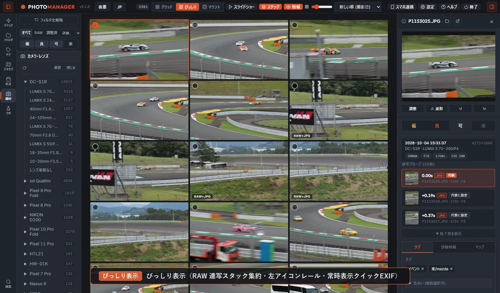
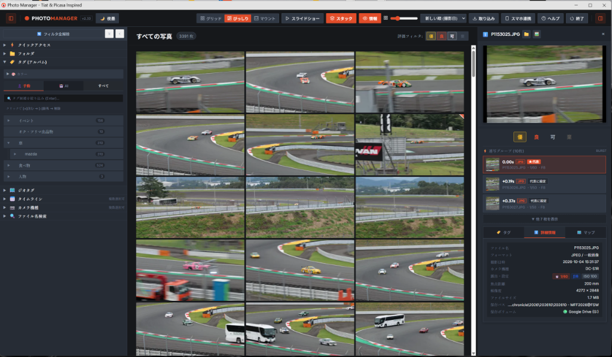
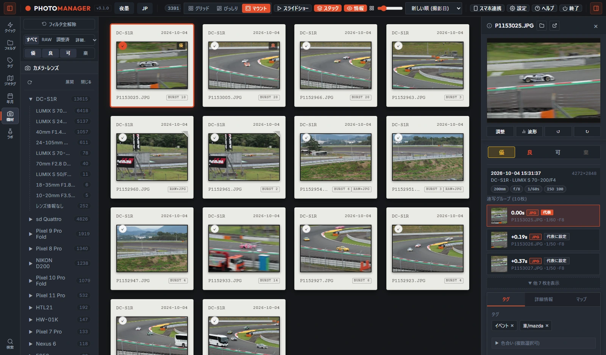
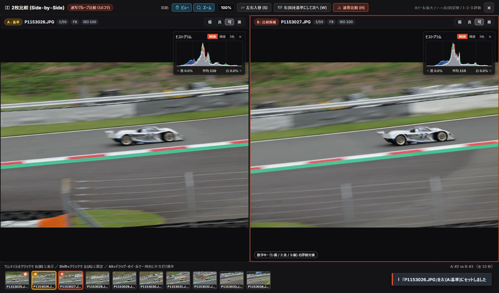

# Tetheract Photo Manager

日本語 | [English](README_EN.md)

Picasa や Tiat に着想を得た、Windows 向けのローカル写真ビューア・選別（セレクト）ツールです。  
JPEG / PNG / WebP / HEIC や各社カメラの RAW データを、元のファイルやフォルダ構造を1バイトも変更することなく、軽快に閲覧・比較・整理できます。

すぐに試す場合は、[GitHub Releases](../../releases) から最新版 ZIP をダウンロードし、解凍して `Tetheract.exe` を起動してください（インストール不要）。

| びっしり表示（アスペクト比維持・連写スタック） | マウント表示（スライドフィルム枠モード） | 2枚比較（Duel）＆ヒストグラム波形比較 |
| :---: | :---: | :---: |
|  |  |  |

---

> [!NOTE]
> はじめに（開発スタンスとデータの安全性について）
>
> - 100% AI にお願いした「バイブコーディング（Vibe Coding）」産です：  
>   このアプリのコードはすべて AI に書いてもらったものなので、作者本人は中身のコードをまったく知りませんｗ そのため、技術的な質問や「この行のコードはどうなってるの？」と聞かれても答えられませんので悪しからず。
> - 個人開発ツールです（要望対応について）：  
>   個人の趣味と実用目的で作っているソフトです。ご要望やバグ報告（Issue 等）はありがたく拝見して参考にさせていただきますが、実際に反映や修正ができるかは AI のご機嫌次第です。「現状のままで自分の用途にハマったらラッキー」くらいの気楽な感覚でお使いください。そのかわり、暇があれば AI 相手にゴネて機能を追加したり修正したりしています。
> - 英語力はゼロです（アプリは `JP` / `EN` 切り替えに対応）：  
>   作者は英語力がゼロのため、英語で話しかけられると 100% 機械翻訳頼りのちょっとおかしな人になりますｗ なお、アプリ画面上部の `JP` / `EN` ボタンで、画面表示やヘルプマニュアルをワンクリックで英語に切り替えられます（もちろんこれも AI 産ですｗ）。
> - 元の写真ファイルには一切手を触れません（完全非破壊・読み取り専用）：  
>   中身のコードは AI 任せですが、「指定したフォルダにある元の写真ファイルは1バイトも書き換えない・移動しない・削除しない」という設計だけは徹底しています。もしアプリが合わなければ、Tetheract Photo Manager のフォルダごとゴミ箱に捨てるだけで、PC の環境も写真フォルダも元のまま残ります。

---

## 特徴

### 1. 保存先に縛られない、簡単で自由な分類と検索。
写真は年数とともに内蔵ドライブや外付けSSDに分散していきますが、管理ソフト側の都合でフォルダ構造を作り直したり、専用の保存場所へまとめ直したりするのは負担になります。保存場所やフォルダ分けは普段使っている形のままにしておき、その上からタグや撮影情報を使って、フォルダやドライブの垣根を意識せずに自由な切り口で束ねたり引き算したりできることを目指しました。

- 既存フォルダのまま横断管理：PC内蔵ドライブや複数の外付けドライブにあるフォルダ構造を維持したまま、横断して閲覧・検索できます。
- 階層タグと機材の包含 `[+]`・除外 `[-]` 検索：タグや「カメラ ＞ レンズ」の階層で、条件を含む `[+]` と除外する `[-]` を直感的に組み合わせられます。同じ親グループ内は「または（OR）」、異なる親グループ間は「かつ（AND）」で結ばれるため、大まかに選んだ中から不要な条件を引き算したり、タグの「打ち漏れ」を探し出したりできます。
- 自然文フィルタバーと道標表示：絞り込み中は画面下部に現在の条件が自然な日本語文で表示され、条件ピルからその場で子タグの追加・除外や「全年の同じ月」への切り替えができます。親階層を閉じているときも破線枠と件数バッジ（`+1` / `-1`）が適用箇所を示します。
- 多角的な絞り込み・並び替えとプリセット保存：撮影年月、撮影地（国 ＞ 都道府県 ＞ 市区町村）、12色カラー、種別（RAW / JPEGのみ / RAW+JPGペア / 調整済 / XMPあり）、4段階評価での絞り込みと、焦点距離・F値・シャッター速度・ISO感度等での並び替えに対応しています。よく使う条件はフィルタプリセットとして保存できます。
- 撮影傾向を振り返る「ラボ」と地図機能：47都道府県の撮影白地図・密度ヒートマップ・日付ごとの移動軌跡（さんぽ軌跡）や、高評価率から相性の良い機材を集計する「勝ちレンズ・得意設定カルテ」、太陽高度によるマジックアワー抽出、過去の同月日を振り返る「歴代の今日」、未整理フォルダを開く「ガチャ」を備えています。

### 2. 元データは汚さず壊さず。でも、見るだけでは終わらない。
大切な原本ファイル（RAWやJPEG）がソフトの都合で書き換えられたり、写真フォルダの中に管理用の隠しファイルが勝手に作られたりするのは避けたいところです。一方で、ただ眺めるだけのビューアでは、選別後のちょっとした手直しや書き出しのたびに別ソフトを開く手間が残ります。「元ファイルと写真フォルダには1バイトも触れない」という一線を厳守したまま、選別から調整・書き出し・必要なときのファイル整理までをひとつながりで行えるようにしています。

- 元ファイル・元フォルダへの書き込みゼロ：回転、調整、タグ付け、日時補正、「棄（ボツ）」の評価を行っても、元の写真ファイルは一切変更・削除されません。操作記録はすべてアプリ内のデータベース（`cache/library.db`）1箇所にのみ保存されます。
- 非破壊の回転・傾き・トリミング・トーン調整：90°回転、水平線の微小角度補正（±45°）、比率固定トリミング、明るさ・コントラスト・彩度の調整（RGB・輝度ヒストグラム連動）を非破壊で行えます。調整前後のワンタッチ比較や、複数写真への一括コピー＆ペーストにも対応しています。
- 撮影日時のシフト補正とスマホGPS引き継ぎ：カメラの内蔵時計ズレや海外旅行の時差を、オフセット指定で一括非破壊補正できます（元のEXIF日時へいつでも復元可能）。また、前後1時間以内にスマホ等で撮った写真からGPS位置情報を非破壊で引き継げます。
- 既存XMPサイドカーの読み取り連携：Lightroom等の現像ソフトが出力した `.xmp` / `.pp3` / `.dop` が同じフォルダにある場合、それらを書き換えずに読み取り、「XMPプレビュー」で調整結果を見比べたり、評価や階層タグを `XMP/...` 階層へ取り込んだりできます。
- 用途に合わせた書き出し：調整反映・リサイズ・撮影順の連番リネーム・EXIF消去・オプションの `.xmp` 出力を一括で行う「スマート・テイクアウト」、赤鉛筆マークやA4印刷に対応した暗室風の「ベタ焼きHTML」出力、クリップボードへの画像コピー（<kbd>Ctrl</kbd>+<kbd>C</kbd>）を備えています。
- 必要なときだけ実ファイルを整理できる内部ストレージ：実ファイルごと整理したい写真だけをアプリ内の `storage/` フォルダへコピーして取り込めば、ペアのRAWや `.xmp` を自動追従させながら、サブフォルダ整理や一括連番リネーム（<kbd>F2</kbd>）を行えます。

### 3. 作業を邪魔しない、Look&Feel。
何百枚・何千枚という写真を見比べて選別するとき、色付きのアイコンや主張の強い枠線、RAW読み込みの待ち時間、あるいはちょっとしたクリックミスでタグ階層が崩れてしまうような挙動は、作業の集中を削いでしまいます。画面は写真の色彩と階調が素直に見えるよう静かに保ち、キーボードと最小限の視線移動だけでテンポよく選別を続けられる操作感を重視しました。

- 写真が主役になる静かな画面設計：カラー絵文字や強い装飾を抑え、明るい「和紙」テーマと暗室のように落ち着いた「夜墨」テーマ、および画面全体の「日本語 / 英語（`JP` / `EN`）」表示をワンクリックで切り替えられます。
- 3つの一覧レイアウトとパネル開閉：標準グリッド、縦横比を保つ「びっしり表示」、ポジフィルム枠のように余白をとる「マウント表示」を選べます。左右パネルの開閉や文字情報の非表示（<kbd>I</kbd> キー）で一覧を広く使えるほか、右インスペクタには見切れのない 4:3 プレビューとクイックEXIFを常時表示します。
- Foveon（`X3F`）や各社RAWの軽快な表示：SIGMA（X3F）、Panasonic（RW2）、Canon（CR2 / CR3）、Nikon（NEF）、Sony（ARW）、Olympus（ORF）、Fujifilm（RAF）、Pentax（PEF）、DNGなどに対応。埋め込みプレビューを優先抽出するため、メーカー固有の色味のまま現像処理を待たずに軽快に閲覧できます。
- 連写・ブラケットを束ねるスマートスタック：連写、露出ブラケット（AEB）、RAW+JPGペア、重複写真を自動で1つに束ねて一覧をすっきり保ちます。拡大表示中は <kbd>↑</kbd> <kbd>↓</kbd> キーでコマを切り替え、上部の「代表」ボタンで表紙カットを変更できます。
- 片手レーティングと2枚比較（Duel）：数字キー（<kbd>1</kbd>: 優 / <kbd>2</kbd>: 良 / <kbd>3</kbd>: 棄 / <kbd>0</kbd>: 可）だけで片手選別ができ、「棄」にした写真は確認ダイアログなしで即座に一覧から隠れて次へ進みます。迷う2枚は <kbd>V</kbd> キーで左右に並べ、同期ズームとヒストグラム比較を行いながら <kbd>W</kbd> キーで勝ち抜き選別ができます。
- 日常操作と構造編集の分離：普段のタグ付けは右インスペクタと右クリックメニューに限定し、タグの階層移動・リネーム・削除は「設定」内の専用エディタに分離することで、選別中の誤操作を防いでいます。左右のタグ一覧はそれぞれ独立して「名前順（自然順）/ 枚数順」を切り替えられます。

### 4. クラウドには頼らない。でもポータブル。
個人の写真ライブラリを外部のクラウドに預けっぱなしにしたり、PCを買い替えるたびに環境構築やデータベースの移行で苦労したりしたくない、という思いから作っています。すべての処理をローカル環境で完結させつつ、フォルダごと外付けSSDやUSBメモリに入れて持ち歩けば、どのPCでも、さらには外出先のスマートフォンでも自分のライブラリをそのまま扱える形にしました。

- 外部送信ゼロのローカル完結動作：写真データの外部送信や外部CDN通信は一切行いません（地図の背景タイルを表示するときのみOpenStreetMapへ接続します）。AIによる自動タグ付け（CLIP）や、GPS座標からの撮影地（国・都道府県・市区町村）の判定もすべて手元のPC内で完結します。
- インストール不要・USBメモリからそのまま起動：ポータブルPython実行環境とデータベース（`cache/library.db`）が単一フォルダ内にまとまっているため、Pythonが入っていないPCでも外付けSSDやUSBメモリからそのまま起動できます。アップデートも軽量な差分ZIPを上書きするだけで完了します。
- ドライブレター変動への自動追従と未接続時閲覧：ドライブ固有のシリアル番号（VSN）を記録するため、別PCへ繋ぎ替えてドライブレター（`E:\` → `F:\` など）が変わってもリンク切れを起こしません。外付けドライブを外している状態でも、保存済みのサムネイルとデータベースだけで閲覧・検索・選別を続けられます。
- スマートフォンでのWi-Fi・オフライン選別：自宅Wi-Fi経由（QRコードのトークン認証・30分無通信で自動停止）、またはUSBメモリ内の `Tetheract_Mobile.html` と `cache/library.db` をスマホのブラウザ（WebAssembly）で直接読み込むオフライン方式で、外出先でもスマホで選別してPCへ差分同期できます。

---

## 主要キーボードショートカット

| キー | 動作 |
| :--- | :--- |
| <kbd>1</kbd> / <kbd>2</kbd> / <kbd>3</kbd> (<kbd>X</kbd>) / <kbd>0</kbd> | 評価を付与（<kbd>1</kbd>: 優 / <kbd>2</kbd>: 良 / <kbd>3</kbd>: 棄 / <kbd>0</kbd>: 可・解除） |
| <kbd>Space</kbd> / <kbd>Enter</kbd> | 拡大表示（ライトボックス）を開く / 閉じる |
| <kbd>←</kbd> <kbd>→</kbd> <kbd>↑</kbd> <kbd>↓</kbd> | 写真の移動（拡大表示中は <kbd>↑</kbd> <kbd>↓</kbd> で連写・ブラケットのコマ切替） |
| <kbd>V</kbd> / <kbd>W</kbd> | 2枚比較（Duel）モードを開く / 比較中に右の写真を勝ち抜き残す |
| <kbd>C</kbd> / <kbd>H</kbd> | トリミング・傾き・トーン調整を開く / ヒストグラム表示切替 |
| <kbd>R</kbd> / <kbd>L</kbd> | 時計回りに 90° 回転 / 反時計回りに 90° 回転 |
| <kbd>F2</kbd> | ファイル名を変更（`storage/` 内の単一リネーム・複数一括連番リネーム） |
| <kbd>[</kbd> (<kbd>B</kbd>) / <kbd>D</kbd> / <kbd>I</kbd> | 左メニュー開閉 / 右インスペクタ開閉 / サムネイル上の文字情報表示切替 |

---

## ダウンロードと起動方法

### 方法A：配布パッケージ（GitHub Releases の ZIP）を使う場合

Python 実行環境や必要なライブラリがすべて同梱されているため、PC への事前インストール作業は不要です。

1. 初回導入（フルパッケージ版 `Tetheract_vX.X.X.zip`）：  
   [GitHub Releases](../../releases) からフルパッケージ版 ZIP をダウンロードして任意のフォルダ（または USB メモリ）に解凍し、`Tetheract.exe` をダブルクリックすると専用ウィンドウで起動します。
2. 既存環境のアップデート（軽量差分版 `Tetheract_vX.X.Xdiff.zip`）：  
   すでにフルパッケージ版をお使いの場合は、`python/` や `models/` の再ダウンロードは不要です。軽量な差分版 ZIP を解凍して既存フォルダへ上書きコピーするだけで、これまでのデータベース（`cache/`）や `storage/` を保ったまま更新できます。

> [!NOTE]
> 旧バージョン（Photo Manager v3.x）からの上書き移行とダウングレード互換性について
>
> - ランチャーの自動整理：旧 `PhotoManager` フォルダへ上書きして `Tetheract.exe` を起動すると、フォルダ内に残っていた旧 `PhotoManager.exe` および `PhotoManager_Mobile.html` は自動的に整理（削除）され、`Tetheract.exe` / `Tetheract_Mobile.html` へ一本化されます。
> - データベースの自動バックアップと後方互換性：初回起動時のデータベース移行処理（`tag_keys_v1`）が走る直前に、移行前のDBスナップショットが `cache/backups/library_pre_tag_keys_v1_YYYYMMDD_HHMMSS.db` として自動保存されます。また、移行後の `cache/library.db` は旧バージョンのテーブル・カラム構造を維持したハイブリッド設計になっているため、万が一旧バージョン（v3.x）のプログラムを上書きして戻した場合でも、同じDBのまま動作します（`cache/backups/` のバックアップから完全復元することも可能です）。

> [!IMPORTANT]
> 初回起動時に「Windows によって PC が保護されました（SmartScreen）」と表示される場合
>
> 本ソフトは写真の外部送信やレジストリ変更を行わないローカルアプリケーション（地図タイル表示時のみ外部接続）ですが、有償のコード署名証明書を取得していない個人開発ソフトであるため、ダウンロード直後の `Tetheract.exe` に対して Windows Defender SmartScreen の確認画面が出ることがあります。以下のいずれかの方法で起動できます。
>
> 1. そのまま実行する：確認画面の「詳細情報」をクリックし、「実行」を選択します（2回目以降は表示されません）。
> 2. `Build.bat` で手元で生成する：フォルダ内の `Build.bat` をダブルクリックすると、Windows 標準搭載の C# コンパイラ（`csc.exe`）を使って、平文のソースコード（[`launcher/Launcher.cs`](launcher/Launcher.cs)）から手元の PC 上で `Tetheract.exe` を生成して起動します。自分の PC 内で作られたファイルになるため、ダウンロード由来のブロックが付かずスムーズに起動できます。

### 方法B：GitHub リポジトリからクローンして使う場合

Git リポジトリには大容量のポータブル Python 本体（`python/`）を含めていません。初回のみ以下の2ステップを実行してください（PC 本体への Python インストールは不要です）。

1. `setup_portable_python.bat` を実行（要インターネット接続・初回のみ）：  
   Python 公式サイトから Embeddable Python 3.11 と依存ライブラリが `python/` フォルダへ自動でダウンロード・構築されます。
2. `Build.bat` を実行：  
   `Tetheract.exe` が生成され、アプリケーションが起動します。

---

## 今後の構想

個人の趣味によるバイブコーディング開発のため、実装時期や実現のお約束はできませんが、「完全オフライン・非破壊・軽快な動作」という基本設計を守りながら、将来的に以下のような機能を構想しています。

- 似た構図・雰囲気の写真を探す（ローカル類似画像検索）：  
  手元の PC 内の AI 画像解析を利用して、お気に入りの1枚を選ぶと、これまでに撮りためた写真の中から「構図・色合い・光の雰囲気」が似ているカットをタグ付けなしでも探し出せる機能。
- ピント面のハイライト表示（フォーカスピーキング）：  
  拡大表示や2枚比較（Duel）モードで、カメラのピーキング機能のようにピントが合っている輪郭を色付きで浮かび上がらせ、連写した中から一番シャープな1枚を選びやすくする補助機能。
- GPS ロガー（`.gpx`）からの位置情報・移動軌跡の紐付け：  
  登山や街歩きの GPS ログ（`.gpx` ファイル）と撮影時刻を照らし合わせ、GPS を内蔵していないカメラで撮った写真でも、元ファイルを書き換えずに撮影場所や歩いた軌跡を地図上で楽しめる機能。
- 外部 RAW 現像ソフトへのダイレクト受け渡し：  
  選別して残した写真（またはペアの RAW ファイル）を、ショートカットキーひとつで普段使っている外部の RAW 現像ソフトへそのまま引き渡す連携機能。
- 余白フレーム・撮影データ付き書き出し：  
  スマート・テイクアウトの出力オプションとして、写真のまわりに静かな余白（マット枠）を設け、カメラ・レンズ名や露出設定を控えめに添えて書き出す機能。

---

## ドキュメント

- [操作マニュアル (`MANUAL.md`)](MANUAL.md)  
  基本操作・片手選別から、2枚比較、排他検索、非破壊調整、書き出し、モバイル・USB運用までをまとめたガイドです。アプリ右上の「ヘルプ（<kbd>F1</kbd>）」からも同じ内容を閲覧できます。
- [USBポータブル運用ガイド (`README_USB.md`)](README_USB.md)  
  外付け SSD や USB メモリでの持ち歩き運用と、スマートフォン連携の手順書です。
- [アーキテクチャ・技術知見集 (`docs/knowledge/`)](docs/knowledge/README.md)  
  SQLite BLOB サムネイル設計や WebAssembly モバイル連携、UI デザインシステム（v3.00）などの設計記録です。

---

## ライセンス

Tetheract Photo Manager 本体のソースコードは [MIT License](LICENSE) の下で公開されています。無保証であることをご理解の上、自由にご利用・改変いただけます。

> [!WARNING]
> 同梱・利用している外部パッケージ類のライセンス遵守について
>
> 本ソフトウェアを改変・再配布・パッケージングする場合は、内包しているサードパーティ製ライブラリおよびデータセットのライセンス条件を遵守してください。
> - 利用している全ライブラリ（Python, FastAPI, Pillow, LibRaw / rawpy [LGPL 2.1], pystray [LGPL 3.0], ONNX Runtime, sql.js 等）およびオフライン位置情報データ（Code for Fukui, GeoNames 等 [CC BY 4.0 / ODbL]）のライセンス一覧と原文は、[`LICENSES/NOTICE.txt`](LICENSES/NOTICE.txt) および [`LICENSES/`](LICENSES) ディレクトリに収録しています。
> - 特に `rawpy` が内包する RAW 現像ライブラリ LibRaw（LGPL 2.1）のライセンス条件を遵守するため、動的リンク（DLL）のまま利用し、`PyInstaller --onefile` 等で単一実行ファイルに静的バンドルして再配布しないようご注意ください。
