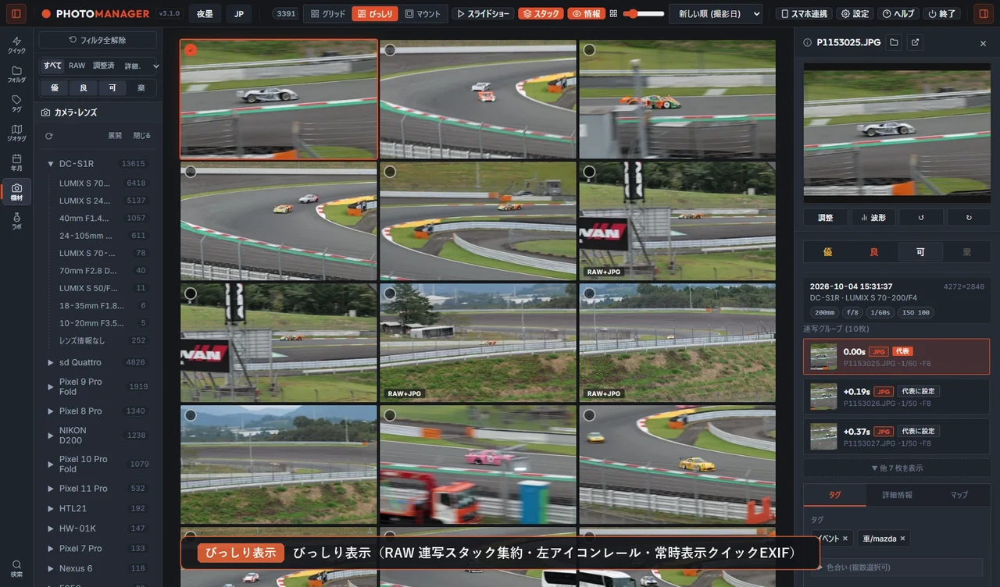
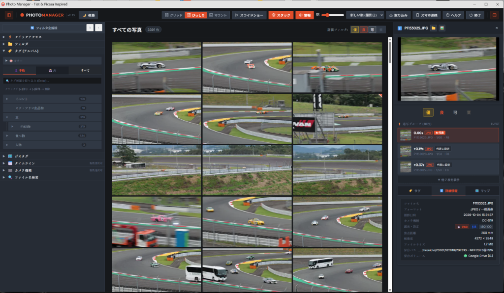
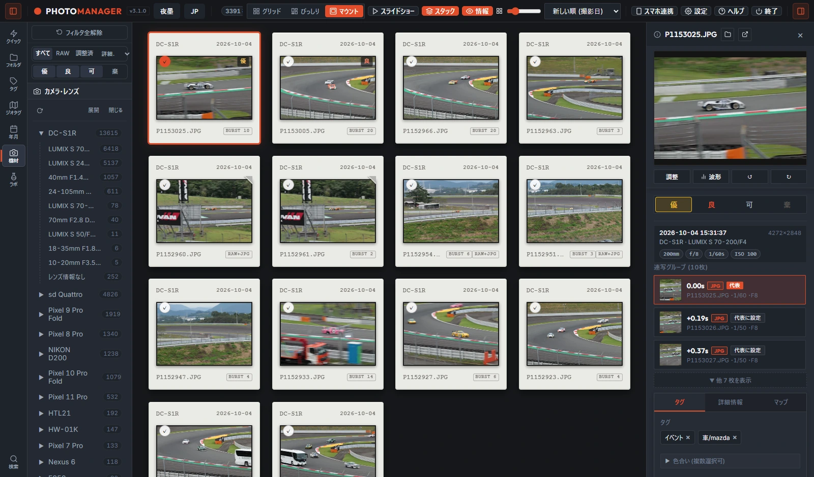
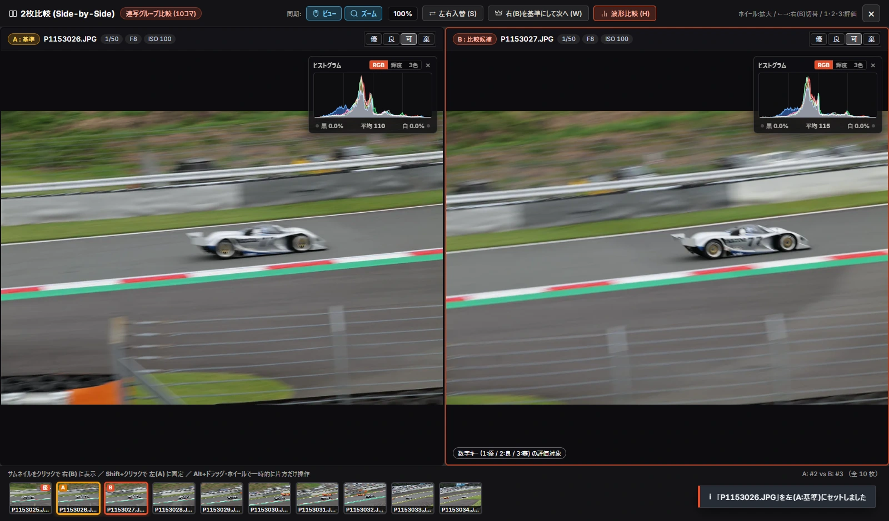

# TETHERACT pm（テザラクト・フォトマネージャー）

日本語 | [English](README_EN.md)

> **📢 名称変更のお知らせ（旧称：Photo Manager）**  
> v1.0.0 より名称を **「TETHERACT pm（テザラクト・フォトマネージャー）」** へ改めました（映画『インターステラー』の超立方体「テサラクト」と、記憶を繋ぎ止める「Tether」を掛け合わせた造語です）。既存のデータベース（`cache/`）や写真は上書きアップデートでそのまま引き継げます。

Picasa や Tiat に着想を得た、Windows 向けのローカル写真ビューア・選別ツールです。  
JPEG / PNG / WebP / HEIC や各社カメラの RAW データを、元ファイルやフォルダ構造を一切変更せずに軽快に閲覧・比較・整理できます。

すぐに試す場合は、[GitHub Releases](../../releases) から最新版 ZIP をダウンロードして解凍し、`Tetheract.exe` を起動してください（インストール不要）。

| びっしり表示（アスペクト比維持・連写スタック） | マウント表示（スライドフィルム枠モード） | 2枚比較（Duel）＆ヒストグラム波形比較 |
| :---: | :---: | :---: |
|  |  |  |

---

> [!NOTE]
> はじめに（開発スタンスとデータの安全性について）
>
> - 100% AI による「バイブコーディング」産です：コードはすべて AI に書いてもらっているため、作者本人は中身をまったく知りませんｗ 技術的な質問には答えられませんので悪しからず。
> - 個人開発ツールです：個人の趣味と実用で作っています。ご要望やバグ報告は参考にさせていただきますが、直せるかは AI のご機嫌次第です。「現状のままで自分の用途にハマったらラッキー」くらいの気楽な感覚でお使いください。
> - 英語力はゼロです（画面の `JP` / `EN` 切替には対応）：英語で話しかけられると 100% 機械翻訳頼りになりますｗ なお、画面上部の `JP` / `EN` ボタンで表示やヘルプをワンクリックで英語に切り替えられます（これも AI 産ですｗ）。
> - 元ファイルには一切触れません（完全非破壊）：指定フォルダ内の元ファイルは1バイトも書き換え・移動・削除しません。アプリが合わなければフォルダごとゴミ箱に捨てるだけで、PC も写真フォルダも元のまま残ります。

---

## 特徴

### 1. 保存先に縛られない、簡単で自由な分類と検索。
フォルダ分けや保存場所をソフトの都合で作り直す必要はありません。普段のフォルダ構造はそのままに、複数のドライブをまたいでタグや撮影情報から自由に写真を束ねたり引き算したりできます。

- 既存フォルダのまま横断管理：PC内蔵ドライブや複数の外付けドライブを、既存のフォルダ構造のまま横断して閲覧・検索できます。
- タグと機材の包含 `[+]`・除外 `[-]` 検索：階層タグや「カメラ ＞ レンズ」で、含む `[+]` と除外 `[-]` を直感的に組み合わせられます（同グループ内は OR、別グループ間は AND、ワンクリックで切替可）。
- 自然文フィルタバー：絞り込み条件を画面下部に自然な日本語文で表示し、条件ピルから子タグの追加・除外や「全年の同じ月」への切り替えができます。
- 多角的な絞り込みとプリセット保存：撮影年月（カレンダー対応）、場所（国 ＞ 都道府県 ＞ 市区町村）、12色カラー、ファイル種別、4段階評価での絞り込みと、露出値等での並び替え・プリセット保存に対応しています。
- 撮影傾向を振り返る「ラボ」と地図：47都道府県の撮影白地図・ヒートマップ・移動軌跡や、高評価率から集計する「勝ちレンズカルテ」、太陽高度によるマジックアワー抽出を備えています。

### 2. 元データは汚さず壊さず。でも、見るだけでは終わらない。
元の写真ファイルやフォルダには1バイトも触れず、管理用の隠しファイルも作りません。その一線を厳守したまま、選別から調整・書き出しまでをひとつながりで行えます。

- 元ファイル・元フォルダへの書き込みゼロ：回転、調整、タグ付け、「棄（ボツ）」の評価を行っても元ファイルは変更されず、記録はすべてアプリ内の `cache/library.db` 1箇所に保存されます。
- 非破壊の回転・傾き・トリミング・トーン調整：90°回転、水平出し（±45°）、トリミング、明るさ・コントラスト・彩度の調整（ヒストグラム連動・一括コピペ対応）を非破壊で行えます。
- 日時シフト補正とスマホGPS引き継ぎ：カメラの時計ズレや時差の一括補正（元のEXIF日時へ復元可）と、前後1時間以内のスマホ写真からのGPS位置情報の引き継ぎに対応しています。
- 既存XMPサイドカーの読み取り：Lightroom等が出力した `.xmp` 等を書き換えずに読み取り、調整結果の比較プレビューや評価・階層タグの取り込みができます。
- 用途に合わせた書き出し：調整反映・リサイズ・連番リネーム・EXIF消去を一括で行う「スマート・テイクアウト」、暗室風の「ベタ焼きHTML」出力、クリップボードへの画像コピー（<kbd>Ctrl</kbd>+<kbd>C</kbd>）を備えています。
- 内部ストレージ（`storage/`）での実ファイル整理：実ファイルごと整理したい写真だけを `storage/` へコピーすれば、ペアのRAWや `.xmp` を自動追従させながらフォルダ移動や一括リネーム（<kbd>F2</kbd>）を行えます。

### 3. 作業を邪魔しない、Look&Feel。
写真の色彩が素直に見える静かな画面設計と、キーボードと最小限の視線移動だけでテンポよく選別を続けられる操作感を重視しました。

- 静かな画面設計と4つの外観テーマ：装飾や絵文字を抑え、`Tetheract D / L`（シャンパン＆モノトーン）・`夜墨`・`和紙` の4テーマと、`JP` / `EN` 言語切替を備えています。
- 3つの一覧レイアウト：標準グリッド、縦横比を保つ「びっしり表示」、フィルム枠風の「マウント表示」を切り替えられ、文字情報の非表示（<kbd>I</kbd> キー）やパネル開閉で画面を広く使えます。
- Foveon（`X3F`）や各社RAWの軽快な表示：SIGMA（X3F）、Canon、Nikon、Sony、Fujifilm、Panasonic、Olympus、Pentax、DNG等に対応し、埋め込みプレビュー抽出によりメーカー固有の色味のまま即座に表示します。
- 連写・ブラケットを束ねるスマートスタック：連写、露出ブラケット（AEB）、RAW+JPGペア、重複写真を自動で1つに束ね、拡大表示中の <kbd>↑</kbd> <kbd>↓</kbd> キーでコマ切替や表紙変更ができます。
- 片手レーティングと2枚比較（Duel）：数字キー（<kbd>1</kbd>: 優 / <kbd>2</kbd>: 良 / <kbd>3</kbd>: 棄 / <kbd>0</kbd>: 可）だけで片手選別ができ、迷う2枚は <kbd>V</kbd> キーで左右に並べて同期ズームと勝ち抜き選別（<kbd>W</kbd> キー）ができます。
- 日常操作と構造編集の分離：普段のタグ付けは右インスペクタに限定し、タグの階層移動・リネーム・削除は「設定」内の専用エディタに分離して選別中の誤操作を防いでいます。

### 4. クラウドには頼らない。でもポータブル。
外部クラウドに依存せず、すべての処理をローカル環境で完結させています。フォルダごと外付けSSDやUSBメモリに入れれば、別PCやスマートフォンでもそのままライブラリを扱えます。

- 外部送信ゼロのローカル完結動作：写真の外部送信は一切行いません（地図タイル表示時のみOpenStreetMapへ接続）。ローカルAI自動タグ付け（CLIP・カラー再判定）や撮影地の都道府県・市区町村判定もPC内で完結します。
- インストール不要・USBからそのまま起動：ポータブルPythonとデータベースが単一フォルダにまとまっており、どのPCでも `Tetheract.exe` からそのまま起動できます。更新も軽量な差分ZIPの上書きだけで完了します。
- ドライブ・複数SDカードの個体識別とメタデータ引き継ぎ：ボリュームシリアル番号（VSN）により、ドライブ文字の変動に自動追従し、複数のSDカードを同じドライブ文字で差し替えても個別に管理・一覧確認できます。SDカード上で付けた評価・タグ・調整は、PCへ写真を移動した際にも自動で引き継がれます。
- 未接続時の閲覧とスマートフォン選別：外付けドライブを外していても保存済みサムネイルで閲覧・選別を続けられます。自宅Wi-Fi（QRコード）や外出先のUSBオフライン接続で、スマホから選別してPCへ同期できます。

---

## 主要キーボードショートカット

| キー | 動作 |
| :--- | :--- |
| <kbd>1</kbd> / <kbd>2</kbd> / <kbd>3</kbd> (<kbd>X</kbd>) / <kbd>0</kbd> | 評価を付与（<kbd>1</kbd>: 優 / <kbd>2</kbd>: 良 / <kbd>3</kbd>: 棄 / <kbd>0</kbd>: 可・解除） |
| <kbd>Space</kbd> / <kbd>Enter</kbd> | 拡大表示（ライトボックス）を開く / 閉じる |
| <kbd>←</kbd> <kbd>→</kbd> <kbd>↑</kbd> <kbd>↓</kbd> | 写真の移動（拡大表示中は <kbd>↑</kbd> <kbd>↓</kbd> で連写・ブラケットのコマ切替） |
| <kbd>V</kbd> / <kbd>W</kbd> | 2枚比較（Duel）を開く / 比較中に右の写真を勝ち抜き残す |
| <kbd>C</kbd> / <kbd>H</kbd> | トリミング・傾き・トーン調整を開く / ヒストグラム表示切替 |
| <kbd>R</kbd> / <kbd>L</kbd> | 時計回りに 90° 回転 / 反時計回りに 90° 回転 |
| <kbd>F2</kbd> | ファイル名を変更（`storage/` 内の単一・複数連番リネーム） |
| <kbd>[</kbd> (<kbd>B</kbd>) / <kbd>D</kbd> / <kbd>I</kbd> | 左メニュー開閉 / 右インスペクタ開閉 / サムネイル文字情報の表示切替 |

---

## ダウンロードと起動方法

### 方法A：配布パッケージ（GitHub Releases の ZIP）を使う場合

Python 環境や依存ライブラリが同梱されているため、事前インストールは不要です。

1. 初回導入（フル版 `Tetheract_vX.X.X.zip`）：ZIP を解凍して `Tetheract.exe` を起動します。
2. アップデート（軽量差分版 `Tetheract_vX.X.Xdiff.zip`）：既存のフォルダへ上書きコピーするだけで、`cache/` や `storage/` を保ったまま更新できます。

> [!NOTE]
> 旧バージョン（Photo Manager v3.x）からの上書き移行について
> - 旧 `PhotoManager.exe` / `PhotoManager_Mobile.html` は `Tetheract.exe` 起動時に自動整理されます。
> - 初回起動時のDB移行直前に `cache/backups/` へ自動バックアップが保存され、旧 v3.x との後方互換も維持されます。
> - USBルートで `autorun.inf` をお使いの場合は、既存ファイルを一度削除してから `Build.bat` を再実行すると新しいアイコンとラベル（`TETHERACT pm`）で再生成できます。

> [!IMPORTANT]
> 初回起動時に「Windows によって PC が保護されました（SmartScreen）」と表示される場合
> コード署名証明書を持たない個人開発ソフトのため、ダウンロード直後に確認画面が出ることがあります。
> 1. そのまま実行する：「詳細情報」→「実行」を選択します（2回目以降は出ません）。
> 2. 手元でビルドする：同梱の `Build.bat` を実行すると、Windows 標準の C# コンパイラでソースコード（[`launcher/Launcher.cs`](launcher/Launcher.cs)）から `Tetheract.exe` を生成して起動します。

### 方法B：GitHub リポジトリからクローンして使う場合

初回のみ以下の2ステップを実行してください（PC 本体への Python インストールは不要です）。

1. `setup_portable_python.bat` を実行（要ネット接続）：`python/` フォルダへポータブル Python 環境が自動構築されます。
2. `Build.bat` を実行：`Tetheract.exe` が生成され、起動します。

---

## 今後の構想

個人の趣味開発のため実装時期は未定ですが、オフライン・非破壊・軽快な設計のまま以下の機能を構想しています。

- ローカル類似画像検索：お気に入りの1枚から、構図・色合い・雰囲気が似ている写真をAI解析で探す機能。
- フォーカスピーキング：拡大表示や2枚比較時に、ピントが合っている輪郭をハイライト表示する補助機能。
- GPSロガー（`.gpx`）連携：撮影時刻と `.gpx` ログを照合し、GPS非搭載カメラの写真にも位置情報や軌跡を紐付ける機能。
- 外部RAW現像ソフト連携：選別した写真（またはペアRAW）をショートカットキーで外部現像ソフトへ直接渡す機能。
- 余白フレーム・EXIF付き書き出し：写真の周囲にマット枠を設け、機材名や露出設定を控えめに添えて書き出す機能。

---

## ドキュメント

- [操作マニュアル (`MANUAL.md`)](MANUAL.md)：基本操作から排他検索、非破壊調整、モバイル・USB運用までの完全ガイド（アプリ内の <kbd>F1</kbd> ヘルプと同内容）。
- [USBポータブル運用ガイド (`README_USB.md`)](README_USB.md)：外付けドライブでの持ち歩き運用とスマホ連携の手順書。
- [アーキテクチャ・技術知見集 (`docs/knowledge/`)](docs/knowledge/README.md)：内部設計やUIデザインシステムの記録。

---

## ライセンス

本体ソースコードは [MIT License](LICENSE) の下で公開されています（無保証）。  
再配布・改変時は同梱ライブラリ（Python, FastAPI, Pillow, LibRaw / rawpy [LGPL 2.1], pystray [LGPL 3.0], ONNX Runtime, sql.js 等）および位置情報データ（Code for Fukui, GeoNames 等）のライセンス条件を遵守してください。一覧と原文は [`LICENSES/NOTICE.txt`](LICENSES/NOTICE.txt) および [`LICENSES/`](LICENSES) に収録しています（`rawpy` 内包の LibRaw は LGPL 2.1 のため、動的リンクのまま利用し単一実行ファイルへ静的バンドルしないでください）。
