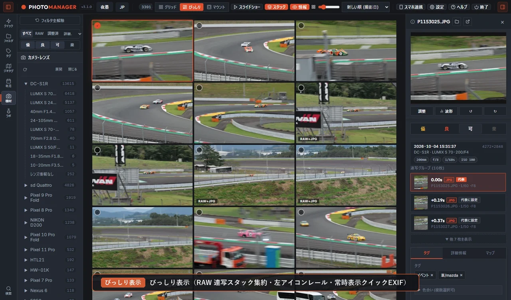
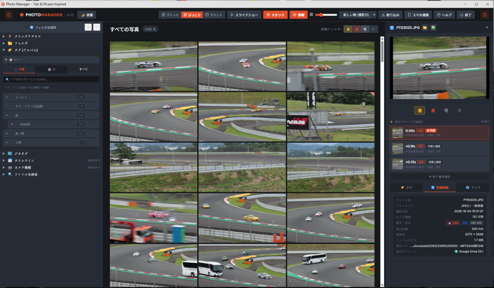
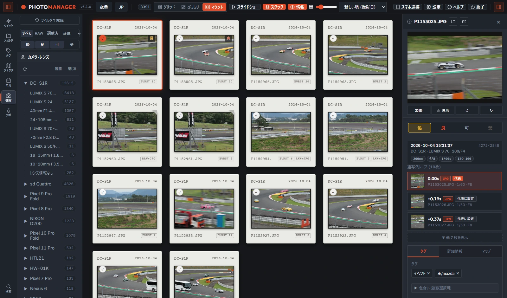
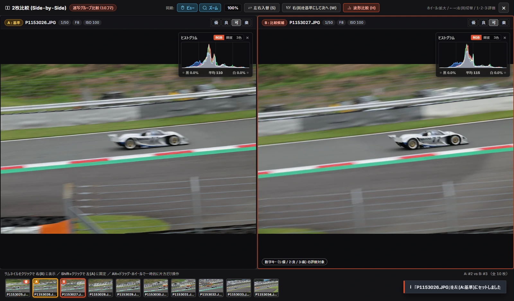
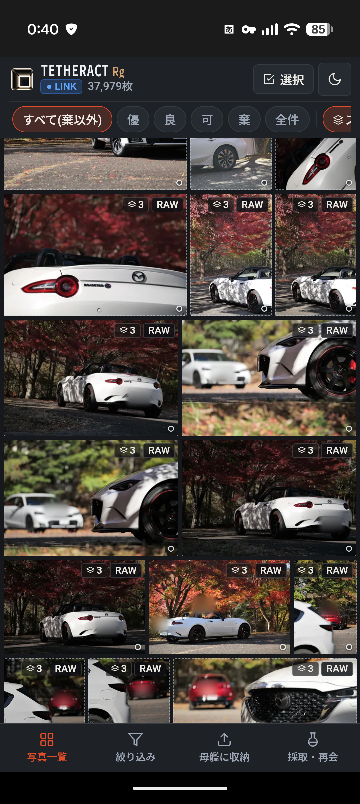
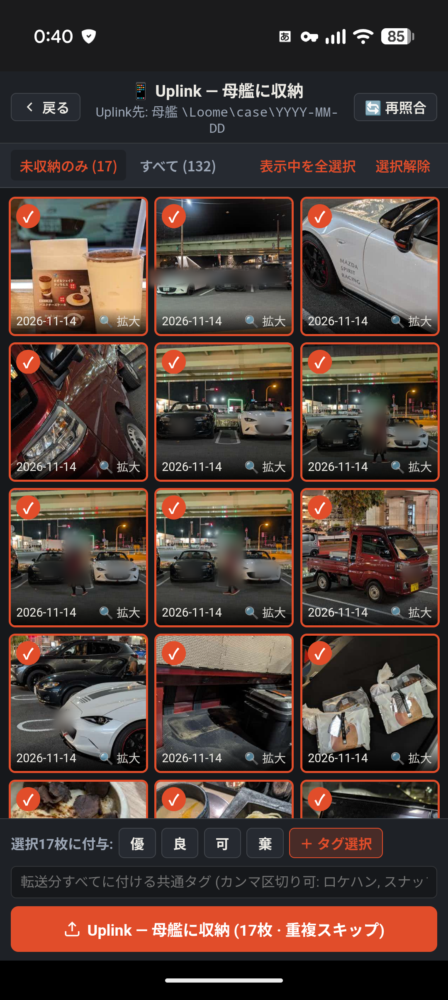
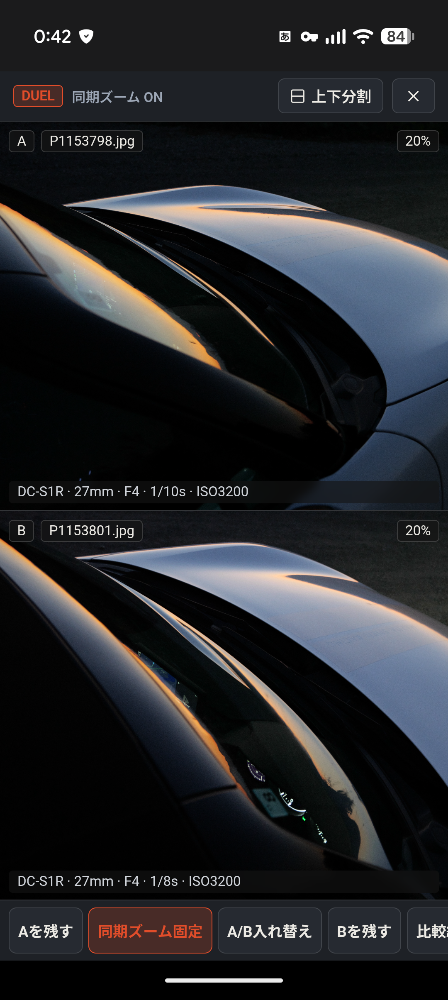

# TETHERACT Photo Manager (TETHERACT pm)

[日本語](README.md) | English

A local, non-destructive photo viewer, culling, and management tool for Windows and Android that lets you browse, compare, and organize RAW and JPEG files across multiple drives, SD cards, and smartphones without modifying a single byte of your original files or folder structure.  
Inspired by the snappy browsing of Picasa and the quiet, distraction-free UI of Tiat. No installation or cloud account is required—simply extract the ZIP from [GitHub Releases](../../releases) and run `Tetheract.exe`.

### Quick Map (Contents & Summary)
- [Who Is This For?](#who-is-this-for) — Built for fast RAW culling, strict non-destructive folder hygiene, and multi-SSD / mobile workflows.
- [1. Flexible Classification & Search](#1-flexible-classification-and-search-independent-of-where-photos-are-stored) — Cross-drive browsing in existing folders with include `[+]` / exclude `[-]` tag & EXIF filtering.
- [2. Non-Destructive Culling to Export](#2-never-touch-or-break-original-files--yet-go-beyond-just-viewing) — Zero writes to original folders, with non-destructive edits, the `Loome` vault, and batch export.
- [3. Quiet Look & Feel](#3-a-quiet-look--feel-that-stays-out-of-your-way) — Distraction-free UI, instant camera-color RAW & 1:1 pixel zoom, one-handed rating, and 2-Up Duel.
- [4. Cloud-Free Portable & Ethical Guard](#4-no-reliance-on-the-cloud--yet-fully-portable) — Runs from a USB drive with VSN media tracking, local CLIP AI, and 3-tier ethical & cryptographic guard.
- [Android Sync & GPS FieldLog (v2)](#android-sync--gps-fieldlog) — Bundled APK for bidirectional Wi-Fi locker sync, Read-Only USB viewing, and offline GPS track matching.
- [Choosing an Edition & Setup](#choosing-an-edition--setup) — Comparison of `v2.x` vs `v1.8.x`, setup/update steps, system requirements, and shortcuts.



| Masonry View (Burst Stack) | Slide Mount View (Film Frame) | 2-Up Duel & Histograms |
| :---: | :---: | :---: |
|  |  |  |

> [!NOTE]
> Concept, Data Safety & Development Stance
> - Name Origin: Inspired by the 4D hypercube "Tesseract" from *Interstellar*, combining `Tether` (linking scattered memories), `Tesseract` (multi-dimensional access beyond physical folders), and `Act` (culling and carrying photos forward).
> - 100% Non-Destructive: Original photo files are never modified, moved, or deleted, and no hidden files are created in your photo folders (all records stay inside `cache/library.db`). Simply delete the app folder to return your PC to its exact original state.
> - 100% AI "Vibe Coding" (Personal Project): Built entirely through conversation with AI for the author's own camera life, so the author has zero knowledge of the code inside lol. Please enjoy it with a relaxed mindset, and use the `JP` / `EN` button to switch the UI and built-in Help to English anytime.

---

## Who Is This For?

- Fast RAW & burst culling: Open thousands of RAW+JPEGs in camera-original colors with zero catalog import wait, and pick keepers using one-handed number keys and 2-Up comparison.
- Strict folder hygiene: Keep your own directory structure without forced library imports or `.xmp` clutter scattered across your photo folders.
- Photos scattered across multiple SSDs and SD cards: Search across internal drives, external SSDs, and multiple SD cards by lens, season, or location—even when drives are unplugged.
- Cloud-free PC & mobile workflow: Sync selected folders over home Wi-Fi to cull with your thumb on the go, or plug an external SSD directly into your Android phone to view RAW previews.
- Easy GPS logging for non-GPS cameras: Record offline tracks with a single tap on your phone's Quick Settings tile and match coordinates non-destructively to camera photos back home.

---

## Four Design Pillars & Core Features

### 1. Flexible Classification and Search, Independent of Where Photos Are Stored.
Filter tens of thousands of photos across multiple drives in milliseconds without reorganizing your folders.

- 8 Perspectives & Natural-Language Filter Bar: Combine 8 left-rail views (`Binder` presets / `Folder` / `Tag` / `Historia` calendar / `Place` / `Gear` / `Lab` insights / `Search`) with bottom-bar target, format, and 4-tier rating filters.
- Include `[+]` & Exclude `[-]` Logic Search: Left-click to include `[+]` and right-click to exclude `[-]` across hierarchical tags and the "Camera > Lens" tree to spot untagged shots or isolate dedicated camera photos from smartphone shots in one click.
- Photography Lab & Map Insights (`Lab`): Includes offline reverse-geocoded location trees, a 47-prefecture footprint map & trajectories, a "Winning Lens Chart" based on keeper rates, and solar-angle Golden/Blue Hour extraction.

### 2. Never Touch or Break Original Files — Yet Go Beyond Just Viewing.
Keep your original photo folders strictly read-only while handling adjustments, file organization, and export in one continuous flow.

- Managed Vault `Loome`: When you want to physically gather and rename favorite shots, copy them into the isolated `Loome/` vault (expandable to external `<Drive>:\Loome`). Inside `Loome`, paired RAW and `.xmp` files follow automatically as you move files via cascading menus or batch-rename them (<kbd>F2</kbd>) in millisecond capture order.
- Non-Destructive Edits & External Editor Sync: Apply 90° rotation, horizon leveling (±45°), cropping, exposure/contrast/saturation adjustments (with batch copy/paste), and camera clock-drift shifts non-destructively. External edits and `.xmp` updates are auto-detected on window return.
- Export Modes & **Art Framer**: Includes **Art Framer** (a 3-step export wizard with offline local AI license-plate & face masking, gallery print frames, EXIF captions, and a visual 3×3 watermark placement map), batch-export via "Smart Takeout" (applying edits, resizing, sequential renaming, and selective EXIF stripping into `take_out/`), darkroom-style "Contact Sheet HTML", and direct clipboard copy (<kbd>Ctrl</kbd>+<kbd>C</kbd>). `Art Framer` or externally retouched Takeout derivatives placed back into managed folders automatically stack with the original photo and inherit its tags.

### 3. A Quiet Look & Feel That Stays Out of Your Way.
Strips away visual noise so you can focus entirely on photo colors and culling tempo.

- Quiet Interface & Motion Adjuster (`Slap & Sweep`): Uses monochrome fine-line SVG icons, a low-eye-movement bottom toolbar, and 4 themes (`Tetheract D / L`, `Sumi`, `Paper`). Adjust UI transition feel continuously from `0%` (instant zero-delay `Slap`) to `100%` (smooth `Sweep`).
- Instant RAW Viewing & Crisp 1:1 Pixel Zoom: Directly extracts embedded previews from camera RAWs (including SIGMA Foveon `.X3F` and Sony lossless `.ARW`) in camera-original colors. Zooms render at true original-pixel resolution (`100%` 1:1), while the 2D virtual grid keeps scrolling smooth on 16,000+ photo libraries.
- One-Handed 4-Tier Rating & 2-Up `Duel`: Rate with number keys (<kbd>1</kbd>: Ex / <kbd>2</kbd>: Gd / <kbd>3</kbd>: Rj / <kbd>0</kbd>: Nm). Bursts, AEB brackets, and RAW+JPEG pairs group into Smart Stacks with the highest-rated frame promoted as cover. Compare two contenders side-by-side (<kbd>V</kbd>) with synced zoom, RGB histograms (<kbd>H</kbd>), and knockout selection (<kbd>W</kbd>).

### 4. No Reliance on the Cloud — Yet Fully Portable.
Everything lives inside a single portable folder that runs directly from an external SSD or USB drive on any Windows PC.

- VSN Media Identification & Hotplug Detection: Tracks drives and SD cards by Volume Serial Number (VSN) rather than drive letters, deduplicating identical photos across backup drives and allowing thumbnail browsing even when drives are unplugged.
- Local AI Auto-Tagging: Runs a bundled CLIP model (ONNX) 100% offline to suggest subject tags and 12-color palette labels.
- Three-Tier Ethical & Cryptographic Guard (`Lv.0`–`Lv.2`): Passwordless `Lv.0` blocks access to other people's `Loome` vaults on borrowed drives and prevents standalone `library.db` extraction. Optional password modes add DB thumbnail encryption (`Lv.1`) and `Loome` file encapsulation (`Lv.2`) with automatic key salvage from `.loome_seal`.

---

## Android Sync & GPS FieldLog

The `v2` series bundles a dedicated Android native app (`android/Tetheract_Android.apk`) that pairs directly with your PC without cloud servers or app stores.

| Phone Grid (`TETHERACT Rg`) & Thumb Bar | `PhoneCase` Batch Uplink to PC `Loome` | Touch 2-Up `Duel` (Split View & Synced Zoom) |
| :---: | :---: | :---: |
|  |  |  |

- Thumb-First Touch UI (`TETHERACT Rg / Ld`): On phones (`Rg`), a single 56px bottom morphing thumb bar adapts across browsing, multi-select, and Lightbox views, supporting pinch column zoom, drag range selection, and Touch 2-Up Duel. Mobile **Art Framer** (with on-device ONNX privacy detection, baked non-destructive adjustments, and a 3×3 watermark placement map) and Quick SNS Share run standalone on the device, while tablets (`Ld`) automatically expand into a 3-pane layout.
- Wi-Fi Locker Sync & `PhoneCase`: Sync selected folders or filters to your phone's local locker over home Wi-Fi for offline culling on the go, then merge ratings and tags back to your PC in one tap. Stream all PC-connected photos live over LAN at home, or cull smartphone camera roll shots in `PhoneCase` and batch-upload (Uplink) them into `Loome/case/`.
- Direct Read-Only USB Drive Viewing: Plug a USB drive or portable SSD containing `Loome` directly into your Android device to view full-resolution images and RAW previews in 100% Read-Only mode (including on-memory decryption of `Lv.1` / `Lv.2` vaults).
- Context Tether (GPS FieldLog): Tap the Android Quick Settings `FieldLog` tile before a walk to record battery-friendly offline daily tracks in your pocket. Send the log to your PC over Wi-Fi to interpolate and assign GPS coordinates non-destructively to non-GPS camera photos (with clock-drift offset, batch undo, and `.gpx` import/export).

> [!TIP]
> For iOS or Browser-Only Use: A standalone WebAssembly HTML file (`Tetheract_Mobile.html`) and Wi-Fi browser mode are also included for offline USB or Wi-Fi culling on iPhone, iPad, or any mobile browser.

---

## Choosing an Edition & Setup

TETHERACT adapts across three UI editions (`TETHERACT Ed` for PC / `TETHERACT Ld` for Tablet / `TETHERACT Rg` for Phone) and is offered in two release lines (`cache/library.db` and `Loome` are 100% compatible across both):

| Release Line | Overview & Recommended Use |
| :--- | :--- |
| `v2.x` Series (Recommended) | Latest integrated line featuring the 2D virtual grid, 5-domain cache, bundled Android app, Touch UI, Art Framer, and GPS FieldLog. |
| `v1.8.x` Series (PC Standalone) | Stable desktop-only line maintained in parallel for users who only need the Windows PC application. |

### Download, Setup & Updating
1. First-Time Setup: Extract `Tetheract_vX.X.X.zip` from [GitHub Releases](../../releases) and launch `Tetheract.exe` (if Windows SmartScreen appears, click "More info" → "Run anyway", or run `tools/Build.bat` to compile `Tetheract.exe` locally from plain-text `tools/Launcher.cs`).
2. PC Update: Place `Tetheract_vX.X.Xdiff.zip` (unextracted) into the app folder and run `Tetheract.exe` for an automatic clean update (`cache/` and `Loome/` data are preserved).
3. Android Setup & Update: Install via the PC "Mobile Sync" QR code (or `android/Tetheract_Android.apk`), and update in one tap over home Wi-Fi via "Check for App Update" in app settings.

---

## Requirements, Formats & Shortcuts

| Item | Specifications |
| :--- | :--- |
| PC Host | Windows 10 / 11 (64-bit) + Microsoft Edge or Google Chrome (no pre-installed Python or VC++ required) |
| Mobile | Android 8.0 (API 26)+ (bundled APK), or any modern mobile browser (`Tetheract_Mobile.html` / Wi-Fi mode) |
| Standard Images | `JPEG`, `PNG`, `WebP`, `HEIC` / `HEIF`, `AVIF`, `TIFF`, `BMP`, `GIF` |
| Camera RAW | Sony (`.ARW` / `.SR2` / `.SRF` / `.ARQ` incl. lossless compressed), SIGMA Foveon (`.X3F`), Canon (`.CR2` / `.CR3` / `.CRW`), Nikon (`.NEF` / `.NRW`), Fujifilm (`.RAF`), Panasonic (`.RW2`), Olympus / OM System (`.ORF`), Pentax (`.PEF`), Adobe / Leica (`.DNG`), Samsung (`.SRW`) |

| Key | Action | Key | Action |
| :--- | :--- | :--- | :--- |
| <kbd>1</kbd> / <kbd>2</kbd> / <kbd>3</kbd> (<kbd>X</kbd>) / <kbd>0</kbd> | Rate (Ex / Gd / Rj / Clear) | <kbd>V</kbd> / <kbd>W</kbd> | 2-Up Duel / Keep right photo |
| <kbd>Space</kbd> / Double-Click | Lightbox / Fit ⇄ 1:1 (`100%`) zoom | <kbd>C</kbd> / <kbd>H</kbd> / <kbd>R</kbd> / <kbd>L</kbd> | Crop & Tone / Histogram / Rotate 90° |
| <kbd>←</kbd> <kbd>→</kbd> / <kbd>↑</kbd> <kbd>↓</kbd> | Navigate / Flip stack frames | <kbd>F2</kbd> / <kbd>[</kbd> / <kbd>D</kbd> / <kbd>I</kbd> | `Loome` rename / Toggle panels & text |

---

## Package Structure, Tech Stack & Documentation

```text
Tetheract/
├── Tetheract.exe           Native GUI launcher (startup, single-instance guard, clean self-updater)
├── Tetheract_Mobile.html   Standalone WebAssembly mobile HTML for browser-only USB offline culling
├── android/                Bundled Android native app (Tetheract_Android.apk)
├── Loome/                  Managed vault for physical file organization (incl. PhoneCase Uplink case/)
├── take_out/               Default output directory for Smart Takeout & Contact Sheet HTML
├── cache/                  SQLite database (library.db), FieldLogs, and generation backups
├── frontend/ & server/     Vanilla HTML/CSS/ES6+ UI & FastAPI backend (LAN bridge, RAW parser)
├── python/ & models/       Bundled Embeddable Python 3.11 & local CLIP ONNX model
└── LICENSES/ & *.md        Bundled OSS notices (NOTICE.txt), user manual, and technical docs
```

- Tech Stack: Python 3.11 (Embeddable) + FastAPI / Vanilla JS (2D virtual grid, `Slap & Sweep`) / SQLite3 (WAL, 5-domain generation cache, ROWID WebP BLOBs) / Kotlin Android Shell (SQLite locker, Read-Only SAF, BouncyCastle in-memory decryption) / Default `127.0.0.1` binding & 3-tier AEAD security
- Documentation: [User Manual (`MANUAL.md`)](MANUAL.md) ｜ [USB Portable Guide (`README_USB.md`)](README_USB.md) ｜ [Release Notes (`RELEASE_NOTES.md`)](RELEASE_NOTES.md) ｜ [Architecture & Technical Notes (`docs/knowledge/`)](docs/knowledge/README.md)
- License: Source code is under the [MIT License](LICENSE) ("AS IS"). Please comply with the licenses of bundled libraries (LibRaw / `rawpy` [LGPL 2.1 dynamic link], etc.) and geocoding datasets listed in [`LICENSES/NOTICE.txt`](LICENSES/NOTICE.txt).
