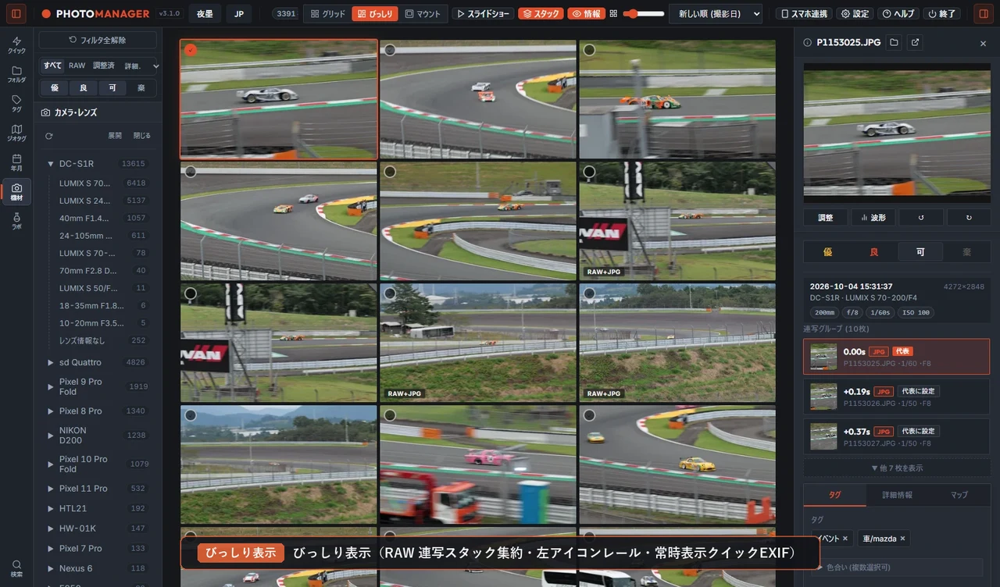
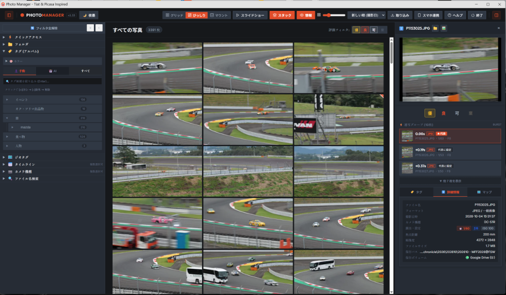
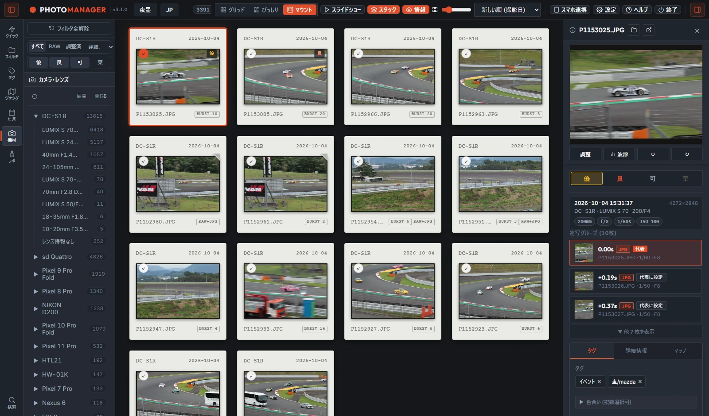
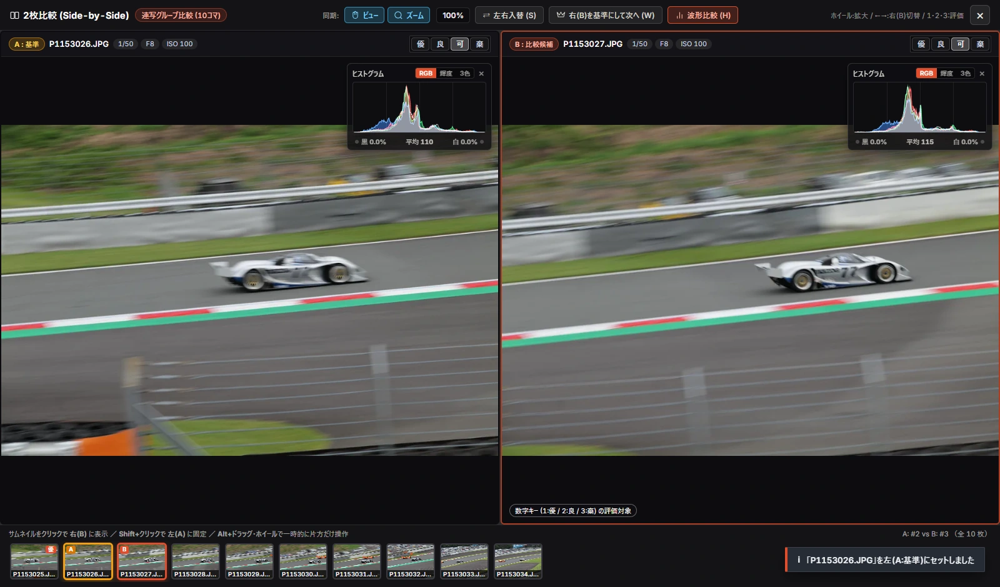

# TETHERACT pm (Tetheract Photo Manager)

[日本語](README.md) | English

A local, non-destructive photo viewer, culling, and management tool for Windows, inspired by Picasa and Tiat.  
Browse, compare, and organize large collections of photos (JPEG, PNG, WebP, HEIC, and camera RAW files) smoothly without modifying a single byte of your original files or folder structure.

To try it right away, download the latest ZIP from [GitHub Releases](../../releases), extract it, and run `Tetheract.exe` (no installation or pre-installed runtimes required).

> Formerly known as "Photo Manager", renamed to **TETHERACT pm** starting with `v1.0.0` (combining the 4D hypercube **Tesseract** from *Interstellar* with **Tether**, linking memories across time and drives). Existing databases (`cache/`) and photos carry over seamlessly.

| Masonry View (Aspect-ratio preserved & Burst Stack) | Slide Mount View (Film Slide Frame Mode) | 2-Up Side-by-Side Duel & RGB Histograms |
| :---: | :---: | :---: |
|  |  |  |

---

> [!NOTE]
> Read Me First (Development Stance & Data Safety)
>
> - 100% "Vibe Coding" (Built by Asking AI): Every line of code was written by AI, so I (the author) have zero knowledge of how the code inside works lol. Please don't ask technical code questions because I genuinely have no idea.
> - Personal Hobby Project: Built for my own photography workflow. Feature requests and bug reports are welcome for reference, though whether they get fixed depends on the AI's mood. Please use it with a relaxed "lucky if it fits my workflow" mindset.
> - Real-Time `JP` / `EN` Toggle (Though My English is Zero): I rely 100% on machine translation if you talk to me in English lol. Click the `JP` / `EN` button to switch the UI and built-in Help into English anytime.
> - 100% Non-Destructive: Original photo files in your folders are never modified, moved, or deleted. If the app isn't for you, simply delete the folder and your PC and photo directories remain completely untouched.

---

## Features

### 1. Flexible Classification and Search, Independent of Where Photos Are Stored.
No need to reorganize folders or import files into a proprietary library. Keep your existing directory structure across multiple drives while freely grouping and subtracting photos using tags and EXIF metadata.

- Cross-Drive Browsing: Browse and search across internal and external drives while keeping your existing folder hierarchy intact.
- Tag & Gear Include `[+]` / Exclude `[-]` Search: Combine include `[+]` and exclude `[-]` conditions across hierarchical tags and the "Camera > Lens" tree (OR within the same root group, AND across groups, toggleable in one click) to easily spot untagged photos.
- Natural-Language Filter Bar & `Binder` Presets: Summarizes active filters with click-to-edit popovers for sibling tags and same-month selection across years. Save favorite filter combinations in `Binder` for one-click recall.
- Multi-Axis Filtering & EXIF Sorting: Filter by Date (with calendar view), Location (Country > State/Prefecture > City), 12-Color Palette, Format/State, and 4-Tier Rating, and sort by focal length, aperture, shutter speed, or ISO.
- Photography Lab & Map Insights: Explore your 47-prefecture footprint map, heatmaps, walk trajectories, "Winning Lens Chart" based on keeper rates, and solar-angle Golden/Blue Hour extraction.

### 2. Never Touch or Break Original Files — Yet Go Beyond Just Viewing.
Your original files and photo folders are never touched, and no hidden management files are created inside them. Within that strict boundary, you can cull, adjust, and export in one continuous workflow.

- Zero Writes to Original Files or Folders: Rotating, adjusting, tagging, or rejecting photos never modifies original files. All records stay inside a single database (`cache/library.db`) within the app folder.
- Non-Destructive Rotate, Straighten, Crop & Tone: Apply 90° rotations, horizon leveling (±45°), aspect-ratio cropping, and exposure/contrast/saturation edits with a live histogram and batch copy/paste.
- Capture Time Shift & Phone GPS Copy: Batch-offset capture timestamps to fix camera clock drift or timezones (with one-click EXIF restore), and copy GPS coordinates from smartphone photos taken within ±1 hour.
- External Editor Sync & XMP Sidecar Reading: Automatically detects file updates and new `.xmp` sidecars when returning from external editors. Reads existing `.xmp` / `.pp3` / `.dop` files non-destructively for preview comparison and isolated `XMP/...` tag import.
- Flexible Export: Batch-export with "Smart Takeout" (applying edits, resizing, sequential renaming, EXIF stripping, and optional `.xmp` output), generate darkroom-style "Contact Sheet HTML", or copy images directly to the clipboard (<kbd>Ctrl</kbd>+<kbd>C</kbd>).
- Managed Vault `Loome` (`Loome/` & External `<Drive>:\Loome`): Copy only the photos you want to physically reorganize into `Loome` via high-speed parallel transfer to move across subfolders or batch-rename (<kbd>F2</kbd>) while paired RAW and `.xmp` files follow automatically.

### 3. A Quiet Look & Feel That Stays Out of Your Way.
A visually quiet interface where photo colors stand out naturally, designed for smooth keyboard-driven culling with minimal eye movement.

- Quiet Interface & 4 Themes: Free of noisy emojis, featuring a compact bottom-docked main toolbar (switchable to top), 4 themes (`Tetheract D / L`, `Sumi / Urusi`, and `Paper / Washi`), and instant `JP` / `EN` switching.
- Three Grid Layouts: Switch between Standard Grid, aspect-ratio Masonry view, and film-frame Slide Mount view. Hide text overlays (<kbd>I</kbd> key) or collapse side panels to maximize space.
- Instant RAW Viewing & Crisp 1:1 Pixel Zoom: Directly extracts embedded previews from camera RAWs—including SIGMA Foveon (`X3F`) and Sony lossless compressed (`ARW`)—for instant display in camera-original colors, rendering zooms directly at true original-pixel resolution without texture upscaling blur.
- Smart Stacks for Bursts & Brackets: Automatically groups bursts, exposure brackets (AEB), RAW+JPEG pairs, and duplicates (prioritizing the highest-rated shot as the cover). Flip frames smoothly with <kbd>↑</kbd> <kbd>↓</kbd> in Lightbox.
- One-Handed Rating & 2-Up Duel: Rate with number keys (<kbd>1</kbd>: Ex / <kbd>2</kbd>: Gd / <kbd>3</kbd>: Rj / <kbd>0</kbd>: Nm), or compare two contenders side-by-side (<kbd>V</kbd> key) with synchronized zoom, RGB histograms, and knockout selection (<kbd>W</kbd> key).
- Safe Tagging Design: Multi-select badge removal applies only to tags shared across all selected photos to prevent accidental loss, while tree reorganization is isolated inside a dedicated Settings editor.

### 4. No Reliance on the Cloud — Yet Fully Portable.
Every feature runs locally offline. Place the folder on an external SSD or USB drive to carry your entire environment safely across PCs and smartphones.

- 100% Local Execution: Never uploads photos or loads external CDNs (only map tiles connect to OpenStreetMap). Local AI auto-tagging (CLIP & color re-evaluation) and offline GPS reverse geocoding run entirely on your PC.
- No Installation & Clean Self-Updating: The portable Python runtime, required DLLs, and SQLite database live in a single folder, launching directly via `Tetheract.exe`. Placing a lightweight `diff.zip` in the app folder performs an automatic clean update on launch.
- VSN Media Identification & Hotplug Detection: Tracks Volume Serial Numbers (VSN) to follow drive-letter changes, distinguish multiple SD cards on the same reader with instant hotplug detection, and carry over ratings, tags, and edits when files move to PC or `Loome`.
- Three-Tier Ethical & Cryptographic Security: Default passwordless `Lv.0` blocks access to other people's `Loome` vaults on borrowed drives and detects standalone `library.db` extraction. Optional password modes add authenticated DB thumbnail encryption (`Lv.1`) and `Loome` file encapsulation (`Lv.2`) with automatic key salvage.
- Unplugged Browsing & Smartphone Culling: Browse thumbnails, search, and rate even when external drives are unplugged. Cull on your phone via home Wi-Fi (QR token) or offline USB (`Tetheract_Mobile.html` via WebAssembly) and sync changes back to your PC.

---

## System Requirements & Supported Formats

| Item | Details |
| :--- | :--- |
| OS | Windows 10 / 11 (64-bit) — No pre-installed Python or VC++ runtime required |
| Browser Engine | Microsoft Edge or Google Chrome (launches in dedicated `--app` window mode) |
| Standard Images | `JPEG`, `PNG`, `WebP`, `HEIC` / `HEIF`, `AVIF`, `TIFF`, `BMP`, `GIF` |
| Camera RAW | `ARW` / `SR2` / `SRF` / `ARQ` (Sony, incl. lossless compressed), `CR2` / `CR3` / `CRW` (Canon), `NEF` / `NRW` (Nikon), `RAF` (Fujifilm), `RW2` (Panasonic), `ORF` (Olympus / OM System), `PEF` (Pentax), `X3F` (SIGMA Foveon), `DNG` (Adobe / Leica, etc.), `SRW` (Samsung) |

---

## Keyboard Shortcuts

| Key / Input | Action |
| :--- | :--- |
| <kbd>1</kbd> / <kbd>2</kbd> / <kbd>3</kbd> (<kbd>X</kbd>) / <kbd>0</kbd> | Set rating (<kbd>1</kbd>: Ex / <kbd>2</kbd>: Gd / <kbd>3</kbd>: Rj / <kbd>0</kbd>: Nm / Clear) |
| <kbd>Space</kbd> / <kbd>Enter</kbd> / Mouse Back | Open / close Lightbox view |
| Double-Click / Mouse Wheel | Toggle Fit ⇄ 1:1 Original Pixel (`100%`) / Zoom in Lightbox (up to `300%`) |
| <kbd>←</kbd> <kbd>→</kbd> <kbd>↑</kbd> <kbd>↓</kbd> | Navigate photos (in Lightbox, <kbd>↑</kbd> <kbd>↓</kbd> switches frames inside a stack) |
| <kbd>V</kbd> / <kbd>W</kbd> | Open 2-Up Duel comparison / Keep right photo as winner |
| <kbd>C</kbd> / <kbd>H</kbd> | Open Crop / Straighten / Tone modal / Toggle histogram |
| <kbd>R</kbd> / <kbd>L</kbd> | Rotate 90° clockwise / Rotate 90° counter-clockwise |
| <kbd>F2</kbd> | Rename file (single or batch sequential rename in `Loome`) |
| <kbd>[</kbd> (<kbd>B</kbd>) / <kbd>D</kbd> / <kbd>I</kbd> | Toggle left menu / Toggle right inspector / Toggle thumbnail text overlay |

---

## Download & How to Run

### Option A: Release ZIP Package (Portable Runtime Included)

No prior Python installation is required.

1. First-Time Setup (Full Package `Tetheract_vX.X.X.zip`): Extract the ZIP and run `Tetheract.exe` (on first launch, you can optionally create `autorun.inf` for custom drive icon & label).
2. Updating (Lightweight Diff `Tetheract_vX.X.Xdiff.zip`):
   - From v1.8.0+ (Automatic Clean Update): Place the downloaded `Tetheract_vX.X.Xdiff.zip` (unextracted) into the app folder and launch `Tetheract.exe`. Obsolete program files are automatically purged before extracting the update, while keeping `cache/`, `Loome/`, and security keys intact.
   - Upgrading from v1.7.2 or earlier: Extract `diff.zip` and overwrite your existing folder, then launch `Tetheract.exe` (legacy root scripts are automatically tidied up on startup).

> [!NOTE]
> Database Compatibility & Migration Notes
> - Once `cache/library.db` is opened in v1.7.0 or later, the security & ethical protection schema is applied and it can no longer be opened by v1.6.1 or earlier (upgrades carry over automatically, and pre-migration backups are saved to `cache/backups/`).
> - Legacy Photo Manager (v3.x) executables and root scripts are cleaned up automatically on startup.

> [!IMPORTANT]
> If Windows Defender SmartScreen Appears on First Launch
> Because this personal project does not use a commercial code-signing certificate, SmartScreen may appear on first launch:
> 1. Run directly: Click "More info" → "Run anyway".
> 2. Build locally: Double-click `tools/Build.bat` to compile `Tetheract.exe` locally from plain-text source (`tools/Launcher.cs`) using the standard Windows C# compiler.

### Option B: Cloning from GitHub

Run these two steps once on first setup (no system Python installation required):

1. Run `setup_portable_python.bat` (requires internet): Downloads Embeddable Python 3.11 and required packages into `python/`.
2. Run `Build.bat`: Compiles `Tetheract.exe` and launches the app.

---

## Architecture

| Layer | Stack & Design |
| :--- | :--- |
| Backend | Python 3.11 (Embeddable bundled) + FastAPI + Uvicorn |
| Frontend | Vanilla HTML5 + CSS3 + JavaScript (ES6+ / Zero build tools or external CDNs) |
| Database | SQLite3 (WAL mode, normalized `photos` / `photo_links`, WebP BLOB `thumbnails`) |
| AI, Mobile & Launcher | ONNX Runtime (local CLIP inference), sql.js (WebAssembly offline DB), C# native launcher (`Tetheract.exe`) |
| Security | Default `127.0.0.1` binding, Host / Origin verification, on-demand LAN QR token auth, 3-tier ethical & encryption guard (`Lv.0`–`Lv.2`) |

---

## Future Outlook

While there is no fixed schedule for this hobby project, the following ideas are being considered under the same offline, non-destructive design:

- Visual Similarity Search: Find photos with similar composition, color tone, or mood using local AI analysis.
- Focus Peaking Highlight: Highlight sharp in-focus edges during Lightbox and 2-Up Duel comparison.
- GPS Logger (`.gpx`) Matching: Match `.gpx` track logs against capture timestamps non-destructively.
- Direct Handoff to External RAW Editors: Pass selected photos or paired RAWs to external RAW developers via a shortcut.
- Mat Frame & Subtle EXIF Export: Export photos with a clean mat border and minimal camera/exposure text.

---

## Documentation

- [User Manual (`MANUAL.md`)](MANUAL.md): Complete guide covering culling, exclusive search, non-destructive edits, security, and mobile/USB workflows (also accessible in-app via <kbd>F1</kbd>).
- [USB Portable Guide (`README_USB.md`)](README_USB.md): Instructions for external drive portability and smartphone sync.
- [Release Notes (`RELEASE_NOTES.md`)](RELEASE_NOTES.md): Latest release highlights and version history.
- [Architecture & Technical Notes (`docs/knowledge/`)](docs/knowledge/README.md): Design records for SQLite BLOB storage, security architecture, and UI guidelines.

---

## License

Source code is released under the [MIT License](LICENSE) on an "AS IS" basis without warranty.  
When redistributing or modifying, please comply with the licenses of all bundled libraries (Python, FastAPI, Pillow, LibRaw / rawpy [LGPL 2.1], pystray [LGPL 3.0], ONNX Runtime, sql.js, etc.) and offline geocoding datasets (Code for Fukui, GeoNames, etc.). Full notices and license texts are in [`LICENSES/NOTICE.txt`](LICENSES/NOTICE.txt) and [`LICENSES/`](LICENSES) (keep LibRaw in `rawpy` dynamically linked as DLLs under LGPL 2.1; do not statically bundle into a single file).
