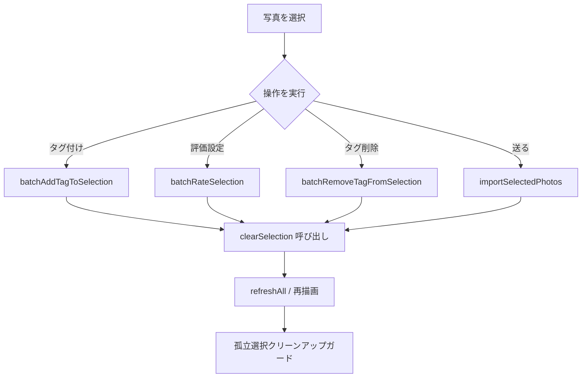

# 修正内容の確認 (Walkthrough): 操作後の選択自動解除と孤立選択の防止

写真のタグ付け・評価設定・インポートなどの操作完了後に、選択状態を自動解除するように改修しました。
これにより、「タグ付与で写真が画面上から非表示（除外フィルタ等）になった後も選択が残り続け、別の写真へのタグ付け時に巻き込まれて誤付与されてしまう」という問題を根本から解消しました。

---

## 主な改修内容

### 1. 各操作完了時の自動選択解除 ([frontend/js/app.js](file:///r:/photo-manager/frontend/js/app.js))
以下の操作が正常完了した直後に、自動的に `clearSelection()` を呼び出すように変更しました：
- **一括タグ付け (`batchAddTagToSelection`)**:
  右クリックメニュー、右ペイン（インスペクタ）、クイックタグツリーからのタグ付与完了時に選択を自動解除。
- **一括評価設定 (`batchRateSelection`)**:
  コンテキストメニュー、下部フローティングバー、右ペインからの評価一括変更完了時に選択を自動解除。
- **一括タグ削除 (`batchRemoveTagFromSelection`)**:
  インスペクタ等からのタグ一括削除完了時に選択を自動解除。
- **インポート（送る） (`importSelectedPhotos`)**:
  選択写真を `import` フォルダへコピー完了した直後に選択を自動解除。
- **インスペクタ単一写真の評価変更**:
  単一写真の星・評価ボタン押下時にも選択状態をリセット。

### 2. 画面外写真の孤立選択自動クリーンアップガード ([frontend/js/app.js](file:///r:/photo-manager/frontend/js/app.js))
- 写真一覧が再取得・再描画される際（`renderPhotoGrid()` の冒頭）、**現在の表示対象一覧（`state.photos`）に含まれていない写真ID** が `state.selectedPhotoIds` に残っていた場合、自動的にそれを検出して選択IDセットから除去（クリーンアップ）する安全ガードを実装しました。
- これにより、除外フィルタ（`[-]`）や未分類フィルタ、評価フィルタなどの影響で写真カードが画面から消えた場合でも、見えない写真が裏で選択され続ける事故を100%防止します。
