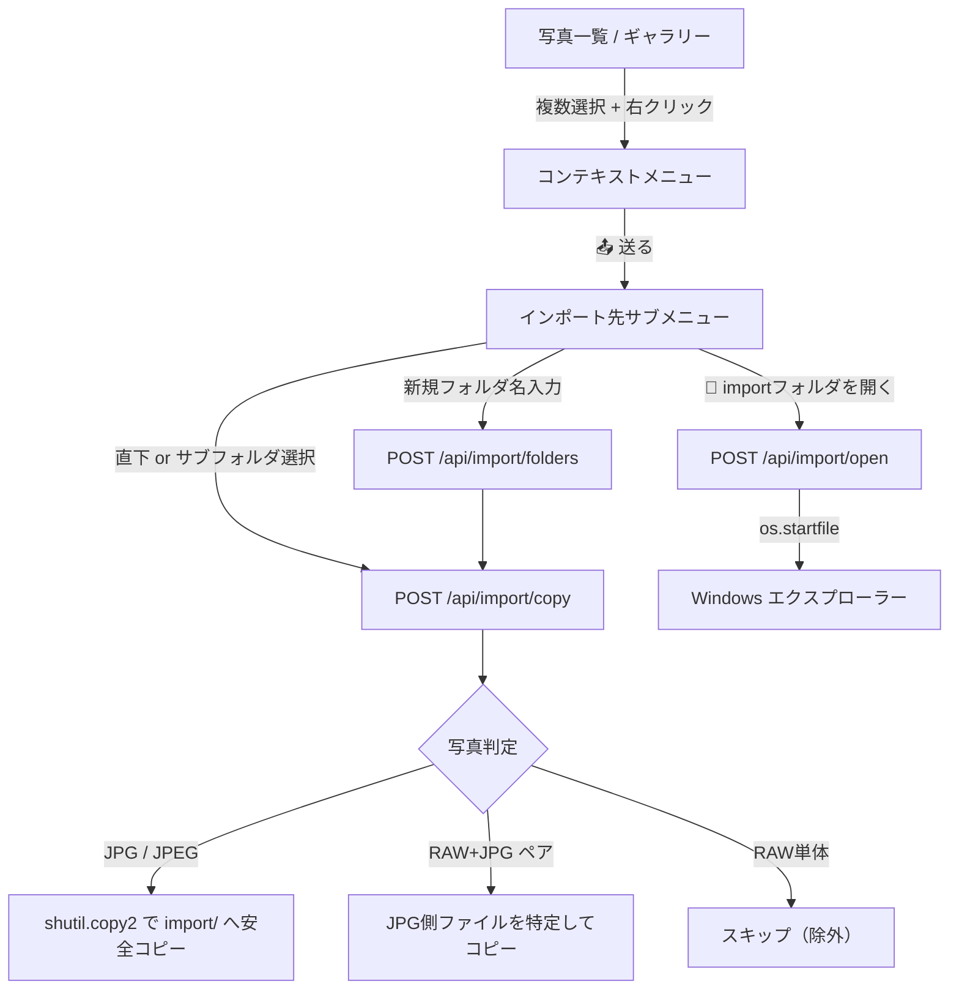

# 修正内容の確認 (Walkthrough): インポート（送る / Send to）機能

Photo Manager 実行環境の直下に `import` フォルダ（ピックアップ用作業ディレクトリ）を作成し、選択した写真を右クリックからワンクリックで取り込める（送れる）インポート機能を実装しました。
ユーザーからの明示的な指示に基づき、**コピー対象は JPG/JPEG ファイルに限定**されています（RAW単体ファイルは安全に除外され、RAW+JPGペア写真の場合はJPG側ファイルが抽出されてコピーされます）。

---

## 主な変更内容とアーキテクチャ

### 1. サーバー側（バックエンド）
- **[server/scanner.py](file:///r:/photo-manager/server/scanner.py)**:
  - `scan_directory` の冒頭に、`import` フォルダ配下のスキャン要求を拒否する安全ガードを追加。
  - `os.walk` の探索ディレクトリ一覧（`dirs`）から `import` を除外し、通常のスキャン巡回時にもライブラリに混入しないよう完全除外。
- **[server/app.py](file:///r:/photo-manager/server/app.py)**:
  - `IMPORT_DIR = BASE_DIR / "import"` を定義し自動生成。
  - `/api/browse` でフォルダブラウザの一覧に `import` フォルダが現れないよう除外。
  - `GET /api/import/destinations`: `import` 直下および既存サブフォルダ一覧と各ファイル数を取得。
  - `POST /api/import/folders`: 新規サブフォルダを作成（Windows禁止文字の自動サニタイズ付き）。
  - `POST /api/import/copy`:
    - 指定された `photo_ids` を取得し、**JPG/JPEG のみを抽出**。
    - 単体RAWはスキップリストへ追加。
    - RAW+JPGペア写真の場合はペア側のJPGパスを解決して採用。
    - `shutil.copy2`（EXIF・タイムスタンプ保持）で同名ファイル保護（`_1`, `_2` ナンバリング）を行いながらコピー。
  - `POST /api/import/open`: `os.startfile` で Windows エクスプローラーを起動して `import` フォルダを表示。

### 2. クライアント側（フロントエンド）
- **[frontend/index.html](file:///r:/photo-manager/frontend/index.html)**:
  - 右クリックメニュー（`#contextMenu`）に「📤 送る (import)」メニュー項目（`#contextMenuImportItem`）とサブメニュー（`#contextImportSubmenu`）を追加。
  - サブメニュー内に「新規フォルダ作成＆送信」フォーム、エクスプローラー起動ボタン、送り先フォルダ一覧コンテナを設置。
  - 下部フローティング選択バー（`#selectionFloatingBar`）にも「📤 送る (import)」ボタンを追加。
- **[frontend/css/style.css](file:///r:/photo-manager/frontend/css/style.css)**:
  - サブメニュー内フォルダノード（`.submenu-folder-node`）、ファイル数バッジ、フォルダを開くアクションボタン、モダンなトースト通知（`.toast-container`, `.toast-message`）のスタイルを追加。
- **[frontend/js/app.js](file:///r:/photo-manager/frontend/js/app.js)**:
  - `openContextMenu` 時に `/api/import/destinations` を非同期取得してフォルダ一覧を動的生成。
  - 送り先フォルダクリックで `POST /api/import/copy` を呼び出し。
  - 新規フォルダ作成時は作成後ただちにコピーを連動実行。
  - コピー結果（コピー枚数、スキップ枚数など）を画面上にトースト通知バナーでわかりやすくフィードバック。

---

## 検証結果

バックエンド単体およびスキャン除外の自動テストスクリプト（`scratch/test_import_logic.py`, `scratch/test_scanner_exclusion.py`）を作成・実行し、以下の正常動作を確認しました：

1. **JPG限定コピーとスキップ**:
   - 通常JPG写真: 正常にコピーされる。
   - RAW+JPGペア写真: RAW側ではなくペアのJPG側ファイルが抽出されてコピーされる。
   - 単体RAW写真: コピーされず `skipped_count: 1` として除外される。
2. **同名ファイル衝突防止**:
   - 既に同名のJPGが存在する場合、`filename_1.jpg` のように自動連番が付与され上書きを防止。
3. **フォルダ作成とサニタイズ**:
   - `test_subfolder_verify` 等のサブフォルダが正常に作成され、その中への写真コピーも成功。
4. **ライブラリ・スキャナーからの完全除外**:
   - `server/scanner.py` で `import` フォルダをスキャンしようとすると即座に拒否され、ライブラリDBへの自動登録が行われないことを確認。
