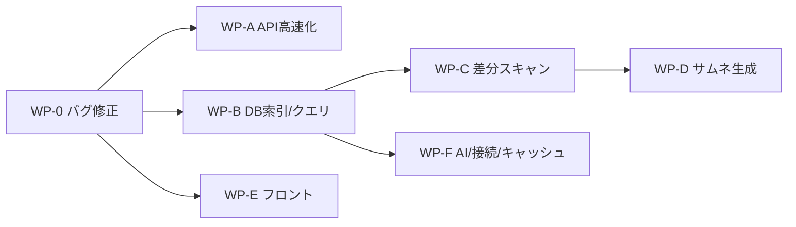

# Agent 委譲用プロンプト集（パフォーマンス改善）

元計画: [implementation_plan.md](implementation_plan.md)
計測スクリプト: [scratch/perf/bench.py](../../scratch/perf/bench.py)（git管理外・本番DBの複製 `.cache/bench_copy.db` で計測）

## 実施順序



- 第1波: **WP-0** 単独 → 第2波: **WP-A / WP-B / WP-E** 並列 → （ここで一旦統合・体感確認）→ 第3波: **WP-C / WP-F** 並列 → 第4波: **WP-D**
- 各WP完了ごとに git commit（1WP = 1コミット）しておくと、問題時に切り戻しやすい

> [!IMPORTANT]
> 決定事項（2026-10-07 ユーザー承認済み）
> - `server/database.py`: **削除する**（WP-0 の B-3 として実施）
> - JSON高速化: **標準 `json` のみ**（新規ライブラリ追加禁止）
> - `VERSION`: **各Agentは変更しない**。統合時にまとめて更新
> - 進め方: **段階導入**（Phase 0+1 = WP-0/A/B/E → 体感確認 → Phase 2 = WP-C/F/D）

## 改修前ベースライン（v1.35・マイグレーション適用後、2026-10-07 再計測）

| 項目 | 値 |
|---|---|
| get_photos(default) | 117 ms |
| jsonable_encoder(/api/photos) | 438 ms |
| json.dumps(/api/photos) | 64 ms |
| payload / stack_photos | 7.81 MB / 3.62 MB |
| get_folders_summary | 243 ms |
| extract_metadata(JPEG) / os.stat | 7.24 / 0.25 ms/件 |
| find_missing_photo_match(未ヒット) | 0.63 ms/件（SCAN photos） |
| thumbnail(現行方式) | 104 ms/枚 |

---

## 共通前提ブロック（全WPのプロンプト冒頭に貼る）

```text
あなたは Photo Manager リポジトリ (<project-root>) のパフォーマンス改善作業の一部を担当する。

【必読】作業前に以下を読むこと:
- AGENTS.md
- .agents/rules/coding-standards.md, powershell-encoding.md, architecture-and-performance.md
- docs/performance_audit/implementation_plan.md（全体計画。自分の担当WP以外は実装しない）

【絶対ルール】
1. DB層の編集対象は server/database/ パッケージ内のファイル。server/database.py（旧モノリス・未使用）は絶対に編集しない。
2. 外科的変更のみ。担当外のコード・コメント・整形を変更しない。既存の日本語コメント/docstringは保持し、新規コメントも日本語で書く。
3. Python: bare except 禁止（except Exception as e: + ログ出力）。テキストの open() には encoding="utf-8"。絶対パスのハードコード禁止。
4. PowerShell のリダイレクト(>, Out-File, Set-Content)、Get-Content, Select-String, findstr, -replace, git diff の直接実行は禁止。ファイル閲覧・編集はIDEツールを使う。
5. 新しい pip パッケージを追加しない。
6. VERSION / server/version.py は変更しない。
7. スキーマ変更は server/database/schema.py の initialize_database() 内に、何度実行しても安全な（冪等な）形で追加する。データ移行が必要なものは migrations テーブルの name で1回限りにする。
8. 本番DB .cache/library.db を直接変更する検証は禁止。計測は scratch/perf/bench.py（.cache/bench_copy.db に複製して計測）を使う。

【計測】
- 作業開始前に `$env:PYTHONIOENCODING='utf-8'; python\python.exe scratch\perf\bench.py --fresh` を実行し、結果を控える。
- 作業後に同じコマンドを実行し、前後の数値を比較表にして報告する。

【完了報告フォーマット】
1. 変更ファイル一覧と、各ファイルの変更要旨（関数名レベル）
2. 改修前後の計測値の比較表
3. 受入基準の各項目について「満たした/満たしていない」と根拠
4. 気づいたが担当外のため手を付けなかった問題点
```

---

## WP-0: 既存バグ修正

```text
【担当】WP-0（既存バグ修正と死にコード削除。性能改善はしない）

【作業内容】
B-1: server/app.py で `logger` が未定義のまま使われている（api_ai_tag_single_photo, api_backup_database）。
     ファイル冒頭の import 群の後に `import logging` と `logger = logging.getLogger("photo_manager.app")` を追加する。
B-2: server/database/folders.py の remove_folder_photos() が vacuum_database() を呼ぶが未インポート。
     循環インポートを避けるため、関数内で `from .stats import vacuum_database` するのが望ましい。
B-4: 以下の文字化け（"????"）を内容に合う日本語に直す:
     - server/app.py のフィルタプリセットAPI（/api/filter-presets 系、5エンドポイント）の docstring と HTTPException の detail 文字列
       （例: 一覧取得 / 作成 / 取得 / 更新 / 削除、"プリセットが見つかりません"、"プリセットの保存に失敗しました: ..."）
     - server/database/__init__.py の presets import 直前のコメント
     - server/database/schema.py の migrations テーブル作成直前のコメント
     元の意味は server/database/presets.py と frontend/js/presets.js を読んで推測する。
B-3: server/database.py（server/database/ パッケージにシャドウされた未使用の旧モノリス）を `git rm` で削除する。
     削除前に grep で "database.py" や "from server import database" 等の参照がコード/バッチ/ビルドスクリプト（build_dist.bat 含む）に
     無いことを確認し、参照があれば削除を中止して報告する。削除後も import server.app が通ることを確認する。
     AGENTS.md / .agents/rules/architecture-and-performance.md に `server/database.py` を指す記述があれば、
     実際の所在（server/database/connection.py, thumbnails.py 等）に書き換える。
B-5: frontend/index.html.orig_backup と frontend/js/app.js.orig_backup が git 管理下にあるか確認し（git ls-files）、
     管理下なら `git rm --cached` で管理から外すだけにする（ファイル削除はしない）。build_dist.bat がこれらを配布物に含めないことを確認し、含めている場合のみ除外する。

【受入基準】
- python\python.exe -c "import sys; sys.path.insert(0,'.'); import server.app" がエラーなく通る
- server/database.py が存在せず、リポジトリ内にそれを前提とする参照が残っていない
- app.py, folders.py, __init__.py, schema.py に "????" が残っていない
- 上記以外のロジック変更がない
```

---

## WP-A: API レスポンス高速化

```text
【担当】WP-A（server/app.py のみ編集）

【背景】/api/photos は FastAPI 標準の jsonable_encoder に約430msかかっている（json.dumps 直書きなら約60ms）。

【作業内容】
P1-1:
- app.py に、dict を `json.dumps(obj, ensure_ascii=False, separators=(",", ":"), default=str)` で
  `Response(content=..., media_type="application/json")` として返すヘルパー関数 `_fast_json(obj)` を1つ追加する。
- 適用先: api_get_photos, api_get_folders, api_get_tags, api_get_timeline, api_get_cameras。
  レスポンスのキー構造・値は一切変えないこと。

P2-6: api_get_thumbnail を軽量化する。
- 写真の取得を get_photo_by_id（タグ・スタックまで3クエリ）から、
  `SELECT id, file_path, file_size FROM photos WHERE id = ?` 相当の軽量取得に置き換える。
  そのための関数 `get_photo_brief(photo_id)` を server/database/photos.py の末尾に追加し、server/database/__init__.py の再エクスポートにも追加してよい（この2ファイルはこの追加のみ許可）。
- リクエストヘッダ If-None-Match が算出した ETag と一致したら、本文なしの 304 を返す（Request を引数に追加）。
- 既存の ETag 算出式・Cache-Control・プレースホルダー返却の挙動は維持する。

【受入基準】
- 改修前後で /api/photos, /api/folders, /api/tags, /api/timeline, /api/cameras の JSON が等価
  （サーバー起動後に各APIを取得し、json.loads した結果を比較するスクリプトで確認）
- bench.py の json.dumps 相当まで /api/photos のサーバー処理が短縮されている（エンコーダ部分の約430msが消える）
- サムネイルが2回目のリクエストで 304 になる
```

---

## WP-B: DB インデックス・クエリ改善

```text
【担当】WP-B（server/database/schema.py, photos.py, folders.py, stacks.py, tags.py, server/ai/worker.py のフォルダ条件部分のみ）

【作業内容】
P1-3 インデックス（schema.py の initialize_database 内、既存の CREATE INDEX 群の直後に冪等に追加）:
  CREATE INDEX IF NOT EXISTS idx_photos_name_size ON photos(file_name, file_size);
  CREATE INDEX IF NOT EXISTS idx_photo_tags_tag_photo ON photo_tags(tag, photo_id);
  DROP INDEX IF EXISTS idx_photo_tags_tag;   -- 上で代替（既存の CREATE INDEX idx_photo_tags_tag 行も削除する）
  DROP INDEX IF EXISTS idx_photo_tags_photo; -- UNIQUE(photo_id, tag) の自動索引と重複（既存の CREATE 行も削除する）
  CREATE INDEX IF NOT EXISTS idx_photos_gps_date ON photos(date_taken) WHERE latitude IS NOT NULL;
  initialize_database の最後に `PRAGMA optimize` を実行する。

P1-3 GPS: photos.py の find_nearby_gps_photos を、Python 側で date_taken（"YYYY-MM-DD HH:MM:SS"）±minutes の
  文字列範囲を datetime で算出し `latitude IS NOT NULL AND longitude IS NOT NULL AND date_taken BETWEEN ? AND ?` で絞り込む形にする。
  time_diff_min の算出と ORDER BY / LIMIT 20 は維持する。日時パース失敗時は従来のクエリにフォールバックする。

P1-2 stack_photos 削減: photos.py の get_photos() 内でスタックメンバーを取得する SELECT のカラムを、
  frontend/js/*.js が実際に参照するものだけにする。
  手順: grep で "stack_photos" と、それを受ける変数（sp. / member. 等）の参照プロパティを全て洗い出し、一覧を報告に含める。
  getThumbnailUrl() が file_size を使う点に注意（含めるかどうかを判断して根拠を報告する）。
  確実に未使用と言えるカラムだけを削除する。

P2-8 フォルダ絞り込み（LIKE の置き換え）:
- LIKE は大文字小文字を区別しないためインデックスが使われず、さらに "_" がワイルドカードとして誤一致する（例: "IMG_2020" が "IMGX2020" に一致）。
- photos.py に共通ヘルパー `_directory_filter_sql(folder, recursive=True) -> (sql_fragment, params)` を作る。
  比較は COLLATE NOCASE とし、配下判定は範囲比較 `directory_path > prefix || '\' AND directory_path < prefix || ']'`
  （']' は '\' の次の文字コード）で行う。'/' 区切りで保存されている既存データも考慮し、両方の区切りを OR で扱う。
- インデックス: CREATE INDEX IF NOT EXISTS idx_photos_directory_nocase ON photos(directory_path COLLATE NOCASE);
- 適用先: get_photos(folder=...), folders.remove_folder_photos, stacks.recalculate_stacks のディレクトリ抽出,
  photos.cleanup_missing_photos_in_folder, ai/worker.py の _run_job 内フォルダ条件, tags.remove_ai_tags のフォルダ条件。
- EXPLAIN QUERY PLAN で idx_photos_directory_nocase が使われることを確認する。

【受入基準】
- bench.py の [PLAN] で 移動照合 と GPS候補 が SEARCH ... USING INDEX になる
- 既存フォルダ数件について、get_photos(folder=X) と remove_folder_photos 対象の件数が改修前と一致する
  （複製DBで改修前の結果を保存しておき比較）。"_" を含むフォルダ名で誤一致しないことをテストデータで示す
- /api/photos の stack_photos 部分のサイズ削減量を報告
```

---

## WP-C: 差分スキャン・書き込みバッチ化

```text
【担当】WP-C（server/scanner.py の scan_directory / smart_sync_photo / extract_metadata, server/raw_loader.py の extract_raw_metadata の戻り値のみ,
               server/database/photos.py, schema.py, stacks.py）
【前提】WP-B のマージ後に着手すること。

【背景】再スキャン時、未変更ファイルも毎回EXIFを解析している（6ms/件。os.stat だけなら0.2ms）。新規ファイル照合で全表スキャン、1件ごとにコミットもしている。

【作業内容】
P2-1 差分スキャン:
- photos に列 file_mtime REAL を追加（schema.py の new_cols に追加）。extract_metadata / extract_raw_metadata の戻り値に
  file_mtime（stat.st_mtime）を含め、upsert_photo の INSERT と ON CONFLICT 更新対象にも追加する。
- scan_directory で列挙後、対象ディレクトリ配下の既存レコード
  {file_path: (id, file_size, file_mtime)} を1回のクエリで先読みする（WP-B のディレクトリ条件ヘルパーを使う）。
- os.stat の size と mtime が両方一致したファイルは extract_metadata を呼ばず "unchanged" として数える
  （scan_tracker と結果 dict に unchanged を追加。既存キーは維持）。file_mtime が NULL の既存行は従来どおり解析して埋める。
P2-3 サムネイルの無効化: size または mtime が変わったファイルは、更新時に該当 photo_id のサムネイルを削除する（delete_thumbnail を使う）。
P2-2 書き込みバッチ化:
- photos.py に `upsert_photos_batch(list_of_meta) -> None` を追加する（1トランザクション・executemany。
  サニタイズ処理は upsert_photo と共通の関数に切り出して重複させない）。
- scan_directory では200件ごとにバッチで書き込む。smart_sync_photo 内の get_photo_by_path は先読み辞書で代替する。
  移動照合（find_missing_photo_match / relink）は新規パスの場合のみ従来どおり実行する。
P2-4 recalculate_stacks:
- 引数に `existing_paths: Optional[set] = None` を追加し、scan_directory から列挙済みの絶対パス集合を渡す。
  集合が渡された場合、そのディレクトリの写真は os.path.exists を呼ばず集合で判定する。
- UPDATE を、変更が必要な行だけ集めてから executemany でまとめて実行する（現在値と同じ行は更新しない）。
- datetime.strptime の結果を写真ごとに1回だけ計算して使い回す。
- スタックの判定ロジック（閾値・代表写真の選び方）は一切変えない。

【受入基準】
- 複製DB上で同じフォルダを2回スキャンし、2回目の所要時間が1回目の1/10以下（計測ログを報告）
- 1回目スキャン後の photos テーブルの主要列（stack_id, is_stack_primary, stack_type, paired_raw_path, rating, tags件数）が
  改修前のコードで同じフォルダをスキャンした結果と一致する（比較スクリプトを作って示す）
- ファイルを1つ上書き保存（mtime変更）して再スキャンすると、その写真のサムネイルが削除→再生成される
```

---

## WP-D: サムネイル生成の高速化

```text
【担当】WP-D（server/scanner.py の ensure_thumbnail と新規の生成関数, server/preload_thumbnails.py, server/raw_loader.py）
【前提】WP-C のマージ後に着手すること（scanner.py / raw_loader.py が競合するため）。

【作業内容】
- scanner.py に `render_thumbnail_webp(target_path: Path, max_size: int = 360, allow_cloud_download: bool = False) -> Optional[Tuple[bytes, int, int]]`
  を作り、ensure_thumbnail と preload_all_thumbnails でコピペされている生成処理（クラウド判定→シェルサムネ→RAW埋め込み→PIL→回転→リサイズ→WebP）を一本化する。
  クラウドファイルでダウンロード禁止の場合のプレースホルダー返却は、従来どおり ensure_thumbnail 側の責務として残す。
P1-8: PIL で開いた画像が JPEG（img.format == "JPEG"）の場合、exif_transpose の前に img.draft("RGB", (max_size*2, max_size*2)) を呼ぶ。
      thumbnail() には reducing_gap=2.0 を指定する。
P1-9: raw_loader.extract_raw_metadata で rawpy.imread を2回呼んでいる箇所を1回の with ブロックにまとめる（sizes 取得と extract_thumb）。
P2-5: preload_all_thumbnails を concurrent.futures.ThreadPoolExecutor（max_workers=min(4, os.cpu_count() or 2)）で並列化する。
      生成はワーカーで行い、save_thumbnails_batch は呼び出し元スレッドで50件ずつまとめて実行する。
      モジュールレベルの threading.Lock で多重起動を防ぎ、実行中に呼ばれたらログを出してすぐ戻る。

【受入基準】
- 改修前後で生成サムネの (width, height) と向きが一致する（JPEG縦位置・横位置、RAW を各数枚、複製DBで比較）
- bench.py の「thumbnail(現行方式・参照値)」に対し、新関数の ms/枚 を同じ条件で計測して報告（目標: JPEG で約1.7倍以上速い）
- preload を2回同時に起動しても生成処理が1本しか走らない
```

---

## WP-E: フロントエンド描画の改善

```text
【担当】WP-E（frontend/js/app.js, frontend/css/style.css のみ）

【作業内容】
P1-5: 評価変更（app.js の setRating 系関数。L4270付近の updateCardRatingDirectly 呼び出し直後）で、
      state.ratingFilter が空でないと毎回 renderPhotoGrid() で最大5000枚を作り直している。次のように変更する:
      - state.photos の該当写真の rating を更新する
      - 新しい評価が state.ratingFilter に含まれる場合 → DOM の部分更新のみ（再描画しない）
      - 含まれない場合 → state.photos から除き、そのカードだけを DOM から削除し、
        以降のカードの dataset.index を振り直す。ライトボックス表示中なら currentPhotoIndex との整合を確認する
P1-4: batchAddTagToSelection / batchRateSelection（L2866, L2894付近）とタグの追加・削除処理（L4155-4183付近）の refreshAll() を、
      必要な再取得だけに置き換える: タグ操作 → fetchPhotos() + fetchTags()、一括評価 → fetchPhotos() のみ。
      フォルダ・タイムライン・カメラの件数は変わらないので再取得しない。
      他の refreshAll() 呼び出し（スキャン完了・フォルダ除外・削除など）はそのまま残す。
P1-6: updateCardSelectionClasses() が毎回全カードを走査している。直前の選択集合を保持し、
      差分（増えたID・減ったID）のカードだけ classList を更新する。カード検索には photoGrid 内の data-photo-id セレクタを使う。
      全選択・全解除のように差分が大きい場合は従来の全走査にフォールバックしてよい。
P1-7: style.css の .photo-card に content-visibility: auto; contain-intrinsic-size: auto var(--thumbnail-size, 200px); を追加する。
      masonry / mount 表示で崩れる場合は、そのモードでは無効化するセレクタを追加する。

【禁止】Date.toISOString() の使用、DOM挿入時のエスケープ漏れ（_escHtml / escapeHtml を使う）、CSS変数のフォールバック値の省略。

【受入基準】
- 評価キーを連打してもグリッドの全再描画が起きない（renderPhotoGrid に一時的に console.count を入れて確認し、確認後に削除）
- 評価フィルタで外れた写真は即座に消え、その後の Shift範囲選択・ライトボックスの前後移動が正しい写真を指す
- 一括タグ付け後に /api/folders, /api/timeline, /api/cameras が呼ばれない（DevTools の Network で確認）
- grid / masonry / mount の全モードとテーマ（和紙/夜墨）で表示崩れがない（スクリーンショットを報告）
- UI の見た目・操作体系は変わらないため MANUAL.md / #helpModal の更新は不要
```

---

## WP-F: AIワーカー・接続設定・オンライン判定キャッシュ

```text
【担当】WP-F（server/ai/worker.py, server/ai/tagger.py, server/database/tags.py, server/database/connection.py,
               server/scanner.py の resolve_portable_path のみ, server/database/folders.py の get_folders_summary 内のFS確認部分のみ）
【前提】WP-B のマージ後に着手すること。WP-C と並列で行う場合、scanner.py は resolve_portable_path 周辺のみ編集し、scan_directory には触れない
        （キャッシュクリア呼び出しの追加は WP-C 統合後に行う）。

【作業内容】
P2-9 AIワーカー:
- _run_job は対象のサムネイルBLOBを fetchall で一括取得しており、件数に比例してメモリが増える。
  まず対象の (id, file_name) だけを取得し、64件ずつ `SELECT photo_id, data FROM thumbnails WHERE photo_id IN (...)` で取得しながら処理する。
- tagger.predict_from_bytes の類似度ループを numpy（マスク + argsort）で書き換える。出力（タグ・confidence の丸め・色タグの判定条件）は完全に同一にする。
- tags.add_ai_tags_to_photo を executemany 化する（ON CONFLICT の挙動と戻り値の意味は維持）。
P2-10 接続設定: connection.py の cache_size を -64000 から -16000 に変更し、コメントに理由（スレッドローカル接続 × スレッドプール最大40本分）を追記する。
      .agents/rules/architecture-and-performance.md の PRAGMA 記述も同じ値に揃える。
P2-7 オンライン判定キャッシュ:
- scanner.py に、ディレクトリ単位でオンライン判定結果を保持するTTLキャッシュ（5秒、threading.Lock で保護）と、
  それをクリアする関数 clear_online_cache() を追加する。
  resolve_portable_path は file_path 自体の exists() 判定を残し、親ディレクトリがキャッシュ上オフラインならすぐ (orig_path, False) を返す。
- get_folders_summary の os.path.isdir / os.scandir の結果を、同様に5〜10秒のTTLでキャッシュする。

【受入基準】
- 複製DBでAIタグ付けを実行し、改修前と同じ写真に同じタグ・confidence が付く（10枚以上で比較）
- 実行中のメモリ使用量（タスクマネージャー等で確認）が対象件数に比例して増えない
- get_folders_summary を連続2回呼んだとき、2回目が大きく短縮される
- オフラインのドライブ上の写真が引き続き is_offline=true になる
```

---

## 統合時チェックリスト（全WP完了後に統合担当が実施）

- [ ] scan_directory の先頭で clear_online_cache() を呼ぶ（WP-C / WP-F の両方が統合されてから追加）
- [ ] `python\python.exe scratch\perf\bench.py --fresh` を実行し、計画書 §2 のベースラインと比較
- [ ] `start.bat` で起動し、計画書 §5 の手動確認を一通り実施
- [ ] `VERSION` と `server/version.py` を 1.36 に更新し、`/api/version` とヘッダー表示で確認
- [ ] `docs/performance_audit/walkthrough.md` に成果（前後の数値）を記録
