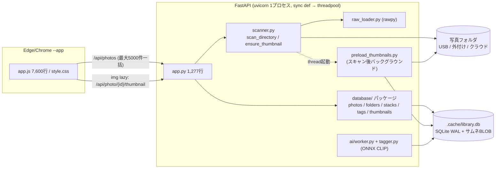

# Photo Manager パフォーマンス監査 & 改善計画 (v1.35 時点)

## 1. システム全体像



**主要データフロー**
- **起動/フィルタ変更**: `refreshAll()` → `/api/photos` `/api/tags` `/api/timeline` `/api/folders` `/api/cameras` を並列取得 → グリッドに最大5,000枚のカードを全件DOM生成（rAFで分割）
- **スキャン**: `os.walk` で列挙 → 1ファイルずつ `extract_metadata`（PILでEXIF解析）→ `smart_sync_photo`（最大5クエリ + 1コミット/件）→ `recalculate_stacks` → 指紋更新 → サムネ事前生成スレッド
- **サムネ**: グリッドの `` が1枚ずつAPIを叩き、DBのBLOBを返却。未生成ならその場で生成

> [!WARNING]
> `server/database.py`（89KB）は `server/database/` パッケージに**シャドウされた死にコード**です（Pythonはパッケージを優先）。直近のPullでも編集されており、Agentが誤って旧ファイルを修正する事故リスクが高いです。

---

## 2. 実測ベースライン（DBコピーで計測・本番DB未変更）

ライブラリ規模: 写真 12,596件 / サムネ 9,642件 / フォルダ 90 / スタック所属 7,620件 / DB 167MB

| 計測対象 | 現状 | 主因 |
|---|---|---|
| `/api/photos` サーバー処理 | **約600ms** (SQL 107 + `jsonable_encoder` **426** + dumps 65) | FastAPI標準のエンコーダが5,000件の辞書を再帰走査 |
| `/api/photos` ペイロード | **8.4MB** (うち `stack_photos` **3.6MB = 43%**) | スタックメンバーを毎回全カラム同梱 |
| `get_folders_summary` | **239ms** | 毎回 `isdir` + `scandir` の実FS走査。`refreshAll` の度に実行 |
| 再スキャン 1ファイル | **6.2ms** (`os.stat`だけなら0.2ms = **30倍差**) | 未変更ファイルもEXIFを再解析 |
| 新規ファイル照合 | 0.57ms/件 (**全表SCAN**、件数比例で悪化) | `(file_name, file_size)` インデックス無し |
| JPEGサムネ生成 | 94〜104ms/枚 → draft方式で **55ms/枚** | フル解像度デコード後に縮小している |

計測スクリプト: [scratch/perf/bench.py](../../scratch/perf/bench.py)（`python\python.exe scratch\perf\bench.py --fresh`。本番DBを `.cache/bench_copy.db` に複製して計測）

---

## 3. 改善項目一覧（優先度順）

凡例 — 効果: ★★★大 / ★★中 / ★小、難易度: 易/中/難

### Phase 0: 先に直すべきバグ・地雷（低コスト）

| ID | 内容 | 場所 |
|---|---|---|
| B-1 | `logger` 未定義のまま使用 → エラー時に `NameError` | [app.py](../../server/app.py) L393, L793 |
| B-2 | `vacuum_database` 未インポート → 全解除後の自動VACUUMが毎回失敗 | [folders.py](../../server/database/folders.py) L572 |
| B-3 | 死にコード `server/database.py` の削除 | ユーザー判断待ち（§6） |
| B-4 | フィルタプリセット系のコメント/エラーメッセージが `????` に文字化け（UIに出る） | [app.py](../../server/app.py) L831-876, `database/__init__.py` L105, `schema.py` L176 |
| B-5 | `frontend/*.orig_backup` が静的配信・配布対象に含まれている | `frontend/` |

### Phase 1: クイックウィン（効果大・低リスク）

| ID | 内容 | 効果 | 難易度 |
|---|---|---|---|
| **P1-1** | `/api/photos` を `json.dumps` 直書きの `Response` で返し `jsonable_encoder` を回避（`/api/folders` `/api/tags` も同様） | ★★★ 約-420ms/回 | 易 |
| **P1-2** | `stack_photos` のカラムをフロントが実際に使う項目だけに削減 | ★★★ ペイロード-30〜40% | 易〜中 |
| **P1-3** | インデックス追加・整理（下記） + 起動時 `PRAGMA optimize` | ★★ | 易 |
| **P1-4** | 一括タグ/評価後の `refreshAll()` を必要最小限の再取得に置換 | ★★★ 操作毎の~1秒+FS走査を削減 | 易 |
| **P1-5** | 単一評価変更時の `renderPhotoGrid()` 全再描画をやめる（現状、評価フィルタは常に非空なので**毎回5,000枚再生成**） | ★★★ 評価操作のカクつき解消 | 中 |
| **P1-6** | `updateCardSelectionClasses()` を差分更新化（現状クリック毎に全カード走査） | ★★ | 易 |
| **P1-7** | `.photo-card` に `content-visibility: auto` + `contain-intrinsic-size` | ★★ 初期描画/スクロール | 易（全ビューモードで要目視） |
| **P1-8** | JPEGサムネ生成に `img.draft("RGB", (2*max, 2*max))` + `reducing_gap` | ★★ 生成1.8倍速 | 易 |
| **P1-9** | `extract_raw_metadata` の `rawpy.imread` 2回呼び出しを1回に統合 | ★★ RAWスキャン | 易 |

**P1-3 インデックス詳細**（[schema.py](../../server/database/schema.py)）
```sql
CREATE INDEX IF NOT EXISTS idx_photos_name_size ON photos(file_name, file_size);        -- 移動照合
CREATE INDEX IF NOT EXISTS idx_photo_tags_tag_photo ON photo_tags(tag, photo_id);       -- タグ絞込(カバリング)
DROP INDEX IF EXISTS idx_photo_tags_tag;     -- 上記で代替
DROP INDEX IF EXISTS idx_photo_tags_photo;   -- UNIQUE(photo_id, tag) の自動索引と重複
CREATE INDEX IF NOT EXISTS idx_photos_gps_date ON photos(date_taken) WHERE latitude IS NOT NULL;  -- GPS候補
```
併せて `find_nearby_gps_photos` を `julianday` 比較から **`date_taken BETWEEN ? AND ?`（Python側で文字列範囲を算出）** に書き換え、上記部分インデックスを効かせる。

### Phase 2: 構造改善（効果大・中リスク）

| ID | 内容 | 効果 | 難易度 |
|---|---|---|---|
| **P2-1** | **差分スキャン**: `photos.file_mtime` 列を追加し、スキャン開始時に対象配下の `{file_path: (size, mtime)}` を1クエリで先読み。未変更ならEXIF解析をスキップ | ★★★ 再スキャン最大30倍速 | 中 |
| **P2-2** | スキャン書き込みのバッチ化（200件毎に1トランザクション）。`get_photo_by_path` も先読み辞書で代替 | ★★ | 中 |
| **P2-3** | ファイル変更検知時にサムネを無効化（現状は**編集後も古いサムネが残る**バグ） | 正確性 | 易（P2-1とセット） |
| **P2-4** | `recalculate_stacks`: スキャン直後は列挙済みパス集合を渡して `os.path.exists` 全件呼び出しを廃止 / UPDATEを `executemany` 化 / 値が変わる行だけ更新 / 日時パースを1回化 | ★★ | 中 |
| **P2-5** | サムネ事前生成の並列化（`ThreadPoolExecutor` 2〜4並列、DB保存はメインスレッドでバッチ）+ 多重起動防止ロック。生成ロジックを `ensure_thumbnail` と共通関数に一本化（現在コピペ重複） | ★★★ 初回生成2〜3倍 | 中 |
| **P2-6** | `/api/photo/{id}/thumbnail` の写真取得を軽量クエリ化（現状 `get_photo_by_id` でタグ・スタックまで3クエリ）+ `If-None-Match` → 304対応 / `get_thumbnail` の不要な `ORDER BY` 削除 | ★ | 易 |
| **P2-7** | オンライン判定 (`resolve_portable_path` / `get_folders_summary` のFS確認) に **TTLキャッシュ（5〜10秒）**。切断済みネットワークドライブで `exists()` が数秒ブロックする問題への対策 | ★★（環境依存で★★★） | 中 |
| **P2-8** | フォルダ絞込の `LIKE` を範囲比較 + `COLLATE NOCASE` インデックスに置換。保存パスの区切り文字を書き込み時に正規化。※`LIKE` は `_` がワイルドカードで `IMG_2020` が `IMGX2020` にも誤一致する潜在バグあり | ★（規模拡大時★★）+ 正確性 | 中 |
| **P2-9** | AIワーカー: 対象サムネBLOBを `fetchall` で**全件メモリ展開**している（5万枚で約1GB）→ ID先読み + 64件チャンク取得。類似度計算のPythonループをnumpy化。タグ保存を `executemany` 化 | ★★ メモリ | 易〜中 |
| **P2-10** | SQLite接続: スレッドローカル × threadpool最大40スレッドで `cache_size=64MB` が各接続に乗る → 16MB程度へ縮小を検討（mmapは共有なので影響小）。RSS実測の上で判断 | ★ メモリ | 易 |

### Phase 3: 任意・大規模（必要になったら）

| ID | 内容 |
|---|---|
| P3-1 | `stack_photos` をグリッドAPIから外し、インスペクタ/ライトボックス表示時に `/api/photo/{id}` で遅延取得 |
| P3-2 | グリッドの仮想スクロール化 + サーバー側キーセットページングで5,000件上限を撤廃 |
| P3-3 | 並列メタデータ抽出（USB-HDDではシーク競合で逆効果の恐れ → ワーカー数を設定化） |
| P3-4 | AI推論のバッチ化（ONNXモデルが動的バッチ対応か要確認） |

---

## 4. Agent委譲用ワークパッケージ

並列作業時の**ファイル競合を避ける**よう分割しています。同じ行のWPは並列可、矢印は順序依存です。

| WP | 含む項目 | 触るファイル | 依存 |
|---|---|---|---|
| **WP-0** | B-1, B-2, B-4, B-5 | `app.py`(該当行のみ), `folders.py`(import), `schema.py`/`__init__.py`(コメント) | なし・最初に実施 |
| **WP-A** | P1-1, P2-6 | `app.py` | WP-0 後 |
| **WP-B** | P1-2, P1-3, P2-8 | `database/photos.py`, `database/schema.py`, `database/folders.py`, `database/stacks.py`(パス条件のみ), `ai/worker.py`(パス条件のみ) | WP-0 後 |
| **WP-C** | P2-1, P2-2, P2-3, P2-4 | `scanner.py`, `database/photos.py`(バッチupsert追加), `database/schema.py`(列追加), `database/stacks.py` | **WP-B 完了後** |
| **WP-D** | P1-8, P1-9, P2-5 | `scanner.py`(サムネ関数のみ), `preload_thumbnails.py`, `raw_loader.py` | WP-C と scanner.py が競合 → **WP-C 後** or 関数単位で厳密分担 |
| **WP-E** | P1-4, P1-5, P1-6, P1-7 | `frontend/js/app.js`, `frontend/css/style.css` | 独立（P1-2 で `stack_photos` 項目を削る場合はWP-Bと項目リストを合意） |
| **WP-F** | P2-9, P2-10, P2-7 | `ai/worker.py`, `ai/tagger.py`, `database/tags.py`, `database/connection.py`, `scanner.py`(`resolve_portable_path`のみ) | WP-B 後（worker.py競合） |

### 全Agent共通の指示（委譲プロンプトに必ず含める）
1. `AGENTS.md` と `.agents/rules/*.md` を最初に読むこと。編集は **`server/database/` パッケージ側**（`server/database.py` は触らない）
2. 外科的変更のみ。無関係な整形・リネーム禁止。コメント・docstringは日本語
3. `except:` 禁止、例外は必ずログ出力。`open()` は `encoding="utf-8"`
4. PowerShell のリダイレクト/`Get-Content`/`Select-String` 禁止
5. スキーマ変更は `initialize_database()` 内の冪等なマイグレーション（`migrations` テーブル）として追加
6. **改修前後で `scratch/perf/bench.py` を実行し数値を報告**。本番DBではなくDBコピーで計測
7. `VERSION` は各Agentでは触らず、統合時にまとめて更新（§6参照）

### WP別 受入基準
| WP | 受入基準 |
|---|---|
| WP-A | `/api/photos` のレスポンス内容が改修前とJSON的に同一、サーバー処理時間 600ms→200ms未満 |
| WP-B | `EXPLAIN QUERY PLAN` で移動照合・GPS候補が `SEARCH ... USING INDEX` になる。フォルダ絞込の結果件数が改修前と一致（`_` を含むフォルダ名でも誤一致しない） |
| WP-C | 同一フォルダの2回目スキャンが1回目の1/10以下の時間。ファイル更新後の再スキャンでサムネが再生成される。追加/更新/移動件数が改修前ロジックと一致 |
| WP-D | 生成サムネの寸法・向き（EXIF回転）が改修前と一致。preloadの多重起動が起きない |
| WP-E | 評価キー連打でグリッドが再生成されない（DevTools Performanceで確認）。評価フィルタで除外される写真は正しく消え、Shift範囲選択・ライトボックスの index がずれない。grid/masonry/mount 全モードで表示崩れなし |
| WP-F | AIタグ付け実行中のメモリ使用量が対象件数に比例して増えない。タグ結果が改修前と一致 |

---

## 5. 検証計画

- **自動計測**: `scratch/perf/bench.py --fresh` を改修前後で実行し表にして比較
- **手動確認**（各WP完了時）: `start.bat` で起動 → 全写真表示 / フォルダ・タイムライン・タグ・カメラ絞込 / 評価キー操作 / 一括タグ / スタック展開 / ライトボックス / フォルダ再スキャン / AIタグ付け
- **回帰観点**: オフライン写真（ドライブ未接続）の表示、RAW+JPEGペア表示、ブラケットスタック代表写真

---

## 6. 決定事項（2026-10-07 ユーザー承認）

| # | 論点 | 決定 |
|---|---|---|
| 1 | `server/database.py`（死にコード） | **削除**（WP-0 / B-3） |
| 2 | JSON高速化の方式 | **標準 `json`**（追加ライブラリなし） |
| 3 | バージョン運用 | **統合時にまとめて 1.35→1.36** |
| 4 | 導入範囲 | **段階導入**: Phase 0+1（WP-0/A/B/E）→ 体感確認 → Phase 2（WP-C/F/D） |

> [!NOTE]
> 本番DBはアプリ起動によりマイグレーション適用済み（`lens_model` 等の追加を確認）。適用後に再計測した結果は §2 の数値とほぼ同等（`jsonable_encoder` 438ms、`get_folders_summary` 243ms 等）で、計画の前提に変更なし。再計測値は [delegation_prompts.md](delegation_prompts.md) に記載。
