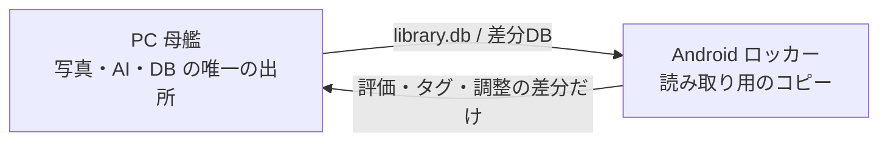

# v2系 Android 強化構想レポート：「リモコン」から「Context Tether」へ

- **作成日**: 2026-11-09
- **対象ブランチ**: `v2`（調査時点: v2.0.2 → 土台修正完了時点: v2.0.3）
- **関連ドキュメント**:
  - [実装計画書：採取（フィールドログ）と再会](implementation_plan.md)
  - [Context Tether 設計仕様（ナレッジベース）](../../../knowledge/field-log-and-recall.md)

---

## 1. 現状診断：なぜ「リモコンの域」を出ないのか

コードベースを確認して分かったのは、問題は UI の作り込み不足ではなく、データが流れる向きにあるということである。

| 観点 | 現状（v2.0.2 時点のコード上の事実） |
| :--- | :--- |
| 端末権限 | [`AndroidManifest.xml`](../../../../android/app/src/main/AndroidManifest.xml) が要求しているのは `INTERNET` だけ。位置情報・カメラ・メディア・センサーは一切使っていない |
| ネイティブ層の役割 | [`TetheractNativeBridge.kt`](../../../../android/app/src/main/java/com/tetheract/pm/TetheractNativeBridge.kt) の公開 API は全部で 15 個。すべて「DB を読む・書く・同期する」用途 |
| フロントエンド | `geolocation` / `getUserMedia` / センサー系 API の使用はゼロ（`navigator.share` と `vibrate` が数か所あるだけ） |
| 同期で運ぶもの | 評価・タグ・トーン調整・スタック代表の **差分だけ**。スマホ側で新しく生まれる情報を運ぶ仕組みがない |

**結論**：従来の Android 版は「PC の縮小窓」として設計されており、スマホにしかない次の特性をまだ使っていなかった。

1. 撮影の **現場にいる**（位置・時刻・向き・その場の状況）
2. **すき間時間** に手の中にある
3. **場所や日常と結びついた端末** である（同じ場所にもう一度立てる）

---

## 2. 先に直すべき土台の不具合と v2.0.3 での対応状況

新機能で「スマホから PC へ情報を運ぶ」前に、コード監査で判明した同期・セキュリティ上の課題を洗い出し、v2.0.3 で先行修正した。

| # | 深刻度 | 内容 | 対応状況（v2.0.3） |
| :--- | :--- | :--- | :--- |
| F1 | 高 | **同期中に行った変更が消える**。送信用データを作ってから POST が返るまでの間に付けた評価やタグも、`clearPendingJournal()` がまとめて消してしまう。USB 書き出しにも同じ問題がある | **修正済み**（`PendingJournalStore.kt` に世代番号 `rev` を導入し、`clearPendingJournalUpTo(sentRev)` で送信分のみ削除） |
| F2 | 高 | **クロップとお気に入りが PC に届かない**。`crop_*` と `is_favorite` はロッカー DB には書かれるが、ジャーナルには記録されない。PC 側の `sync-import` もクロップを受け取らない | **修正済み**（ジャーナルおよび `mobile_router.py` の双方で `crop_*`・`is_favorite` を反映） |
| F3 | 中 | **JS からネイティブへ渡す項目が欠けている**。`rotation` / `crop_*` / `add_tag_keys`（タグ改名に追従するためのキー）が送られていない | **修正済み**（`mobile.js` およびネイティブジャーナルで保持・送信） |
| F4 | 中 | **ジャーナルが 2 つある**（JS の localStorage とネイティブの `pending_journal.db`）。件数表示は JS 側を優先するため、表示と実際がずれることがある | **修正済み**（Android ネイティブ環境ではネイティブジャーナルに一本化） |
| F5 | 中 | **競合を検出していない**。スマホ側の変更が常に勝つため、ロッカーに取り込んだ後に PC で付けた評価を、古いスマホ側の値で上書きしてしまう | **保留**（PC 側の `updated_at` はサムネイル生成や地名付与でも更新されるため、項目単位の版管理が必要） |
| F6 | 中 | **照合できなかった変更が黙って捨てられる**。さらにファイル名だけでの照合は別の写真に誤って適用するおそれがある | **修正済み**（ファイル名単体照合を廃止し、未照合分は `unmatched_keys` としてスマホ側に残す） |
| F7 | 中 | **スマホから同期した回転・クロップ・トーンが PC 側のサムネイルに反映されない** | **修正済み**（`sync-import` 適用後にバックグラウンドで対象写真のサムネイルを再生成） |
| S1 | 高（セキュリティ） | **UI バンドルに署名がない**。USB 直下に `Tetheract_Mobile.html` を置くだけでアプリの UI を差し替えられる | **保留**（署名鍵の管理方針を別途策定） |
| S2 | 中（セキュリティ） | ブリッジ経由で任意の SQL を実行できる（`execSqlJson`） | **修正済み**（`execSqlJson` を廃止し、`rawQueryJson` でも書き込み系 SQL をブロック） |
| P1 | 低（性能） | 件数を取るだけの `getLockerStatusJson()` が、毎回 USB 上の更新ファイルを SAF で探しに行く | **修正済み** |

---

## 3. 新しい概念：**Context Tether（文脈をつなぎとめる）**

> **カメラは光を記録する。スマホは文脈を記録する。PC がその二つを結び合わせる。**

`Tetheract` という名前には最初から *tether*（つなぎ留める）が入っている。Android 版を「PC につながれた子機」から **「撮影の瞬間・場所とライブラリをつなぐ役」** に変える。

検討の結果、「判断（クイズ形式で問いに答える機能）」は「溜める・分類するだけが目的の人には鬱陶しく感じられる」という理由から見送り、**「採取（Collect）」と「再会（Revisit）」の 2 本柱** に集中する方針とした。

### 3.1 採取（Collect）：撮影の現場に立ち会う
- **クイック設定タイルで ON/OFF する GPS フィールドログ**:
  - ミラーレスや一眼カメラで撮っている間、Android のクイック設定パネルのトグルスイッチ（「GPSログ」タイル）を ON にするだけで、Google Play 開発者サービスに依存しない `LocationManager` の前面サービスで位置を記録する（既定 30 秒間隔・12 時間自動停止）。
  - 記録したログは **日付別ファイル（`YYYY-MM-DD.jsonl`）** として保存し、スマホでも PC でも 1 日単位・全件で簡単に消せるようにする（送信済みかつ 30 日経過で自動削除）。
  - PC 側では撮影時刻（端末ローカル時刻とログ点の UTC オフセット `tz`・カメラ機種別時計補正）で照合し、プレビュー確認のうえで非破壊で位置と地名を付与する（バッチ単位での取り消し・GPX 書き出しにも対応）。

### 3.2 再会（Revisit）：場所と日付が写真を呼び戻す
- **「ここで撮った写真」**:
  - 今いる場所の半径 N m 以内で過去に撮った写真を、スマホ内ロッカーから緯度経度の範囲検索で引き出し、距離・方角・撮影年とともにオフラインで表示する。
- **スマホ版「歴代の今日」**:
  - 過去の同じ月日に撮影した写真をスマホ上で一覧する。
- **充電中の写真立てモード（`DreamService`）**:
  - 充電中のタブレットやスマホで、Android 標準のスクリーンセーバーとして「歴代の今日」や高評価写真をクロスフェード再生する。
