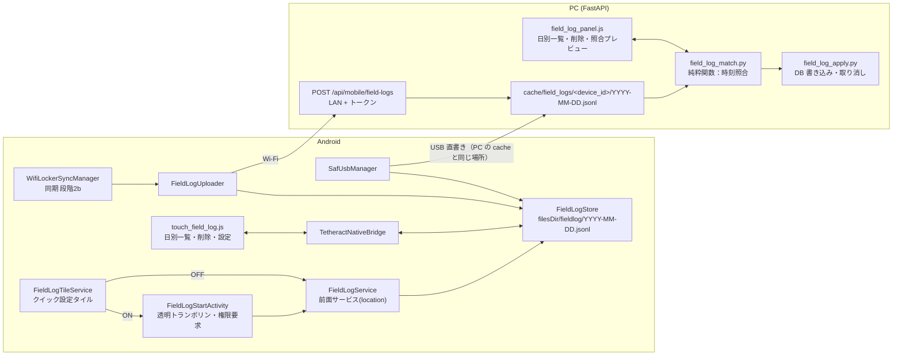
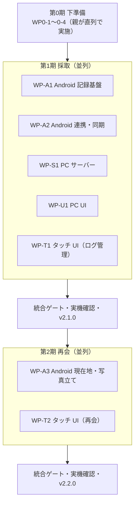

# 実装計画書：採取（フィールドログ）と再会（Context Tether 第1期）

- **作成日**: 2026-11-09
- **対象ブランチ**: `v2`（v2.0.3 時点。`main` には一切入れない）
- **想定バージョン**: 第1期 完了時 `v2.1.0`、第2期 完了時 `v2.2.0`（新機能のため MINOR を上げる）
- **前提資料**:
  - [構想レポート：「リモコン」から「Context Tether」へ](concept_report.md)
  - [Context Tether 設計仕様（ナレッジベース）](../../../knowledge/field-log-and-recall.md)
  - [Android アプリ＆タッチ構成仕様書](../../../knowledge/android-app-and-touch-architecture.md)
  - [モジュール分割・マルチエージェント分業規約](../../../../.agents/rules/modularization-and-multi-agent.md)
  - [v1/v2 ブランチと dist 分離規約](../../../../.agents/rules/branch-and-dist-separation.md)

---

## 0. 引き継ぐエージェントへ（最初に読む）

1. `git branch --show-current` が `v2` であることを確認する。違えば `git checkout v2`。
2. この計画書の **§3 契約（Contract）** は、並列作業の前に確定させた約束事である。サブエージェントには契約の該当節をそのまま渡し、勝手に変えさせない。契約を変える必要が出たら、親（オーケストレータ）が本書を更新してから全員に再通知する。
3. **§9 未決事項** のうち「着手前にユーザー確認」と書いたものは、該当作業の前に必ず `ask_question` でユーザーに確認する。
4. Android ビルド環境は `.android_toolchain/`（gitignore 済み）に導入済み（JDK 17.0.10 / Android SDK 34・build-tools 34.0.0 / Gradle 8.5）。Kotlin のコンパイル確認は §7.2 の手順で行える。初回は依存の取得で約 4〜5 分、2 回目以降は短い。
5. 各フェーズの終わりに **§7 統合ゲート** を通してからコミットする。push と GitHub リリースは、ユーザーの明示的な指示があるまで行わない。

---

## 1. 目的と範囲

### 1.1 コンセプト
> カメラは光を記録する。スマホは文脈を記録する。PC がその二つを結び合わせる。

スマホを「PC の縮小リモコン」から「撮影の現場に立ち会い、場所と日付で写真を呼び戻す相棒」に変える。第1期では次の 2 本柱だけを作る（「判断キュー」は不採用。ユーザー判断：溜めるだけの人には鬱陶しい）。

| 柱 | 第1期で作るもの |
| :--- | :--- |
| **採取** | クイック設定タイルで ON/OFF する GPS ログ、日付別ファイル保存と簡単な削除、PC への送信、PC での撮影時刻照合と位置付与（プレビュー・取り消し可能）、GPX 書き出し |
| **再会** | 「ここで撮った写真」（現在地の近くで過去に撮った写真）、スマホ版「歴代の今日」、充電中の写真立てモード（DreamService） |

### 1.2 範囲外（第3期以降）
- 通知の「印」ボタンと、それを評価候補へ変換する PC 処理（ファイル形式だけは §3.1 で予約済み）
- 時計合わせ QR（QR 読み取りライブラリのライセンス確認が必要）
- PC のさんぽ軌跡（`frontend/js/location_map.js`）へのトラック重ね描き（1345 行あるため、先に切り出しが必要）
- 昔の写真を重ねて同じ構図で撮り直す再撮影ガイド（カメラ権限が必要）
- 音声メモ

### 1.3 守るべき原則（4 本の柱との対応）
- **柱 2 元データは汚さず壊さず**: 写真ファイルには触れない。位置付与は DB の `latitude/longitude/gps_source` への非破壊記録だけ。適用前の値を保存し、適用単位で元に戻せること。
- **柱 4 クラウドに頼らない**: Google Play 開発者サービスを使わない（`LocationManager` を直接使う）。ログは外部へ一切送らない。LAN 送信は PC との直接通信だけ。
- **プライバシー（ユーザー指示）**: ログは **日付別ファイル** にし、スマホでも PC でも **1 日単位・全件をすぐ消せる** こと。ログは `library.db` にも `mobile_delta.db` にも入れない（DB のバックアップや同期で位置履歴が意図せず広がらないようにする）。

---

## 2. 全体アーキテクチャ



> [!NOTE]
> USB 運用では、PC 版 Tetheract は USB 上で動き、`cache/` も USB 上にある。スマホが SAF で `<USBルート>/cache/field_logs/<device_id>/YYYY-MM-DD.jsonl` に書けば、PC 側の取り込み処理なしにそのまま PC の保存場所に入る。

---

## 3. 契約（Contract）— 並列作業の前に確定済み

### 3.1 フィールドログのファイル形式（スマホと PC で共通）

- **ファイル名**: `YYYY-MM-DD.jsonl`。日付は **点を記録した時点の端末ローカル日付**（`toISOString()` 系の UTC 日付は禁止）。
- **形式**: UTF-8 の JSON Lines。追記専用で、1 行 1 レコード。最終行が途中で切れていても、パーサはその行だけ捨てて続行する（クラッシュ耐性）。
- **先頭行（必須）**: ヘッダ。
  ```json
  {"type":"header","format":"tetheract-fieldlog-v1","device_id":"3f2a…","device_name":"Pixel 8","date":"2026-11-09"}
  ```
- **レコード種別**:

| type | 必須キー | 任意キー | 意味 |
| :--- | :--- | :--- | :--- |
| `pt` | `t`（UTC epoch ミリ秒, int）, `tz`（その時点の UTC からのオフセット分, int。JST なら 540）, `lat`, `lon`（float） | `acc`（水平精度 m）, `alt`（m）, `spd`（m/s）, `prov`（`gps` / `network`） | 位置点 |
| `session` | `t`, `tz`, `state`（`start` / `stop`） | `reason`（`user` / `auto_timeout` / `low_battery` / `killed`） | 記録の開始・終了 |
| `mark` | `t`, `tz` | `lat`, `lon`, `label` | **第3期用に予約**。第1期では書かないが、パーサは無視せず読み飛ばせること |

- **device_id**: アプリ初回起動時に生成するランダム UUID（ハードウェア ID は使わない）。`^[0-9a-f-]{8,64}$`。
- **記録の間引き**: 精度 `acc > 50m` の点は捨てる。静止時も、時刻補間の根拠を残すため最低 5 分に 1 点は書く。

### 3.2 Android 内部 API（Kotlin）

```kotlin
// FieldLogStore.kt（filesDir/fieldlog/ を管理。ロッカー filesDir/locker/ とは完全に別）
data class FieldLogDay(
    val date: String, val points: Int, val firstT: Long, val lastT: Long,
    val distanceM: Double, val bytes: Long, val uploaded: Boolean
)
data class FieldLogSettings(val intervalSec: Int = 30, val autoStopHours: Int = 12, val autoDeleteDays: Int = 30)

class FieldLogStore private constructor(context: Context) {
    companion object {
        /** サービス・ブリッジ・アップローダが同じインスタンスを共有する（プロセス内シングルトン。全メソッドは内部で同期化する） */
        fun get(context: Context): FieldLogStore
    }
    fun deviceId(): String
    fun appendPoint(loc: android.location.Location)
    fun appendSession(state: String, reason: String)
    fun listDays(): List<FieldLogDay>          // 新しい日付順
    fun deleteDays(dates: List<String>): Int   // 削除した日数。記録中の当日を消しても、次の点で新しいファイルとヘッダを作り直す
    fun deleteAll(): Int
    fun readDay(date: String): ByteArray?
    fun sha256(date: String): String?
    fun markUploaded(date: String, sha256: String)   // fieldlog/upload_state.json に記録
    fun pendingUploadDates(): List<String>           // 未送信、または送信後に追記された日
    fun applyAutoDelete(nowMs: Long): Int            // 送信済み かつ autoDeleteDays 経過の日を削除（0 なら何もしない）
    fun loadSettings(): FieldLogSettings
    fun saveSettings(s: FieldLogSettings)
}

// FieldLogService.kt
// - ACTION_START / ACTION_STOP。foregroundServiceType="location"
// - LocationManager.GPS_PROVIDER を intervalSec 間隔で購読（GMS 不使用）
// - 常駐通知：「GPSログ記録中 · 経過 h:mm · n点」＋「停止」アクション
// - autoStopHours 経過、または電池 15% 未満で自動停止（session stop を書く）
// - START_NOT_STICKY（Android 14 では背景からの位置サービス再起動ができないため。強制終了後は次回アプリ起動時に「記録が中断されました」と表示）
// - companion object { fun isRecording(context): Boolean }（SharedPreferences に状態を保持）
// - 状態が変わるたびに TileService.requestListeningState と MainActivity への通知（§3.3 のコールバック）
// - 画面への状態通知は、プロセス内のリスナー登録で行う（LocalBroadcastManager は依存にないため使わない）:
//     companion object {
//         const val ACTION_START = "com.tetheract.pm.action.FIELD_LOG_START"
//         const val ACTION_STOP = "com.tetheract.pm.action.FIELD_LOG_STOP"
//         const val ACTION_OPEN_FIELD_LOG = "com.tetheract.pm.action.OPEN_FIELD_LOG"  // 通知タップで MainActivity を開くときの action
//         fun isRecording(context: Context): Boolean
//         fun buildStatusJson(context: Context): JSONObject          // §3.3 fieldLogGetStatusJson と同じ形
//         fun setStatusListener(listener: ((JSONObject) -> Unit)?)   // MainActivity が onCreate で登録し onDestroy で null に戻す
//     }
// - WP-A1 はマニフェストの MainActivity に、タイル長押し用の intent-filter
//   (action android.service.quicksettings.action.QS_TILE_PREFERENCES) を追加する。
//   その Intent と ACTION_OPEN_FIELD_LOG を受けて画面を開く処理（onCreate / onNewIntent）は WP-A2 が MainActivity に書く。

// FieldLogTileService.kt
// - onStartListening でタイルの状態（ACTIVE/INACTIVE）を isRecording に合わせる
// - onClick：記録中 → ACTION_STOP。停止中 → FieldLogStartActivity を起動
//   （API 34 以上は startActivityAndCollapse(PendingIntent)、33 以下は startActivityAndCollapse(Intent)）
// - タイル長押し（QS_TILE_PREFERENCES）は MainActivity を開き、フィールドログ画面を表示する

// FieldLogStartActivity.kt（透明・履歴に残らないトランポリン）
// - ACCESS_FINE_LOCATION（と Android 13 以上なら POST_NOTIFICATIONS）が未許可なら requestPermissions
// - 許可済みなら FieldLogService を startForegroundService して即 finish
// - 拒否されたら Toast で理由を出して finish

// FieldLogUploader.kt（WifiLockerSyncManager は 709 行のため送信処理はここに分離）
class FieldLogUploader(private val store: FieldLogStore) {
    /** pendingUploadDates を順に POST し、成功した日を markUploaded する。戻り値は送信日数 */
    fun uploadPending(serverUrl: String, token: String, post: (url: String, body: String) -> JSONObject): Int
}
```

### 3.3 JS ↔ ネイティブ ブリッジ（`window.TetheractNative` に追加）

| メソッド | 戻り値（JSON 文字列） | 備考 |
| :--- | :--- | :--- |
| `fieldLogGetStatusJson()` | `{recording, startedAt, todayPoints, settings:{intervalSec,autoStopHours,autoDeleteDays}, permission:{location, notification}, interrupted}` | `interrupted` は前回の記録が強制終了で中断された場合 true |
| `fieldLogStartJson()` | `{ok, status:"started" \| "permission_requested"}` | アプリ前面からの開始。権限がなければ MainActivity で要求し、結果をコールバックで通知 |
| `fieldLogStopJson()` | `{ok}` | |
| `fieldLogListDaysJson()` | `{days:[{date, points, firstT, lastT, distanceM, bytes, uploaded}]}` | |
| `fieldLogDeleteDaysJson(datesJson)` | `{ok, deleted}` | `datesJson` は `["2026-11-09", …]` |
| `fieldLogDeleteAllJson()` | `{ok, deleted}` | |
| `fieldLogSaveSettingsJson(json)` | `{ok, settings}` | 範囲：interval 5〜300 秒、autoStop 1〜24 時間、autoDelete 0（無効）/7/30/90 日 |
| `requestCurrentLocationJson(requestId)` | `{ok, status:"requested"}` | **第2期**。結果は `__onTetheractLocation` で非同期に返す |

ネイティブ → JS のコールバック（`evaluateJavascript`。JS 側は未定義でも落ちないよう `if(window.X)` で呼ぶ）:
- `window.__onTetheractFieldLogChanged(statusObj)`: 記録の開始・停止、権限の結果、自動停止のたびに呼ぶ
- `window.__onTetheractOpenFieldLog()`: タイル長押しや通知タップでアプリを開いたとき
- `window.__onTetheractLocation(requestId, {ok, lat, lon, acc, t, error})`: **第2期**

### 3.4 JS アダプタ（新規 `frontend/js/adapters/field_log_adapter.js`）

`data_adapter.js` が 733 行で上限に近いため、新しいファイルにする。`window.TetheractFieldLogAdapter` として公開し、すべて Promise を返す。DOM 操作は禁止。

```javascript
window.TetheractFieldLogAdapter = {
  isAvailable(),                    // -> boolean（Android ネイティブで、かつ fieldLog* が存在するとき true）
  async getStatus(),                // -> fieldLogGetStatusJson の内容
  async start(), async stop(),
  async listDays(),                 // -> days 配列
  async deleteDays(dates), async deleteAll(),
  async saveSettings(settings),
  async requestCurrentLocation(),   // 第2期。requestId を内部で発行し、__onTetheractLocation を待つ（タイムアウト 20 秒）
  onStatusChanged(callback),        // __onTetheractFieldLogChanged の購読（複数登録可）
  onOpenRequested(callback),        // __onTetheractOpenFieldLog の購読
};
```

### 3.5 PC API

| メソッド・パス | アクセス | 内容 |
| :--- | :--- | :--- |
| `POST /api/mobile/field-logs` | **LAN 許可（トークン必須）** | 本文 `{device_id, device_name, date, sha256, content}`。`content` は §3.1 の JSONL 文字列。上限 8MB/日。sha256 を検証し、`cache/field_logs/<device_id>/<date>.jsonl` に一時ファイル経由で置き換え保存する。戻り値 `{ok, date, points, sha256}` |
| `GET /api/field-logs` | localhost のみ | `{devices:[{device_id, device_name, days:[{date, points, first, last, distance_m, bytes}]}]}` |
| `POST /api/field-logs/delete` | localhost のみ | `{targets:[{device_id, date}]}` または `{all:true}`。ファイルを削除する。**適用済みの位置は消さない**（取り消しは別操作） |
| `GET /api/field-logs/{device_id}/{date}.gpx` | localhost のみ | GPX 1.1 で書き出す（`trk/trkseg/trkpt` と UTC の `time`） |
| `POST /api/field-logs/match/preview` | localhost のみ | §3.6 のパラメータで照合し、書き込まずに結果を返す |
| `POST /api/field-logs/match/apply` | localhost のみ | 同じパラメータで **サーバー側で再計算** して適用する（クライアントが送った座標は信用しない）。戻り値 `{batch_id, applied}` |
| `GET /api/field-logs/match/batches` | localhost のみ | 適用履歴の一覧 |
| `POST /api/field-logs/match/undo` | localhost のみ | `{batch_id}`。適用前の値に戻す |

- 入力検証: `date` は `^\d{4}-\d{2}-\d{2}$`、`device_id` は §3.1 の正規表現に一致すること。パスはこの 2 つからだけ組み立てる（パストラバーサル防止）。
- Android の `HttpURLConnection` は Origin ヘッダを送らないため、`server/app.py` の `_NULL_ORIGIN_ALLOWED_PATHS` への追加は不要の見込み。実機確認で 403 になった場合だけ追加を検討する。

### 3.6 照合アルゴリズム（`server/field_log_match.py`、純粋関数）

```python
def match_photos(
    photos: list[dict],            # {id, date_taken("YYYY-MM-DD HH:MM:SS" または "YYYY:MM:DD HH:MM:SS"), camera_model, latitude, gps_source}
    points: list[dict],            # §3.1 の pt。t の昇順に並べて渡す
    camera_offsets: dict[str, int] = {},   # カメラ機種ごとの時計補正（秒）。写真時刻にこれを足すと正しい時刻になる
    max_gap_sec: int = 300,        # 前後2点の間隔がこれ以下なら線形補間
    max_nearest_sec: int = 120,    # 補間できない場合に最寄り点を採用する許容差
    overwrite: str = "missing_only",  # "missing_only" | "replace_inferred" | "all"
) -> dict:  # {"items":[{photo_id, lat, lon, method:"interpolated"|"nearest", gap_sec, acc_m, prev_source}], "unmatched":[photo_id...], "skipped":[{photo_id, reason}]}
```

- **時刻変換（最重要）**: PC の `date_taken` は時差情報のないローカル時刻（調査で確認済み。タイムゾーン列はない）。写真時刻を UTC に直すときは、**その時刻に最も近い点の `tz` を使う**。
  `utc_ms = (ローカル時刻を UTC とみなしたエポック − tz × 60 秒 + camera_offset) × 1000`
- 写真が日付の境目付近（23:59 など）にあることを考え、照合では前後 1 日分のファイルも読み込む。
- 対象から外すもの: `overwrite` に従う。既定の `missing_only` は `latitude IS NULL` の写真だけを対象にする。`gps_source='manual'` は、どの設定でも上書きしない。
- 書き込み（`server/database/field_log_apply.py`）:
  - `gps_source='fieldlog'` と `meta_dirty=1` を書く。
  - 地名は `reverse_geocode(lat, lon, db_conn=conn)` で付ける。
  - `server/database/photos.py` L512-517 の再スキャン保護リストに `'fieldlog'` を加える。
  - 適用前の値（latitude, longitude, gps_source, country, state, city）を `cache/field_logs/_batches/<batch_id>.json` に保存し、undo はそこから戻す。

### 3.7 PC の保存構造

```text
cache/field_logs/
├── <device_id>/
│   ├── device.json              # {"device_name": "...", "last_upload_at": "YYYY-MM-DD HH:MM:SS"}
│   ├── 2026-11-08.jsonl
│   └── 2026-11-09.jsonl
└── _batches/
    └── 20261109-214500-ab12.json # 照合適用の履歴（取り消し用の元の値）
```
`cache/` は gitignore 済みで、配布 ZIP からも除外済み（`server/make_release_zips.py` L20、`build_dist.bat` L18）。

### 3.8 ログ削除の仕様（ユーザー指示）

| 場所 | 方法 |
| :--- | :--- |
| スマホ：アプリ内 | フィールドログ画面の日別一覧で、日付を選んで削除。「すべて削除」。いずれも `showConfirmModal` 相当の確認を出す |
| スマホ：タイル | タイル長押しでフィールドログ画面を直接開く |
| スマホ：自動 | 「PC送信済み かつ N 日経過」で自動削除（N = 0/7/30/90。既定値は §9 で確認） |
| PC：アプリ内 | フィールドログパネルの日別一覧から削除、または全削除 |
| PC：手動 | `cache/field_logs/` のフォルダやファイルを直接削除しても壊れない（MANUAL.md に記載する） |

> [!IMPORTANT]
> ログを削除しても、写真に適用済みの位置は残る。位置を消したいときは「適用の取り消し」を使う。この違いを UI の文言と MANUAL.md の両方で明示すること。

---

## 4. フェーズとワークパッケージ（WP）



### 第0期：下準備（親が直列で実施。サブエージェント不要）

| WP | 内容 | 変更ファイル | 完了条件 |
| :--- | :--- | :--- | :--- |
| **WP0-1** | `server/routers/mobile_router.py`（831 行で上限超過）から `_apply_mobile_sync_changes` 一式と `_schedule_thumbnail_refresh` を新規 `server/mobile_sync_apply.py` へ切り出す（Extract Before Extend）。`mobile_router.py` と `server/app.py` からの re-export は残す（`tests/test_core_regression.py` が `from server.app import _apply_mobile_sync_changes` を使っているため） | `server/mobile_sync_apply.py`（新規）、`server/routers/mobile_router.py` | 両ファイルとも 800 行以下。全テストが OK |
| **WP0-2** | `scripts/build_android_apk.py` の整合性チェックを強化する。①`REQUIRED_ANDROID_FILES` 方式に加えて `android/app/src/main/java/**/*.kt` すべてに 800 行上限を適用する。②ブリッジ契約チェックの対象を `frontend/js/adapters/*.js` 全体に広げる | `scripts/build_android_apk.py` | `--check-only` が合格 |
| **WP0-3** | ①`frontend/js/views/touch/touch_layout.js` に、パースペクティブパネルの描画を外部から複数登録できる口 `TetheractTouchUI.registerPerspectiveRenderer(id, fn)`（`id` ごとに配列で保持し、`lab` では既存の「DB読込・同期を開く」ボタンの下に各レンダラーの要素を順に追記できる構造）を足す。これで第1期（採取）と第2期（再会）のカードが互いを上書きせず共存できる。②ユーザー承認済み（Q4）に基づき、`frontend/js/mobile.js` の `window.__handleAndroidBack` 冒頭に `window.__extraBackHandlers` 配列を走査する 3 行のフックを追加する | `touch_layout.js`、`mobile.js`（3行のみ） | 既存の挙動が変わらないこと。`touch_layout.js` が 800 行以下 |
| **WP0-4** | Kotlin のコンパイル基準線を確認する（§7.2）。**2026-11-09 に v2.0.3（`c1c9045`）で `compileReleaseKotlin` 成功を確認済み**（警告は `UsbOfflineUpdater.kt` の未使用引数 1 件のみ）。第1期の直前にもう一度だけ流す | なし（失敗時のみ該当 .kt） | `compileReleaseKotlin` が成功 |

### 第1期：採取（5 つのサブエージェントで並列）

| WP / ロール | 編集を許可するファイル（Write Allowed） | 読み取り専用（Read Only） | ミッション |
| :--- | :--- | :--- | :--- |
| **WP-A1** Android 記録基盤 | `FieldLogStore.kt`、`FieldLogService.kt`、`FieldLogTileService.kt`、`FieldLogStartActivity.kt`（いずれも新規、`android/app/src/main/java/com/tetheract/pm/` 配下）、`android/app/src/main/AndroidManifest.xml`、`android/app/src/main/res/drawable/ic_tile_fieldlog.xml`（新規）、`android/app/src/main/res/values/strings.xml`（必要なら新規） | 既存の .kt すべて、`android/app/build.gradle` | §3.1 と §3.2 の実装。マニフェストに権限 5 つ（ACCESS_FINE/COARSE_LOCATION、FOREGROUND_SERVICE、FOREGROUND_SERVICE_LOCATION、POST_NOTIFICATIONS）、サービス 2 つ、Activity 1 つを追加する。既存の依存（core-ktx の NotificationCompat 等）だけで作り、ライブラリは追加しない |
| **WP-A2** Android 連携・同期 | `FieldLogUploader.kt`（新規）、`TetheractNativeBridge.kt`、`MainActivity.kt`、`WifiLockerSyncManager.kt`、`SafUsbManager.kt` | WP-A1 の 4 ファイル（契約 §3.2 を前提に呼び出す）、`LockerDatabaseManager.kt`、`PendingJournalStore.kt` | §3.3 のブリッジとコールバックを実装する。MainActivity には権限要求（`onRequestPermissionsResult`）と、タイル長押し・通知からの起動処理を足す。Wi-Fi 同期の段階 2 の直後に段階 2b として `FieldLogUploader.uploadPending` を呼ぶ（追加は 10 行以内）。USB 書き出しでは `<USB>/cache/field_logs/<device_id>/<date>.jsonl` へ未送信の日を書き、`markUploaded` する。同期完了時に `applyAutoDelete` を呼ぶ |
| **WP-S1** PC サーバー | `server/field_log_store.py`、`server/field_log_match.py`、`server/database/field_log_apply.py`、`server/routers/field_log_router.py`（いずれも新規）、`server/database/__init__.py`（re-export のみ）、`server/database/photos.py`（L512-517 の保護リストに `'fieldlog'` を足す 1 行のみ）、`server/app.py`（ルーター登録の import と include_router の 2 行のみ）、`server/lan_access.py`（`_LAN_API_EXACT["POST"]` に upload パスを 1 つ追加）、`tests/test_field_log.py`（新規）、`tests/test_security.py` | `server/routers/gps_lab_router.py`、`server/geocoder/*`、`server/routers/common.py`、`server/mobile_sync_apply.py` | §3.5〜§3.7 の実装。`field_log_match.py` は DB と FastAPI に依存しない純粋関数にする。テストでは補間・最寄り・許容差超え・タイムゾーン・カメラ補正・日付境界・最終行の欠け・`manual` を上書きしないこと・undo を網羅する。`test_security.py` では、upload が LAN 許可でトークンなしなら 401、match/apply・undo・delete は LAN から 403 になることを検証する |
| **WP-U1** PC UI | `frontend/js/field_log_panel.js`、`frontend/css/field-log.css`（いずれも新規）、`frontend/index.html`（script・css の読み込み、入口ボタン、`#helpModal` への説明追加） | `frontend/js/location_map.js`、`frontend/js/selection.js`、`frontend/js/common.js`（`showConfirmModal` / `showToast` / `escapeHtml` を使う） | フィールドログのモーダルを作る。①端末別・日別の一覧（点数・時間帯・距離・サイズ）と削除・全削除・GPX ダウンロード。②照合：対象範囲（日付・フォルダ・選択中の写真）、カメラ機種ごとの時計補正（秒）、上書き方針を指定し、プレビュー表（方式・間隔・精度）を見てから適用する。③適用履歴と取り消し。入口ボタンは `index.html` L667 `#locationOpenMapBtn` の近くに置く。凍結ファイルには触れない |
| **WP-T1** タッチ UI（ログ管理） | `frontend/js/adapters/field_log_adapter.js`、`frontend/js/views/touch/touch_field_log.js`、`frontend/css/touch-fieldlog.css`（いずれも新規）、`frontend/mobile.html`（script・css の読み込みのみ）、`server/mobile_bundle.py`（`MOBILE_JS_REL_PATHS` と `MOBILE_CSS_REL_PATHS` への追記のみ） | `frontend/js/mobile.js`（凍結。読むだけ）、`frontend/js/views/touch/touch_layout.js`（WP0-3 の登録口を使う）、`frontend/js/adapters/data_adapter.js` | §3.4 のアダプタと、ログ管理画面を作る。①記録の開始・停止と状態表示（記録中・経過・点数・中断の通知）。②日別一覧（PC 送信済みの印）、選択削除・全削除（確認付き）。③設定（間隔・自動停止・自動削除）。`registerPerspectiveRenderer('lab', …)` で Lab パネルに「採取」カードを出し、既存の「DB読込・同期を開く」ボタンも残す。`__onTetheractOpenFieldLog` を受けたらこの画面を開く。外部由来の文字列は必ずエスケープする |

> [!WARNING]
> **ファイル所有権の衝突に注意**:
> - `AndroidManifest.xml` は WP-A1 だけ、`MainActivity.kt` は WP-A2 だけが編集する。
> - `tests/test_security.py` は第1期では WP-S1 だけが編集する。新しい JS モジュールを `modular_files` リスト（L621-637）へ追加する作業は、統合時に親が行う。
> - `scripts/build_android_apk.py` の `REQUIRED_ANDROID_FILES` への追加も親が統合時に行う。
> - `MANUAL.md`、`VERSION`、リリースノート、`docs/knowledge/` も親が統合時に更新する。

### 第2期：再会（2 つのサブエージェントで並列）

| WP / ロール | 編集を許可するファイル | 読み取り専用 | ミッション |
| :--- | :--- | :--- | :--- |
| **WP-A3** Android 現在地・写真立て | `LockerRegistry.kt`、`CurrentLocationProvider.kt`、`PhotoFrameDreamService.kt`、`PhotoFrameSelector.kt`（いずれも新規）、`MainActivity.kt`（Manager の生成を LockerRegistry に置き換える）、`TetheractNativeBridge.kt`（`requestCurrentLocationJson` の追加）、`LockerDatabaseManager.kt`（`ensureLibraryDbOpen` に `CREATE INDEX IF NOT EXISTS idx_photos_latlon ON photos(latitude, longitude)` を 1 行足すだけ）、`AndroidManifest.xml`（DreamService の登録） | 第1期の Kotlin 全ファイル | ①**LockerRegistry**：`LockerDatabaseManager` / `SafUsbManager` / `WifiLockerSyncManager` をアプリ全体で 1 つにする。DreamService と MainActivity で DB 接続とロックを共有するため。②**現在地の 1 回取得**：API 30 以上は `getCurrentLocation`、それ未満は `requestSingleUpdate`。2 分以内の最終既知位置があればそれを使う。③**写真立て**：ネイティブの ImageView 2 枚を 12 秒ごとにクロスフェードする。選び方は「歴代の今日」（`SUBSTR(date_taken,6,5) IN ('MM-DD','MM:DD')`）の良以上 → 足りなければ良以上からランダム → それもなければ全体。画像は USB/Wi-Fi の高画質があれば使い、なければサムネイル。左下に小さく「2019 · 京都市」を表示する。WebView は使わない |
| **WP-T2** タッチ UI（再会） | `frontend/js/core/geo_recall.js`、`frontend/js/views/touch/touch_recall.js`、`frontend/css/touch-recall.css`（いずれも新規）、`frontend/mobile.html`（読み込みのみ）、`server/mobile_bundle.py`（一覧への追記のみ）、`frontend/js/adapters/field_log_adapter.js`（`requestCurrentLocation` の実装） | `mobile.js`、`touch_layout.js`、`data_adapter.js` | ①`geo_recall.js`（純粋関数）：`buildNearbyQuery(lat, lon, radiusM)` で `{sql, params}` を返す（緯度経度の範囲で絞る SELECT）。ほかに `haversineM`、`bearingDeg`、`groupByDistance`（〜100m / 〜1km / 〜5km）、`buildOnThisDayCondition(date)`。②`touch_recall.js`：Lab パネルに「再会」カードを出し、「ここで撮った写真」（距離・方角・撮影年）と「歴代の今日」を一覧表示する。写真は `rawQueryJson` で取得し、タップで自前の全画面プレビュー（`/usb_photo/{id}` → `/thumb/{id}`）を開く。`mobile.js` のビューアには依存しない |

---

## 5. サブエージェント起動テンプレート

親は各 WP ごとに `invoke_subagent`（TypeName は `self`、Workspace は `inherit`）で起動し、プロンプトには次の要素を必ず入れる。

```text
あなたは Tetheract Photo Manager の {ロール名} です。作業ブランチは v2（切り替え禁止）。
最初に AGENTS.md と .agents/rules/modularization-and-multi-agent.md を読み、規約（日本語コメント、bare except 禁止、
toISOString 禁止、PowerShell のテキスト操作禁止、800 行上限、凍結ファイルへの追記禁止）に従ってください。

## 計画書
docs/archive/tasks/v2-field-log-and-recall/implementation_plan.md の §1、§3（特に §3.x）、§4 の {WP 名} を読んでください。
契約（§3）は確定済みです。変更が必要だと判断したら、実装を止めて親に send_message で相談してください。

## 編集を許可するファイル（これ以外は作成・変更禁止）
- ...
## 読み取り専用ファイル
- ...

## 完了条件
- ...（§4 の完了条件と、§7 のうちこの WP に関係する検証コマンド）
- git commit は行わない（親が統合時にまとめてコミットする）
- 完了したら、変更したファイル・行数・検証結果・未解決事項を send_message で親に報告する
```

> [!TIP]
> - 第1期は `Workspace: inherit` で 5 つ同時に起動すると、WP-A2 が WP-A1 の新規クラスを参照してコンパイル競合を起こすため、**Wave 1（WP-A1・WP-S1・WP-U1・WP-T1 の 4 並列）→ WP-A1 完了直後に Wave 2（WP-A2）** の 2 段構成で実行する。
> - WP-A2 が WP-A1 の API を呼ぶ箇所は §3.2 のシグネチャどおりに書く。統合時にシグネチャがずれていたら、親が調整する。

---

## 6. 実装上の注意（調査・精査で判明した事実）

- `MainActivity` は `android.app.Activity` を継承している（AppCompat は使っていない）。権限要求は `requestPermissions` / `onRequestPermissionsResult` を使う。
- 依存ライブラリは `androidx.core:core-ktx:1.12.0` / `androidx.webkit` / `androidx.documentfile` だけ。NotificationCompat は core に含まれる。**新しいライブラリは追加しない**（追加する場合は license-management スキルの手順が必須）。
- `compileSdk 34 / minSdk 26 / targetSdk 34`。位置情報の前面サービスには `FOREGROUND_SERVICE_LOCATION` と `foregroundServiceType="location"` が必須。タイルから位置サービスを直接起動すると Android 14 で拒否されるため、トランポリン Activity を経由する。
- **Android 14 の権限・ロック画面・強制終了検知ガード**:
  - ユーザーが「おおよその位置情報（`ACCESS_COARSE_LOCATION`）」のみを許可した場合、`LocationManager.GPS_PROVIDER` は `SecurityException` を投げる。`FieldLogStartActivity` では `ACCESS_FINE_LOCATION` が必須であることを案内し、`FieldLogService` 側でも `checkSelfPermission` と `try-catch (SecurityException)` で保護する。
  - ロック画面上からタイルをタップされた場合（`TileService.isLocked == true`）、未許可状態なら `unlockAndRun` でロック解除後に `FieldLogStartActivity` を起動する。
  - OS による強制終了（`interrupted`）を確実に判定するため、`FieldLogService` の companion object にプロセス内 `@Volatile var isRunningInMemory = false` を持ち、「SharedPreferences の `recording == true` なのに `isRunningInMemory == false`」のときを強制終了による中断と判定して `session stop (reason="killed")` を補完追記する。
- **SAF（USB 直書き）の拡張子二重付与防止**:
  - `SafUsbManager` で `<USB>/cache/field_logs/<device_id>/<date>.jsonl` を作成する際、`DocumentFile.createFile("application/json", ...)` を使うと Android の SAF プロバイダが `.jsonl.json` と拡張子を二重付与する場合があるため、MIME タイプには必ず `"application/octet-stream"` を渡す。
- **第2期の `MainActivity.onDestroy()` と `PhotoFrameDreamService` の DB クローズ競合防止**:
  - 現在 `MainActivity.onDestroy()`（L460）で `lockerDbManager.closeLibraryDatabase()` を呼んでいるが、WP-A3 で `LockerRegistry` により `MainActivity` と `PhotoFrameDreamService` が DB を共有する際は、`MainActivity.onDestroy()` での無条件クローズを外す（USB/Wi-Fi フル同期の DB ファイル差し替え時のみ `synchronized(lock)` 内でクローズする）。
- ネイティブ→JS 通知は `evaluateJavascript` で `window.__onTetheract…` を呼ぶ既存方式に合わせる（MainActivity L204-228 / L386-396 が例）。
- ロッカー DB の `photos` には PC と同じく `latitude / longitude / gps_source / country / state / city` 列がある（delta も full も全列が届く）。
- `rawQueryJson` が受け付けるのは読み取り専用の SQL だけ（SELECT / WITH / 構造参照の PRAGMA）。再会の検索は SELECT だけで書ける。
- 戻るボタンの階層処理は `mobile.js` L4471-4529 にあり、WP0-3 で `window.__extraBackHandlers` 配列を先頭で走査する 3 行を追加する（ユーザー承認済み）。
- モバイルは i18n 辞書を使っておらず、日本語が直書きされている。新しい UI も既存に合わせて日本語で書く。英語対応は backlog A-5 で一括して行う。
- テーマは `data-theme`（`sumi` / `paper`）の 2 値。色は `--accent-primary` / `--border-color` などのテーマ変数で書き、旧名（`washi` / `urusi`）は使わない。
- PC の `date_taken` に時差情報はない。§3.6 の時刻変換を必ず守る。
- `WifiLockerSyncManager.kt`（709 行）と `LockerDatabaseManager.kt`（692 行）は 800 行に近い。追加はごく少なくし、ロジックは新しいクラスに置く。また `WifiLockerSyncManager` では写真評価等の未送信変更が 0 件のときでもフィールドログが送信されるよう、`if (pendingCount > 0)` ブロックの直後で `FieldLogUploader.uploadPending` を呼ぶ。

---

## 7. 統合ゲート（各フェーズの終わりに親が実行）

### 7.1 自動検証
```powershell
node --check frontend/js/adapters/field_log_adapter.js   # 新規・変更した JS すべて
.\python\python.exe -c "import sys; sys.path.insert(0,'.'); from server.mobile_bundle import ensure_standalone_mobile_html as f; print(f(force=True))"
.\python\python.exe scripts\build_android_apk.py --check-only
.\python\python.exe -m unittest discover -s tests -p "test_*.py"
```
- 単体 HTML の再生成が成功すること。`=== Inlined … ===` マーカーに新しいモジュールが入っていること（`tests/test_security.py` の `modular_files` に親が追記する）。
- 全テストが OK であること（実行前の件数は 45 件）。

### 7.2 Kotlin のコンパイル
```powershell
$env:JAVA_HOME = (Get-ChildItem .android_toolchain\jdk-17 -Directory | Select-Object -First 1).FullName
$env:ANDROID_HOME = (Resolve-Path .android_toolchain\android-sdk).Path
$gradle = (Get-ChildItem .android_toolchain\gradle-8.5 -Recurse -Filter gradle.bat | Select-Object -First 1).FullName
& $gradle -p android compileReleaseKotlin --no-daemon --console=plain
```
- APK を作るときは `.\python\python.exe scripts\build_android_apk.py`（バージョン刻印とアセット同期、`dist_v2/android/` への出力を伴う。**バージョンを上げた後に実行する**）。
- 出力先は開発フォルダ内の `dist_v2/` まで。USB ドライブなど開発フォルダの外へコピーしてはならない（branch-and-dist-separation 規約）。

### 7.3 実機確認チェックリスト（ユーザーに依頼する）

**第1期（採取）**
- [ ] クイック設定にタイル「GPSログ」を追加できる。タップで記録が始まり、初回は位置と通知の権限ダイアログが出る
- [ ] 記録中は常駐通知に経過時間と点数が出る。通知の「停止」とタイルの再タップで止まる
- [ ] 画面を消して 30 分歩いても点が記録され続ける
- [ ] タイルを長押しするとアプリのフィールドログ画面が開く
- [ ] 日別一覧で 1 日分を削除できる。全削除もできる。記録中に当日分を消しても記録が続く
- [ ] Wi-Fi 同期で PC の `cache/field_logs/<device_id>/` に日付別ファイルができる。USB 書き出しでも同じ場所に入る
- [ ] PC のフィールドログパネルで照合をプレビューし、適用すると GPS のないカメラ写真に位置と地名が付く
- [ ] 適用を取り消すと元に戻る。ログを削除しても適用済みの位置は残る
- [ ] GPX を書き出し、他の地図ソフトで開ける

**第2期（再会）**
- [ ] 「ここで撮った写真」に、現在地の近い順・距離・方角つきで過去の写真が出る
- [ ] 「歴代の今日」に過去の同じ月日の写真が出る
- [ ] 端末設定のスクリーンセーバーで「TETHERACT 写真立て」を選べる。充電中に写真が切り替わる

### 7.4 コミットとドキュメント
- 1 コミット 1 目的。目安は WP ごと（例：`feat(android): フィールドログの記録基盤とクイック設定タイルを追加`）。
- フェーズ完了時に親が行うこと:
  - `MANUAL.md` と `#helpModal` を更新する（documentation-manual スキルの手順に従う）
  - `docs/knowledge/field-log-and-recall.md` を新規作成する（設計の背景・ファイル形式・プライバシー方針）
  - `VERSION` を MINOR で上げ、`frontend/index.html`、`frontend/mobile.html`、`launcher/Launcher.cs` を同期する（AGENTS.md のバージョン規約どおり）
  - リリースビルドをする場合はリリースノート 2 種を作る（AGENTS.md の規約どおり）

---

## 8. リスクと対策

| リスク | 対策 |
| :--- | :--- |
| 機種ごとの省電力機能で、前面サービスでも位置が止まる | 実機確認で 30 分歩行テストを行う。止まる場合は MANUAL に「電池の最適化から除外」の手順を書く（自動で除外を要求する権限は使わない） |
| カメラの時計ズレで照合位置がずれる | 第1期は PC 側のカメラ機種別の秒補正で対応し、プレビューで確認してから適用する。自動補正（時計合わせ QR）は第3期 |
| 位置履歴が意図せず残る・広がる | 日付別ファイル、削除 UI、自動削除、DB 非格納、配布 ZIP からの除外（`cache/` 除外済み） |
| 写真立てがサムネイル解像度で粗い | 高画質が取れるときだけ高画質を使う。オフラインでも高画質で見たい要望は「持ち出し Binder の高画質化」として別途扱う |
| 凍結ファイル（`mobile.js`、`server/app.py`）の肥大化 | WP0-3 の登録口で `mobile.js` を無改修に保つ。`app.py` はルーター登録 2 行だけ |
| Kotlin を並列で書くとコンパイルが通らない | §3.2 のシグネチャを厳守し、全体のコンパイルは統合時に親が行う |

---

## 9. ユーザー確認済み・確定事項

| # | 内容 | 確定値 | 状態 |
| :--- | :--- | :--- | :--- |
| Q1 | 自動削除の既定値 | **PC送信済み かつ 30 日経過で自動削除**（`autoDeleteDays = 30`） | **確定（2026-11-09）** |
| Q2 | 記録間隔と自動停止の既定値 | **記録間隔 30 秒 ／ 自動停止 12 時間**（`intervalSec = 30`, `autoStopHours = 12`） | **確定（2026-11-09）** |
| Q3 | 照合の既定の上書き方針 | **`missing_only`（GPS のない写真だけ）**。`replace_inferred` は画面上で選択可 | **確定（2026-11-09）** |
| Q4 | `mobile.js` の戻るハンドラへのフック追加 | **許可**（`window.__handleAndroidBack` 冒頭に `window.__extraBackHandlers` を走査する 3 行を追加） | **確定（2026-11-09）** |
| Q5 | Origin 検証：Android からの upload が 403 にならないか | Android の `HttpURLConnection` は `Origin` ヘッダを送らないため `_is_origin_allowed(None, ...)` は `True` を返す。実機でも確認する | 第1期の実機確認時 |
| Q6 | Phone モード（v2.0.4 ボトムナビ）での「採取・再会」入口配置 | **Phone 下部ボトムナビを 5 タブ化し、専用の「採取・再会（Lab）」タブを追加してワンタップで `openPerspectiveSheet('lab')` を開く**（Tablet は左レール `Lab`） | **確定（2026-11-10）・WP0-3 で実装済み** |
