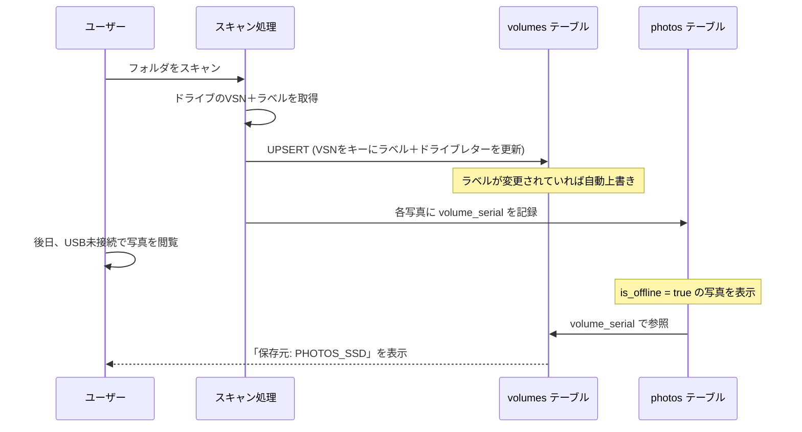

# リンク切れ画像の元保存場所（ボリュームラベル）表示機能

リンク切れ（オフライン）の画像がどのドライブに保存されていたかを特定できるようにする。
**ボリュームシリアル番号（VSN）を安定キーとし、ボリュームラベルはスキャンの都度自動更新される表示用属性として管理する。**

## 設計方針

### キーの選定: ボリュームシリアル番号（VSN）

| 候補 | 安定性 | 備考 |
|------|--------|------|
| ドライブレター (`R:`) | ❌ 不安定 | USBの差し直しで変わる |
| ボリュームラベル (`PHOTOS_SSD`) | ❌ 不安定 | ユーザーがリネーム可能 |
| **ボリュームシリアル番号 (VSN)** | ✅ 安定 | フォーマット時に一度だけ付与。変わらない |

### ラベル更新の仕組み



**ポイント**: スキャンするたびに `volumes` テーブルの `volume_label` が自動更新されるので、ユーザーがラベルを変更しても次のスキャンで反映される。

---

## Proposed Changes

### バックエンド: ボリューム情報取得ユーティリティ

#### [NEW] [`volume_info.py`](file:///r:/photo-manager/server/volume_info.py)

Windows API (`GetVolumeInformationW`) を `ctypes` で呼び出し、ファイルパスからボリューム情報を取得するユーティリティモジュール。

```python
def get_volume_info(file_path: str) -> Optional[Dict]:
    """ファイルパスからボリュームシリアル番号とラベルを取得"""
    # → {"serial": "A1B2C3D4", "label": "PHOTOS_SSD", "drive": "R:"}
```

- `ctypes.windll.kernel32.GetVolumeInformationW` を使用（外部依存なし）
- 非Windowsや取得失敗時は `None` を返す（安全にフォールバック）

---

### バックエンド: データベーススキーマ

#### [MODIFY] [`database.py`](file:///r:/photo-manager/server/database.py)

**1. `volumes` テーブルの新設**

```sql
CREATE TABLE IF NOT EXISTS volumes (
    volume_serial TEXT PRIMARY KEY,  -- VSN（安定キー）
    volume_label  TEXT NOT NULL,     -- 表示用ラベル（更新可能）
    drive_letter  TEXT,              -- 最後に見たドライブレター
    last_seen_at  TIMESTAMP DEFAULT CURRENT_TIMESTAMP
);
```

**2. `photos` テーブルに `volume_serial` カラムを追加**

既存のマイグレーション機構にそのまま追加:
```python
("volume_serial", "TEXT"),
```

**3. 新しい関数**

- `upsert_volume(serial, label, drive)` — ボリューム情報をUPSERT（ラベル自動更新）
- `get_volume_by_serial(serial)` — シリアルからボリューム情報を取得
- `get_all_volumes()` — 登録済み全ボリュームの一覧取得

---

### バックエンド: スキャナ

#### [MODIFY] [`scanner.py`](file:///r:/photo-manager/server/scanner.py)

- `scan_directory()` の冒頭で、対象ディレクトリのボリューム情報を1回取得
- `volumes` テーブルにUPSERT（ラベルの自動更新）
- `extract_metadata()` の戻り値に `volume_serial` を追加

---

### バックエンド: API

#### [MODIFY] [`app.py`](file:///r:/photo-manager/server/app.py)

- `GET /api/photos` のレスポンスにオフライン写真のボリューム情報を付与
  - `volume_label` と `volume_drive` フィールドを追加
- `GET /api/volumes` — 登録済みボリューム一覧API（将来のボリューム管理UI用、今回は参考情報として）

---

### フロントエンド: インスペクタ

#### [MODIFY] [`index.html`](file:///r:/photo-manager/frontend/index.html)

- インスペクタのメタデータ領域に「保存ボリューム」行を追加（「保存パス」の下に配置）

```html
<div class="meta-row" id="inspectorVolumeRow">
  <span class="meta-name">保存ボリューム</span>
  <span class="meta-val" id="inspectorVolume">-</span>
</div>
```

#### [MODIFY] [`app.js`](file:///r:/photo-manager/frontend/js/app.js)

**1. インスペクタ**
- `showSingleInspector()` にボリューム情報の表示ロジックを追加
- オフライン時は強調表示（🔌アイコン付きで「この写真は "PHOTOS_SSD" にありました」）
- オンライン時も「現在のボリューム: PHOTOS_SSD (R:)」として表示

**2. グリッドカードのツールチップ / オフラインバッジ**
- オフラインバッジの `title` 属性にボリューム情報を追加
  - 例: `「元ファイルが未接続です（ボリューム: PHOTOS_SSD）」`

**3. ライトボックス**
- オフライン時のメタ情報にボリューム名を追加

---

## 表示イメージ

### インスペクタ（オフライン時）
```
保存パス     R:\Photos\2024\DSC_0001.jpg
保存ボリューム  📀 PHOTOS_SSD (R:)  ← ラベル変更されても次スキャンで自動更新
```

### グリッドのオフラインバッジ（マウスオーバー）
```
🔌 未接続
tooltip: 「元ファイル未接続（ボリューム: PHOTOS_SSD）」
```

---

## Verification Plan

### 手動検証
1. USBドライブに写真を入れてスキャンし、DBにボリューム情報が記録されることを確認
2. USBを抜いた状態でオフライン写真のインスペクタにボリューム名が表示されることを確認
3. USBのボリュームラベルを変更後、再スキャンでラベルが自動更新されることを確認
4. ライトボックスとグリッドのツールチップにもボリューム名が反映されることを確認
