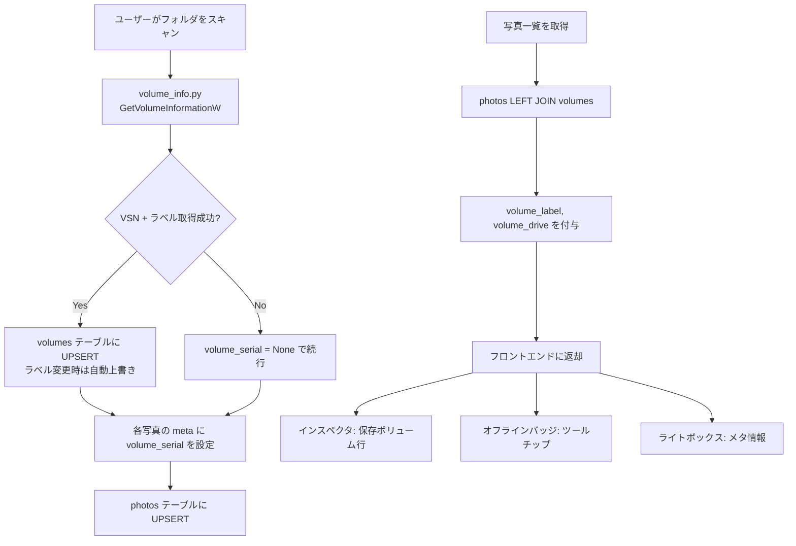

# ウォークスルー: ボリュームラベル表示機能

## 概要

リンク切れ（オフライン）画像の元保存場所を特定するために、**ボリュームシリアル番号（VSN）を安定キーとしたボリューム情報管理機能**を実装しました。

## 変更ファイル一覧

| ファイル | 変更内容 |
|---------|---------|
| [volume_info.py](file:///r:/photo-manager/server/volume_info.py) | **[NEW]** Windows API でボリューム情報を取得するユーティリティ |
| [database.py](file:///r:/photo-manager/server/database.py) | `volumes` テーブル新設 / `photos.volume_serial` カラム追加 / CRUD関数追加 / `get_photos` に LEFT JOIN追加 |
| [scanner.py](file:///r:/photo-manager/server/scanner.py) | スキャン時にボリューム情報取得→DB登録→各写真に紐付け |
| [raw_loader.py](file:///r:/photo-manager/server/raw_loader.py) | RAWメタデータに `volume_serial` フィールド追加 |
| [app.py](file:///r:/photo-manager/server/app.py) | `GET /api/volumes` エンドポイント追加 / import追加 |
| [index.html](file:///r:/photo-manager/frontend/index.html) | インスペクタに「保存ボリューム」行を追加 |
| [app.js](file:///r:/photo-manager/frontend/js/app.js) | インスペクタ・オフラインバッジ・ライトボックスにボリューム情報表示 |

## データフロー



## ラベル自動更新の仕組み

1. スキャン時にドライブの VSN とラベルを取得
2. `volumes` テーブルに `ON CONFLICT DO UPDATE` で UPSERT
3. **ラベルを変更しても、次にそのドライブをスキャンした時点で自動反映**
4. VSN は変わらないので、古い写真のレコードも最新ラベルで表示される

## 検証結果

| テスト項目 | 結果 |
|-----------|------|
| `get_volume_info()` でR:ドライブのVSN取得 | ✅ `{'serial': '91C96AC8', 'label': '', 'drive': 'R:'}` |
| `initialize_database()` でマイグレーション実行 | ✅ エラーなし |
| `photos` テーブルに `volume_serial` カラム存在確認 | ✅ |
| `volumes` テーブルのスキーマ確認 | ✅ `[volume_serial, volume_label, drive_letter, last_seen_at]` |

## 次の手順

アプリを再起動して、フォルダを再スキャンすれば既存写真にもボリューム情報が記録されます:

```
r:\photo-manager\python\python.exe r:\photo-manager\run.py
```

スキャン後、インスペクタの「保存ボリューム」行にラベルが表示されるようになります。
