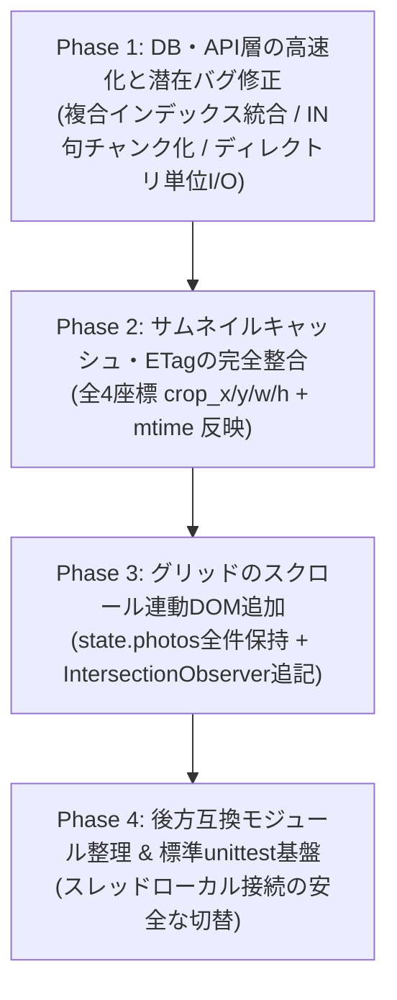

# 大規模化・パフォーマンス改善における相互影響検証と安全設計計画 (v2.20+)

本ドキュメント（Knowledge Item）は、Photo Manager (v2.20時点) の内部技術課題（大量枚数表示、SQLクエリ・I/Oコスト、サムネイルキャッシュ、モジュール分割、自動テスト）を改善するにあたり、**「ある部位の最適化が他の部位にバグ（退行）やパフォーマンス悪化を引き起こさないか」**を実コードに基づいて徹底検証した設計指針である。

今後、パフォーマンス改善やリファクタリングを行うAIエージェントは、必ず本ドキュメントの**「禁止アンチパターン」**と**「安全実装仕様」**に従うこと。

---

## 1. 相互影響・副作用の検証マトリクス（禁止アンチパターン）

一見すると正しそうな一般的な高速化手法であっても、Photo Manager 独自の機能（3種レイアウト、スタック、ポータブルパス解決、非破壊クロップ、スレッドローカルDB接続）と干渉し、重大なバグや逆効果を生むものが存在する。以下の **7つのアンチパターンは採用禁止** とする。

| # | 対象領域 | ❌ やってはいけないアンチパターン | 💥 引き起こされるバグ・他部位への悪影響 |
|---|---|---|---|
| **1** | グリッド描画 | **DOM破棄型仮想スクロール (Virtual Windowing) や API細切れページネーションの導入** | 1. **びっしりモード (`layout-masonry`) の崩壊**: 可変アスペクト比の Flexbox (`flex-grow: 1`) で行折り返しを計算しているため、画面外のDOMを破棄するとスクロールのたびに行の折り返し位置がズレて画面が激しく跳ねる。<br>2. **全選択 (`Ctrl+A`)・スライドショーの退行**: `state.photos` が細切れになると、`selectAllPhotos()` で未スクロール分の写真が選択から漏れ、スライドショーのシャッフル再生も全件対象にならなくなる。 |
| **2** | DB取得上限 | **`get_photos(limit=5000)` の上限値だけを単純に `50000` 等へ引き上げる** | `server/database/photos.py` 内のタグ取得・スタック取得で `WHERE photo_id IN (?, ?, ...)` を発行しているため、SQLite のバインド変数上限（`SQLITE_MAX_VARIABLE_NUMBER = 32766`）を超えた瞬間に **`sqlite3.OperationalError: too many SQL variables` でクラッシュ**する。 |
| **3** | 重複写真集計 | **`duplicate_count` を `photos` テーブルの物理カラムに事前計算キャッシュする** | 写真の増減ルートは7箇所（スキャン、単一削除、一括削除、フォルダ管理解除、リンク消失化、リンク消失パージ、`carry` クリーンアップ）存在する。1箇所でも再計算が漏れると「重複が解消されたのに切り欠き（ドッグイヤー）や重複バッジが永遠に消えない」不整合バグが発生する。 |
| **4** | インデックス | **既存の `idx_photos_date_taken` を残したまま `(date_taken, file_size)` インデックスを追加する** | SQLite B-Tree の左端プレフィックス（Leftmost Prefix）により `date_taken` が完全な二重インデックスとなり、**スキャン時 (`upsert_photos_batch`) の書き込み速度低下**と `.cache/library.db` の容量肥大化を招く。 |
| **5** | オンライン判定 | **`api_photos()` の個別 `os.path.exists` を単純な `os.listdir(p["directory_path"])` に置き換える** | USBポータブル運用でドライブレターが変動（例: `D:` → `E:`）した際や `photos/` 相対配置時に、DB上の旧 `directory_path` を直接参照してしまい、**全写真が「未接続・ファイル消失」と誤判定される**。 |
| **6** | サムネイル配信 | **現状のまま `Cache-Control: immutable` を付与する、または `/api/thumbnails/batch` (Base64) をグリッドで使う** | 1. **クロップ平行移動時のキャッシュ残りバグ**: 現行の `getThumbnailUrl()`（`common.js`）は `crop_x, crop_w` のみ、サーバー側 ETag（`app.py`）は `crop_w, crop_h` のみで、`crop_y` 等が欠落している。比率固定のままクロップ枠を上下移動するとURLもETagも変わらず、古いサムネイルが一生更新されなくなる。<br>2. **Base64バッチの逆効果**: データ量が1.33倍に増え、ブラウザのネイティブHTTPキャッシュが効かずJSヒープを圧迫してGCカクつきを起こす。 |
| **7** | 自動テスト | **`:memory:` の指定や、`connection.DB_PATH` の書き換えだけでテストを実行する** | `server/database/connection.py` はスレッドローカル（`_local_db.connection`）に接続をキャッシュしている。`_local_db.connection` を閉じてリセットしない限り、**既存の接続が再利用されて本番の `.cache/library.db` を直接破壊する**。また `:memory:` は別スレッドから見えるテーブルが消滅する。 |

---

## 2. ブラッシュアップした安全な改善計画（Phase 1 〜 Phase 4）

他部位のパフォーマンスを1ミリも落とさず、既存の全機能（3種レイアウト、選択、スタック、ポータブル解決、非破壊調整）と100%整合する実装仕様を以下に定義する。



---

### Phase 1: DB・API層の高速化と潜在バグ修正

#### 1.1 インデックスの統合置換（スキャン書き込み速度の維持 ＆ 一時B-Tree排除）
- **対象**: `server/database/schema.py` (`initialize_database`)
- **施策**:
  - 単一カラムの `idx_photos_date_taken` を `DROP INDEX IF EXISTS idx_photos_date_taken` で廃止し、複合カバリングインデックス `CREATE INDEX IF NOT EXISTS idx_photos_date_size_unlinked ON photos(date_taken, file_size, is_unlinked)` に統合する。
- **検証 & SQLiteオプティマイザの注意点**:
  - インデックス総数が増えないため、`scanner.py` の `upsert_photos_batch()` の書き込み性能は一切劣化しない。
  - 左端カラムが `date_taken` のため、既存の `ORDER BY date_taken` や `WHERE date_taken` はそのままインデックスが効く。
  - **重要**: 重複集計サブクエリの `WHERE` 条件で `(is_unlinked IS NULL OR is_unlinked = 0)` と書くと、SQLiteオプティマイザが `idx_photos_is_unlinked` の `MULTI-INDEX OR` を選択してしまい、`GROUP BY date_taken, file_size` のために `USE TEMP B-TREE FOR GROUP BY` が発生する。**必ず `IFNULL(is_unlinked, 0) = 0` と記述すること**で、`idx_photos_date_size_unlinked` の **完全な Covering Index 走査（一時B-Treeゼロ）** が強制される。

#### 1.2 重複判定SQLの条件統一（件数不一致バグの解消）
- **対象**: `server/database/photos.py` (`get_photos`, `get_duplicate_photos_count`), `server/database/duplicates.py` (`get_duplicate_photo_ids`, `get_all_duplicate_groups`, `get_duplicates_for_photo`)
- **発見された問題**:
  - 現行の `get_photos()` 内の `dup` サブクエリおよび `get_duplicate_photos_count()` / `duplicates.py` の内側サブクエリに `is_unlinked` 除外条件が入っていなかったため、片方がリンク消失（`is_unlinked = 1`）となった写真ペアが重複として残り続け、サイドバーの「📋 重複のある写真」のバッジ件数と実際の表示枚数が食い違う問題があった。
- **施策**:
  - すべての重複集計サブクエリ・検索クエリの `WHERE` 条件に `AND IFNULL(is_unlinked, 0) = 0` を統一適用する。

#### 1.3 `IN (...)` クエリのチャンク分割（上限突破時のクラッシュ防止）
- **対象**: `server/database/photos.py` (`get_photos`, `get_missing_photos`)
- **施策**:
  - `photo_ids` からタグ一覧（`photo_tags`）およびスタックメンバー（`photos`）を取得する際、`photo_ids` / `active_stack_ids` を **900件ずつのチャンク** に分割してクエリを実行する。
  - これにより、将来 `limit` を 10,000〜50,000 件に引き上げても `sqlite3.OperationalError: too many SQL variables` エラーが絶対に発生しない。

#### 1.4 `api_photos()` におけるファイル存在確認（`is_missing`）のディレクトリ単位バッチ化
- **対象**: `server/app.py` (`api_photos`)
- **現状のボトルネック**:
  - 毎回最大5,000枚に対してループ内で個別に `resolve_portable_path(file_path)` と `os.path.exists()` を呼んでおり、最大5,000回の `stat` システムコールが発生している。
- **施策（ポータブル性を壊さない2段階判定）**:
  1. `dir_path` ごとに `resolved_dir, is_dir_online = resolve_portable_path(dir_path)` を1回だけ実行し、オンラインなら `os.scandir(resolved_dir)` の結果を小文字正規化した `set`（`dir_files_cache[dir_path]`）としてリクエスト内キャッシュする。
  2. 各写真の `file_name.lower()` が `dir_files_cache[dir_path]` に含まれていれば、**個別 `stat` なしで即座に `is_missing = False` と判定**する。
  3. セットに含まれない場合のみ（`photos/` 直下配置などの特殊フォールバックケース、または本当に削除されたケース）、個別の `resolve_portable_path(file_path)` + `os.path.exists()` を実行して最終確認する。
- **効果**:
  - ポータブルパス解決のフォールバック仕様を100%維持したまま、通常時のディスクI/O回数を **5,000回 → フォルダ数回（数十〜数百倍高速）** に削減できる。

---

### Phase 2: サムネイルキャッシュ・ETagの完全整合

#### 2.1 クロップ全4座標（`x, y, w, h`）と更新時刻の反映
- **対象**:
  - フロントエンド: `frontend/js/common.js` (`getThumbnailUrl`), `frontend/js/selection.js` (`refreshSelectedThumbnails`)
  - バックエンド: `server/app.py` (`api_get_thumbnail`)
- **施策**:
  - `getThumbnailUrl(photo)` のキャッシュバスター文字列に `crop_x`, `crop_y`, `crop_w`, `crop_h` の全4座標、`file_mtime`、および手動更新用の `photo._thumbBust` を含める。
  - `server/app.py` の `api_get_thumbnail()` の `etag_val` にも `cx_part`, `cy_part`, `cw_part`, `ch_part` の全4座標を含める。
  - 手動の「🔄 サムネイル更新」実行時（`selection.js`）は、対象 `photo._thumbBust = Date.now()` をセットして `getThumbnailUrl(photo)` で `` を更新する。

---

### Phase 3: DBアスペクト比によるプレースホルダ事前サイズ確定 ＆ スクロール連動DOMチャンク追加

#### 3.1 DBメタデータを用いたプレースホルダ寸法の事前確定（びっしりモード等のガタつき完全解消）
- **対象**: `frontend/js/common.js` (`getPhotoAspectInfo`), `frontend/js/app.js` (`createPhotoCard`, `onThumbImageLoad`), `frontend/js/adjust.js` (`applyTransformToPhotoViews`), `frontend/css/style.css`
- **発見されたバグと仕組み**:
  - `thumbnails` テーブルの `thumb_width` / `thumb_height` は、`server/scanner.py` (`refresh_photo_thumbnail_transform`) によって **既に EXIF Orientation・`rotation`（90°/270°）・`crop`（トリミング）がすべて反映された後の寸法** が格納されている。
  - しかし旧 `createPhotoCard()` では、`photo.thumb_width` を使った場合でも無条件に `if (photo.rotation === 90 || photo.rotation === 270)` で縦横を入れ替えていたため、回転済み写真のプレースホルダが画像ロード完了まで「逆向きのアスペクト比」になり、画像ロード時にガタッとレイアウトが跳ねる原因になっていた。
- **安全実装仕様 (`getPhotoAspectInfo(photo)`)**:
  1. `photo.thumb_width > 0 && photo.thumb_height > 0` が存在する場合は、すでに回転・クロップ適用済みであるためそのまま使用する（二重回転させない）。
  2. サムネイル未生成（またはクライアント上で回転・クロップ直後）の場合は、`photo.width` / `photo.height` から開始し、`rotation === 90 || rotation === 270` なら縦横を入れ替え、さらに `crop_w > 0 && crop_h > 0` があれば乗算して正確な表示寸法を算出する。
  3. カード生成時に `--photo-aspect: ${w} / ${h}` と数値比率 `--photo-aspect-ratio: ${(w / h).toFixed(4)}` の両方を `.photo-card` にセットする。
  4. `frontend/css/style.css` の `body.layout-masonry .photo-card` に `contain-intrinsic-size: auto calc(var(--thumbnail-size, 230px) * var(--photo-aspect-ratio, 1.5)) var(--thumbnail-size, 230px);` を設定する。これにより、画像がまだ1バイトも読み込まれていない状態（および `content-visibility: auto` の画面外プレースホルダ状態）でも、**最終的な写真と1ピクセルも違わないサイズでプレースホルダが事前確保**され、スクロール時のガタつき（Layout Shift）がゼロになる。

#### 3.2 データ全件保持 ＋ スクロール連動DOMチャンク追加 (`renderPhotoGrid`)
- **対象**: `frontend/js/app.js` (`renderPhotoGrid`, `appendPhotoGridChunk`, `ensureCardsRenderedUpTo`, `checkAndAppendGridChunksIfNeeded`, `removePhotoFromView`)
- **設計原則**:
  - **`state.photos` にはフィルタに合致した全写真オブジェクトを保持し続ける**。これにより、`Ctrl+A` 全選択、インスペクタ一括編集、スライドショー、ライトボックスの前後移動・フィルムストリップ、件数バッジは既存コードのまま100%無傷で動作する。
  - **`elements.photoGrid` へのDOM挿入のみを「スクロール連動チャンク追加」にする**：
    1. `renderPhotoGrid()` 呼び出し時は、まず先頭 `GRID_INITIAL_CHUNK = 200` 枚を即座にDOMへ同期挿入する（従来の5,000枚全件rAF無限ループによるバックグラウンドCPU・DOM圧迫を廃止）。
    2. スクロールコンテナ（`.photo-grid-container`）の `scroll` / `resize` イベントおよびサムネイルサイズ変更・レイアウトモード変更時に `checkAndAppendGridChunksIfNeeded()` を呼び、下端から `900px` 以内に近づいたら次の `GRID_CHUNK_SIZE = 200` 枚を `DocumentFragment` で追記する。
    3. `removePhotoFromView(photoId)` 実行時は、全再描画を行わず `renderedGridCount` をデクリメントして該当カードのみをDOMから除去し、後続の `dataset.index` を振り直す。

---

### Phase 4: 後方互換を維持したモジュール整理 & 自動回帰テスト基盤

#### 4.1 副作用ゼロのモジュール整理原則
1. **`frontend/css/style.css` は分割しない**:
   - CSSの `@import` 分割はHTTPリクエスト増加とセレクタ優先順位（詳細度）の事故を招くため単一ファイルを維持し、ファイル冒頭にセクション目次コメントを整備する。
2. **`server/database/` の分割は `__init__.py` の再エクスポートで隠蔽する**:
   - `server/database/photos.py` から GPS操作（`gps.py`）や画像調整操作（`adjustments.py`）を切り出す際は、必ず `server/database/__init__.py` で同じ関数名を export し、`server/app.py` や `server/scanner.py` 側の import 文を一切壊さない。
3. **`frontend/js/` の分割はローカル変数の共有がない単位に限定する**:
   - バンドラを使わない `<script>` 順次読み込み構造のため、複数ファイルから参照される状態は必ず `common.js` の `state` オブジェクトに格納する。

#### 4.2 ポータブルPython標準 `unittest` による安全な回帰テスト基盤
- **対象**: 新規 `tests/` ディレクトリ（`build_dist.bat` の配布対象からは除外）
- **設計原則**:
  - 外部パッケージ（`pytest` 等）の追加インストールを不要とするため、Python標準ライブラリの `unittest` で統一する。
  - **【最重要】本番DB保護のための接続切替プロトコル**:
    `server/database/connection.py` に以下のテスト用接続リセット関数を用意（またはテスト基底クラスで制御）し、本番の `.cache/library.db` に1バイトも触れないことを保証する：
    ```python
    def switch_database_path(new_path: Path) -> None:
        """テスト・ベンチマーク用: スレッドローカル接続を安全に閉じてDBパスを切り替える"""
        global DB_PATH
        conn = getattr(_local_db, "connection", None)
        if conn is not None:
            try:
                conn.close()
            except Exception:
                pass
            _local_db.connection = None
        DB_PATH = new_path
    ```
  - **優先テスト対象**:
    1. `_directory_filter_sql()` の境界値テスト（ドライブ直下 `C:\`、アンダースコア `_` 含有フォルダ名、大文字小文字、再帰/非再帰）。
    2. `recalculate_stacks()` の3段階スタック判定テスト（RAW+JPGペア、露出ブラケット、高速連写、Exifなし同一秒の連写化阻止、重複スタック）。
    3. `filter_exif_data()` の5分類Exif選択消去テスト（全維持、GPSのみ消去、露出消去、カメラ情報消去、全消去）。
    4. `parse_filename_datetime()` の日時推測テスト。
