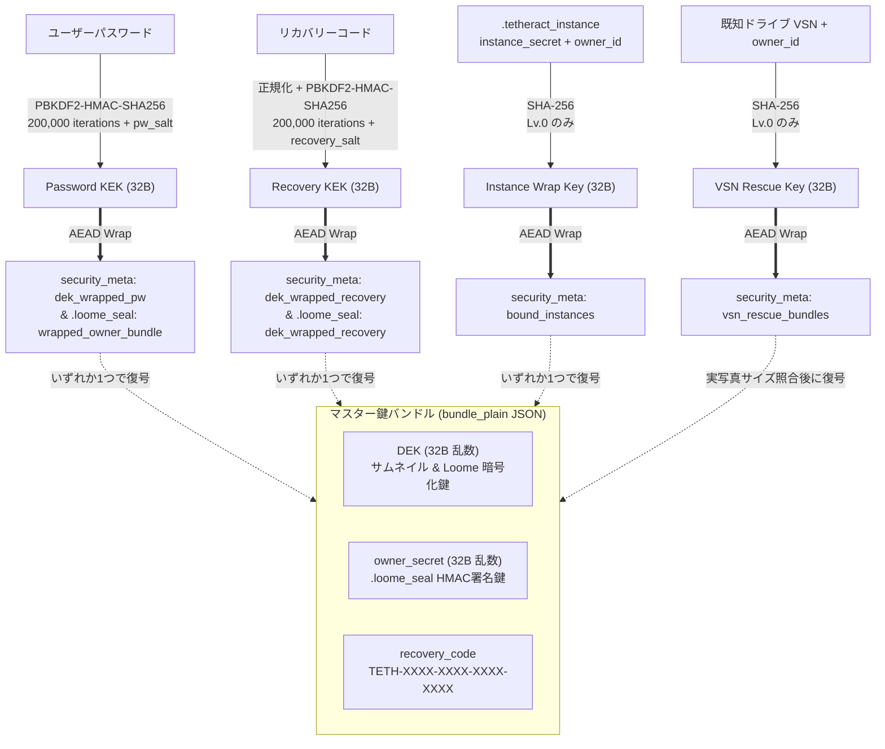

# セキュリティアーキテクチャ ＆ 3段階エシカル保護設計書 (Security & Ethical Protection Architecture)

本ドキュメントは、Tetheract Photo Manager のセキュリティ設計原則、ネットワーク多層防御（Defense in Depth）、**v1.7.0 で導入された3段階セキュリティ＆エシカル保護モデル（Lv.0 / Lv.1 / Lv.2）**、および鍵ロスト（セルフブリック）を100%防ぐフェイルセーフ設計仕様を定義する。

---

## 1. 概要と設計思想

Tetheract Photo Manager は、USBメモリやポータブルSSDで持ち歩ける完全スタンドアロンの写真管理ツールであり、内部で Python (FastAPI/Uvicorn) によるローカルHTTPサーバーを起動し、ブラウザ（Edge / Chrome の `--app` モード）をUIとして利用している。

そのため、本ツールのセキュリティは以下の**2つの軸**を両立するよう設計されている：
1. **ローカルWebサーバーとしてのネットワーク防御**（DNS Rebinding、CSRF、同一LAN内からの不正侵入、XSS、DoSの遮断）
2. **ポータブル写真管理ツールとしての物理・データ保護とエシカル（倫理的）配慮**（他人の `Loome` ドライブの無断閲覧・上書き防止、`library.db` 単体引き抜きによるサムネイル盗み見防止、パスワードによる起動・DB・`Loome` カプセル化ロック、およびUSB故障やDB誤削除時の確実な救済・自己修復）

### 想定脅威モデル (Threat Model)

| 分類 | 脅威 | 攻撃・事故経路 | 想定される被害 | 本ツールの防御・救済策 |
| :--- | :--- | :--- | :--- | :--- |
| **Network** | **DNS Rebinding** | 悪意ある外部Webサイト閲覧中、ドメイン名が `127.0.0.1` へ再解決される | 同一オリジンとみなされ、ブラウザ経由でローカル写真やメタデータが外部送信される | **厳格な Host ヘッダ検証**（IPリテラル/localhost以外は即座に `400` 遮断） |
| **Network** | **CSRF / 不正Origin** | 悪意ある外部サイトや同一LAN他ホストからの `fetch` / `POST` 要求 | PCシャットダウン、写真削除、設定変更等の不正操作 | **Origin ヘッダ検証**（ループバックまたは同一Host以外は `403` 遮断） |
| **Network** | **LAN経由の不正アクセス** | 同一Wi-Fi環境内の第三者端末からのアクセス | 写真の不正閲覧、PCファイル削除、フォルダ操作 | **ランダムトークン認証** ＋ **APIホワイトリスト** ＋ **30分無通信自動停止** |
| **Web UI** | **XSS / DoS** | 悪意あるEXIF情報・ボリューム名・ファイル名、巨大XMP読込 | スクリプト実行やメモリ枯渇 (OOM) | **`escapeHtml()` 徹底サニタイズ** ＋ **サイズ上限** (XMP 5MB, Upload 32MB) |
| **Ethical / Physical** | **他人の `Loome` 接続** | 友人や同僚から借りた外付けSSD/USB内に相手の `Loome` がある | 意識せず他人の保管庫を覗き見たり、自分のDBに取り込んだり、上書き作成してしまう | **Lv.0 エシカル保護**: `.loome_seal` 電子刻印＆非空検知により閲覧・ドライブ管理登録・Loome作成を完全拒否（別PCの自分のLoomeは同一パスワード/復旧コードで承認可） |
| **Physical** | **`library.db` 単体引き抜き** | `cache/library.db` だけをコピーして別のTetheract環境へ差し替える | SQLite 内の `thumbnails` BLOB やメタデータをそのまま閲覧される | **Lv.0 個体鍵ペアリング**: 本体 `.tetheract_instance` 不一致時は `db_foreign_locked`（`423 Locked`）で遮断。Lv.1/Lv.2 ではサムネイルBLOB自体をAEAD暗号化＋`VACUUM`平文消去 |
| **Physical** | **USB紛失・PC覗き見** | ポータブルSSD/USBの紛失、または離席中のアプリ起動・エクスプローラー直接閲覧 | アプリを開かれたり、OSのエクスプローラーから `Loome/` 内の写真を直接見られる | **Lv.1 起動＆DBロック** ／ **Lv.2 フルロック（`Loome` 先頭64KBカプセル化 `TETHVLT1`）** ＋ ヘッダーの「今すぐロック」ボタン |
| **Lifecycle** | **本体USB故障・DB誤削除・差分VerUP** | 本体USBの破損、Lv.2運用中の `library.db` 誤削除、ZIPアップデート時のファイル上書き | 暗号化キー（`DEK`）が行方不明になり、自分の写真まで永久に復号不能（セルフブリック）になる | **3つの救済手段（PW / 所有メディアVSN＋実写真照合 / リカバリーコード）** ＋ **`Loome/.loome_seal` からの鍵自動サルベージ＆履歴保護** ＋ **差分ZIPでの鍵領域完全除外** |

---

## 2. ネットワーク多層防御アーキテクチャ (Layer 1〜4)

```text
[クライアント要求 (ブラウザ / スマホ)]
             │
             ▼
  ┌────────────────────────────────────────────────────────┐
  │ Layer 1: Host ヘッダ検証 (DNS Rebinding 防御)            │
  │   - 127.0.0.1 / localhost / [::1] / PC自身のLAN IP のみ │
  └──────────────────────────┬─────────────────────────────┘
                             │ 合格
                             ▼
  ┌────────────────────────────────────────────────────────┐
  │ Layer 2: Origin ヘッダ検証 (CSRF 遮断)                  │
  │   - ループバック または Origin == Host の同一オリジンのみ│
  └──────────────────────────┬─────────────────────────────┘
                             │ 合格
                             ▼
  ┌────────────────────────────────────────────────────────┐
  │ Layer 3: LAN トークン認証 (セッション保護)               │
  │   - ループバック (PC自身) はパス                         │
  │   - LAN端末は有効な QRトークン / HttpOnly Cookie が必須  │
  └──────────────────────────┬─────────────────────────────┘
                             │ 合格
                             ▼
  ┌────────────────────────────────────────────────────────┐
  │ Layer 4: LAN API ホワイトリスト (最小権限)               │
  │   - スマホ閲覧・評価・タグ付け等の安全APIのみ許可         │
  │   - PC管理・削除・セキュリティ設定APIは 403 遮断          │
  └──────────────────────────┬─────────────────────────────┘
                             │ 合格
                             ▼
  ┌────────────────────────────────────────────────────────┐
  │ Layer 5: 起動ロック＆エシカル保護ゲート (v1.7.0)          │
  │   - is_app_locked() 時は解錠用API以外すべて 423 Locked   │
  │   - 他人の Loome ドライブへのアクセスは 403 PermissionErr│
  └──────────────────────────┬─────────────────────────────┘
                             │ 合格
                             ▼
  [FastAPI エンドポイント処理 (ファイルI/O・DB操作)]
```

### Layer 1: Host ヘッダ検証 (`server/lan_access.py`)
同一オリジンGETリクエストはブラウザが `Origin` ヘッダを送出しないため、悪意ある外部WebサイトがDNS Rebinding（攻撃者ドメインのAレコードを `127.0.0.1` へ動的変更）を行うと Origin 検証をすり抜ける。
これを防ぐため、HTTPの `Host` ヘッダが `localhost` または許可されたIPアドレスリテラル（`127.0.0.1`, `::1`, 検出されたPC自身のLAN IP）である場合のみ通信を許可し、それ以外のドメイン名は直ちに `HTTP 400 Bad Request` で破棄する。

### Layer 2: Origin ヘッダ検証 (`server/app.py`)
- `Origin` が存在する場合、ループバック（`127.0.0.1` / `localhost` / `[::1]`）か、リクエストの `Host` ヘッダと一致する同一オリジンのみ許可する。
- プライベートLANのIP帯を一括許可しないことで、同一LAN上の他ホストで開かれたページから `127.0.0.1` 宛ての破壊系APIを呼ばれる攻撃を完全に防ぐ。
- `Origin: null`（単体モバイルHTML `Tetheract_Mobile.html`）は `_NULL_ORIGIN_ALLOWED_PATHS` の同期系APIのみ許可する。

### Layer 3 & 4: LAN接続トークン認証 ＆ LAN API ホワイトリスト (`server/lan_access.py`)
- アプリ起動直後は `127.0.0.1:8088` のみで待ち受け、ユーザーが「スマホ連携」モーダルを開いた時のみセカンダリUvicornスレッドがLAN IPでリッスンを開始する（30分無通信で自動停止）。
- QRコード内のランダムトークン（`secrets.token_urlsafe(18)`）による `HttpOnly; SameSite=Lax` Cookie 認証を必須とし、かつホワイトリスト（`_LAN_API_EXACT` / `_LAN_API_PATTERNS`）に登録されたスマホ閲覧・選別用API以外はすべて `HTTP 403 Forbidden` で遮断する。

---

## 3. 3段階セキュリティ＆エシカル保護アーキテクチャ (v1.7.0)

実装の中核は [`server/security.py`](../../server/security.py) に集約されている。外部のC拡張暗号ライブラリに依存せず、Python標準搭載の OpenSSL C実装（`hashlib.pbkdf2_hmac`, `hashlib.shake_256`, `hmac.digest`, `secrets`）のみで高速かつポータブルな認証付き暗号（Encrypt-then-MAC AEAD）を実現している。

### 3.1 3つのセキュリティレベル比較

| 機能・保護項目 | **Lv.0: エシカルモード**（既定・PW不要） | **Lv.1: 起動＆DBロック**（PW必要） | **Lv.2: フルロック**（PW必要） |
| :--- | :---: | :---: | :---: |
| **他人の `Loome` ドライブ完全拒否**（閲覧・ドライブ登録・Loome作成不可） | **有効（常時）** | **有効** | **有効** |
| **別PCの自分の `Loome` のパスワード／復旧コード承認** | **有効** | **有効** | **有効** |
| **`library.db` 単体引き抜き検知ロック**（`.tetheract_instance` ペアリング） | **有効** | **有効** | **有効** |
| **アプリ起動時のパスワードロック画面（全データAPI `423 Locked` 遮断）** | なし（ペアリング一致時は即時起動） | **有効** | **有効** |
| **DB内サムネイルBLOB (`thumbnails.data`) の AEAD 暗号化 ＋ `VACUUM` 平文消去** | 平文WebP | **有効 (`TENC\x01`)** | **有効 (`TENC\x01`)** |
| **`Loome` 内画像・RAWファイルの先頭64KBカプセル化暗号化**（OS直接閲覧遮断） | 無加工（平文） | 無加工（平文） | **有効 (`TETHVLT1`)** |
| **スマート・テイクアウト／外部書き出し時の元ファイル1ビット完全復元** | そのまま出力 | そのまま出力 | **自動復号して無加工出力** |
| **本体USB故障時の救済手段** | ①所有メディアVSN＋実写真照合<br>②リカバリーコード | ①パスワード<br>②リカバリーコード | ①パスワード<br>②リカバリーコード |

---

### 3.2 2段階鍵階層（DEK / KEK）と暗号化フォーマット

パスワード変更時に数万枚のサムネイルや `Loome` ファイルを再暗号化する必要がないよう、**2段階鍵方式（Two-Tier Key Wrapping）**を採用している。



1. **AEAD 暗号プリミティブ (`aead_encrypt` / `aead_decrypt`)**:
   - **暗号化**: 16バイト乱数 `nonce` と 32バイト鍵から `SHAKE256(key + nonce + b"TETH_ENC_V1")` でキーストリームを生成し、C実装の多倍長整数XOR（`_xor_bytes`）で高速に暗号化。
   - **認証 (Encrypt-then-MAC)**: `mac_key = SHAKE256(key + nonce + b"TETH_MAC_V1").digest(32)` を導出し、`HMAC-SHA256(mac_key, magic(5B) + nonce(16B) + aad + ciphertext)` の32バイトタグを付与し、`hmac.compare_digest` で定数時間検証する。
   - **バイナリ構造**: `THUMB_ENC_MAGIC (b"TENC\x01", 5B)` + `nonce (16B)` + `mac (32B)` + `ciphertext`（ヘッダ計53バイト）。

2. **サムネイルBLOB暗号化 (`encrypt_thumbnail_blob` / `decrypt_thumbnail_blob`)**:
   - `thumbnails.data` カラムに対して上記の AEAD 暗号化を適用する。
   - **固定 AAD (`THUMB_AAD = b"TETH_THUMB_V1"`) の採用**: 重複写真の統合や `Loome` インポート時に SQL で `thumbnails.data` が古い `dup_id` から新しい `primary_id` へ直接コピーされても復号エラーにならないよう、固定 AAD を使用する（復号時は `THUMB_AAD` ➔ `str(photo_id)` ➔ `b""` の順で後方互換フォールバック検証を行う）。
   - Lv.0 から Lv.1/Lv.2 への移行時、全サムネイルを暗号化した直後に `vacuum_database()` を実行し、SQLite のフリーリストや旧ページに残った平文サムネイルの痕跡をディスクから完全消去する。

3. **Lv.2 `Loome` ファイルカプセル化 (`seal_loome_file` / `unseal_loome_file`)**:
   - 数十MBのRAWファイル全体を書き換えるとI/O負荷が大きいため、画像・RAWヘッダおよびプレビュー構造が含まれる**先頭最大 64KB（65,536 bytes）のみをインプレースでストリーム暗号化**する。
   - **ディスク上のカプセル化構造**:
     - **先頭 8 bytes**: `VAULT_MAGIC`（`b"TETHVLT1"`）に置換（OSのエクスプローラーや外部画像ビューアからは未知のバイナリとして認識され直接閲覧が遮断される）。
     - **9 byte 目 〜 `min(orig_size, 65536)`**: `SHAKE256(dek + nonce + b"VAULT_ENC_V1")` による暗号文。
     - **末尾 72 bytes フッター**:
       `cipher_head8 (8B)` + `nonce (16B)` + `mac (32B)` + `orig_mtime_ns (uint64 LE, 8B)` + `VAULT_MAGIC (b"TETHVLT1", 8B)`
   - **メタデータ透過性**:
     - カプセル化および解除の直後に `os.utime(p, ns=(orig_atime_ns, orig_mtime_ns))` で元のタイムスタンプを1ナノ秒単位で復元する。
     - `get_logical_file_size(path)` が末尾72バイトを除いた元のファイルサイズを返すため、DB上の `file_size` や重複判定キー（`content_key`）が変化しない。
     - `server/scanner.py` の `compute_file_sample_hash()` および `has_exif_datetime()` もカプセル化ファイルを検知すると `read_loome_file_decrypted_bytes()` 経由で復号バイト列を参照するため、**平文時と1ビットの狂いもない同一ハッシュ値**を算出する。

---

### 3.3 Lv.0 エシカル保護：「他人の `Loome`」完全拒否と自前 `Loome` 承認

1. **電子刻印 `.loome_seal` と所有権判定 (`inspect_drive_loome_ownership`)**:
   - Tetheract が `Loome` を作成・更新する際、`<Drive>:\Loome\.loome_seal`（隠し属性）に `owner_id`、`vsn`、`seal_mac = HMAC-SHA256(owner_secret, f"{owner_id}:{vsn}:LOOME_SEAL_V1")`、およびパスワードラップ／リカバリーコードラップを書き込む。
   - 外付けドライブが接続された際、`<Drive>:\Loome` を検査し以下の3状態で判定する：
     - `"none"`: そのドライブに `Loome` フォルダが存在しない（制限なし）。
     - `"own"`: `.loome_seal` の `owner_id` と `seal_mac` が自DBと一致する、または自DBの `volumes` / `photos` / `scan_roots` に登録履歴がある既存 `Loome`（アクセス許可）。
     - `"foreign"`: 異なる `owner_id` の `.loome_seal` がある、または `.loome_seal` が無く自DBに登録履歴もないのに中にファイルが存在する（**他人の `Loome` としてエシカル保護ロック発動**）。
2. **エシカル保護ロック時の遮断範囲**:
   - 左サイドバーの `Loome` ツリーおよび `Folder` ツリーに `🔒 他環境のLoome（保護中）` バッジを表示。
   - そのドライブ内の `Loome` の閲覧、そのドライブ全体またはサブフォルダの「フォルダの管理登録（スキャン）」、およびそのドライブへの「新規 `Loome` 作成」を API（`assert_drive_not_blocked_by_foreign_loome`）と UI の双方で完全に拒否する。
3. **別PCで作成した自分の外付け `Loome` の承認 (`unlock_foreign_loome_with_password`)**:
   - 自宅PCと外出先ノートPCなど、別の Tetheract 環境で作った自分の外付け `Loome` を接続した場合は、ロック案内モーダル（`#foreignLoomeUnlockModal`）から**設定していたパスワードまたはリカバリーコード**を入力することで、`.loome_seal`（および `previous_seals` 履歴）内のバンドルを復号して正当なオーナーであることを証明できる。
   - 承認成功時は、もし外付け `Loome` 内のファイルが旧環境の `foreign_dek` で Lv.2 カプセル化されていれば自動的に現環境の `DEK` へ再カプセル化（または平文復元）してシームレスに統合する。

---

### 3.4 起動シーケンス安全化とレースコンディション防止

起動時やマイグレーション時にロックエラーや DB 競合（`SQLITE_BUSY`）で起動不能になることを防ぐため、以下の順序制御を徹底している：

1. **バックグラウンドタスクの待機**:
   - `server/app.py` の起動時レンズ情報補完スレッド（`_bg_backfill_lenses`）は、`is_app_locked()` が `False` になるまで最大300秒待機してから動作を開始する（起動直後の `VACUUM` やロック解除処理とDBロックが競合しない）。
2. **`vacuum_database()` 時の全スレッド接続一斉クローズ**:
   - `server/database/connection.py` で全スレッドの SQLite 接続を `_all_connections` セットで追跡し、`vacuum_database()` 実行前に `close_all_connections()` で全スレッドのキャッシュ接続を確実に閉じてから単一接続で `VACUUM` を実行する。
3. **フロントエンド起動ロックゲート (`initSecurityGateOnStartup`)**:
   - `frontend/js/app.js` の `DOMContentLoaded` では、**最初に `await window.initSecurityGateOnStartup()` を実行してロックが完全に解除されるまで待機**し、解除完了後に初めて `initStorageFolders()`, `initFolderTree()`, `loadPhotos()`, メディアSSE購読（`/api/media/events`）を開始する。

---

## 4. フェイルセーフ ＆ セルフブリック（鍵ロスト）完全防止設計

Red Team（破壊的セキュリティ・アップデート批判）と Blue Team（ポータブル運用・ライフサイクル保護）の相互監査に基づき、ユーザーの誤操作・アップデート・電源断によって暗号化鍵（`DEK`）が失われる経路をすべて遮断している。

### ① 差分VerUP (`Tetheract_vX.Y.Zdiff.zip`) による鍵上書きの完全排除
- 暗号化鍵やパスワード検証情報はすべて `cache/library.db` 内の `security_meta` テーブルに格納されている。
- `build_dist.bat` および `server/make_release_zips.py` は `cache/`, `Loome/`, `storage/`, `.tetheract_instance`, `.loome_seal`, `recovery_key.txt` を配布パッケージから完全除外しているため、差分ZIPの上書きアップデートで鍵やペアリング情報が失われることはない。

### ② Lv.2 運用中に `cache/library.db` を誤削除・紛失した際の「自動鍵サルベージ」と履歴保護
- **問題**: もし Lv.2 で `Loome/` の写真を暗号化している最中にユーザーが誤って `cache/library.db` を削除して再起動すると、通常なら新しい乱数 `DEK` が生成されてしまい、古い `DEK` が失われる危険がある。
- **対策**:
  1. `write_loome_seal()` は本体 `Loome/.loome_seal` に `owner_id`, `security_level`, パスワードラップ (`wrapped_owner_bundle`), リカバリーコードラップ (`dek_wrapped_recovery`), 個体鍵ラップ (`bound_instances`) をすべて保存し、さらに既存シールに異なる鍵情報があれば **`previous_seals` 配列（最大10世代）に自動退避して絶対に上書き消去しない**。
  2. 起動時の `initialize_security_state()` で `library.db` の `security_meta` が空だった場合、新規乱数を作る前に `_try_salvage_meta_from_internal_loome_seal()` を実行し、**本体 `Loome/.loome_seal` から元の `owner_id`・セキュリティレベル・ラップ鍵一式を新しい `library.db` へ自動サルベージ**する。ユーザーはそのまま元のパスワードまたはリカバリーコードを入力するだけで元の `DEK` を復元でき、`Loome/` 内の暗号化写真を100%復号できる。

### ③ Lv.0 でフル版ZIP展開フォルダへ `cache/` ＋ `Loome/` を手動引っ越しした際の自動再ペアリング
- **問題**: ユーザーが新しいフル版ZIPを別フォルダへ展開し、`cache/` と `Loome/` フォルダだけを手動コピペ引っ越しした際、ドット始まりの隠しファイル `.tetheract_instance` をコピーし忘れることがある。
- **対策**: Lv.0 では本体 `Loome/.loome_seal` に `lv0_cohesion_bundle` を記録している。起動時に `.tetheract_instance` が未知であっても、同じ本体フォルダ内に **`cache/library.db` と一致する `owner_id` ＆ HMAC署名を持つ `Loome/.loome_seal` がセットで存在すれば**、`_try_auto_pair_lv0_by_internal_loome_seal()` が正当なフォルダ引っ越しと判定して新しい `.tetheract_instance` を自動ペアリングし、ロック画面を出さずに即時起動する（`library.db` 単体だけが別環境へ引き抜かれた場合は対になる `Loome/.loome_seal` が存在しないため、従来通り引き抜きロックが発動する）。

### ④ 先行鍵コミット（Write-Ahead Key Commit）とフッター先行フラッシュ
- `configure_security_level()` では、サムネイルや `Loome` ファイルの暗号化マイグレーションを開始する**前（Step 0）**に、新しい `pw_salt` と `dek_wrapped_pw` を DB の `security_meta` と `.loome_seal` の双方へ先行コミットする。
- `seal_loome_file()` では、先頭64KBを暗号文で上書きする**前**に末尾72Bフッターを書き込んで `flush()` し、万一その隙間に電源断が発生して残った未コミットフッターも次回実行時にHMAC検証で自動クリーンアップする。
- `save_recovery_key_file()` でも、既存の `recovery_key.txt` に過去の発行コードが存在する場合は上書き消去せず、`# --- 過去の発行履歴 (自動保持) ---` としてファイル末尾に自動保持する。

### ⑤ 旧バージョン（v1.7.0未満）の別環境DB持ち込み検知と起動時ロック優先シーケンス
- **`security_meta` 未作成の別環境DB検知 (`_is_unsealed_db_from_foreign_environment`)**:
  - v1.7.0 より前のバージョンで作られた `library.db`（`security_meta` テーブル無し）が別環境へ単体で放り込まれた場合でも、①本体 `Loome/.loome_seal` の既存刻印との矛盾、②`app_meta.server_candidates` に記録された作成元ホスト名と現PCホスト名の不一致、③`volumes` テーブルの物理ドライブVSN（`C:` ドライブ等）と現PC接続ドライブVSNの不一致の3重チェックにより「別環境で作られたDBの持ち込み」を自動識別し、即座に `db_foreign_locked = True`（エシカル保護ロック）を発動する。
  - なお、Google Drive for Desktop 等の全PC・全アカウント共通の仮想ボリュームシリアル番号（`19831116` 等）は `SHARED_VIRTUAL_VSNS` として個体識別・所有メディア救済の対象から除外している。
- **起動時ロック優先シーケンス（SMB・クラウドI/Oによる起動ハング防止）**:
  - `initialize_database()` では、ファイルシステムにアクセスする処理（`scan_roots` 指紋抽出や `exifless_content_hash_v1` マイグレーション）よりも**前**に `initialize_security_state()` を実行する。ロック状態（別環境DB持ち込みロック・パスワードロック）である場合は起動時のファイルI/Oやストレージクリーンアップを一切行わず、0.3秒以内にHTTPサーバーを立ち上げてロック画面を即時表示する。
- **旧バージョン（v1.6.1以前）へのDB放り込み（ダウングレード攻撃）防止 (`_v170_guard` 仮想生成列 ＆ トリガー)**:
  - v1.7.0（Lv.0 / Lv.1 / Lv.2）で初期化された `library.db` を、エシカル保護が存在しない v1.6.1 以前の旧バージョン環境に放り込んで閲覧しようとするダウングレードバイパスを防ぐため、`photos` および `thumbnails` テーブルに SQLite 仮想生成列 `_v170_guard INTEGER GENERATED ALWAYS AS (tetheract_v170_guard()) VIRTUAL` を付与し、`photos`, `thumbnails`, `photo_tags`, `app_meta` に `BEFORE INSERT/UPDATE/DELETE` トリガーを設定している。
  - `VIRTUAL` 生成列のためディスク上のデータ書き換えは 0バイト（適用時間 0.001秒・速度劣化ゼロ）であり、v1.7.0 以降の `get_connection()` および `mobile.js`（`sql.js`）では `tetheract_v170_guard()` が登録されているため完全透過で動作する一方、v1.6.1 以前の旧環境に放り込むと起動時および `SELECT p.* FROM photos p` 実行時に `OperationalError: no such function: tetheract_v170_guard` が発生し、旧バージョンでの起動・閲覧を完全に遮断する。

---

## 5. LAN ホワイトリストへの API 追加手順

新しいAPIエンドポイントを作成し、それをスマホ連携画面（`mobile.html` / `mobile.js`）からも呼び出す必要がある場合は、`server/lan_access.py` の `_LAN_API_EXACT` または `_LAN_API_PATTERNS` に明示追加する。PCのファイル削除・フォルダ管理・セキュリティ設定変更（`/api/security/*`）等のAPIはLAN公開厳禁とする。

---

## 6. セキュリティ回帰テストの実行方法

セキュリティに関する変更を行った際は、リポジトリ同梱の Python を用いてテストスイートを実行し、全テストがパスすることを確認する。

```powershell
# 全回帰テスト（コア機能 ＋ セキュリティ）の一括実行
.\python\python.exe -m unittest discover -s tests -p "test_*.py" -v

# セキュリティ回帰テスト単体の実行
.\python\python.exe tests\test_security.py
```

### `tests/test_security.py` 収録テストケース一覧
- `test_local_access_ok`: ローカルループバックからの正規API呼出しが正常に行えること
- `test_dns_rebinding_host_rejected`: 外部ドメインによるHostヘッダ詐称が `400` で遮断されること
- `test_foreign_origin_rejected`: 外部WebサイトからのCSRFリクエストが `403` で遮断されること
- `test_lan_host_origin_cannot_call_localhost_destructive_apis`: 同一LAN他ホストOriginからの破壊系API呼び出しが遮断されること
- `test_same_origin_lan_mobile_requests_allowed`: 同一Originのスマホ画面からのリクエストが許可されること
- `test_lan_requires_token`: トークン無しのLANアクセスが `401` で拒否され、QRトークン経由でCookie認証されること
- `test_lan_whitelist_blocks_admin_apis`: PC管理・削除APIがLAN経由で `403` 遮断されること
- `test_lan_whitelist_allows_mobile_apis`: モバイル画面用APIがLAN経由で正常に許可されること
- `test_xmp_size_limit`: 5MBを超える不正な巨大XMPが安全にスキップされること
- `test_open_folder_rejects_files`: エクスプローラー起動APIがディレクトリ以外の実行ファイルを拒絶すること
- `test_three_tier_security_and_ethical_protection`: **【v1.7.0】** Lv.0 他人のLoome完全拒否＆同一パスワード承認、DB単体引き抜き検知＆所有メディア照合／リカバリーコード救済、Lv.1 起動ロック＆サムネイルBLOB暗号化、Lv.2 Loomeファイルカプセル化（`TETHVLT1`）＆1ビット完全復元の総合検証
- `test_red_blue_team_failsafe_and_salvage`: **【v1.7.0】** Red Team vs Blue Team 監査項目（①Lv.2カプセル化ファイルの `compute_file_sample_hash` 平文一致性、②重複統合で `photo_id` が変わった暗号化サムネイルの復号＆Lv.0解除、③Lv.2運用中に `library.db` と `.tetheract_instance` を誤削除して再起動した際の `Loome/.loome_seal` からの鍵自動サルベージと完全復号、④Lv.0での `cache/`+`Loome/` 引っ越し自動ペアリングと `library.db` 単体引き抜きロック）の総合検証
