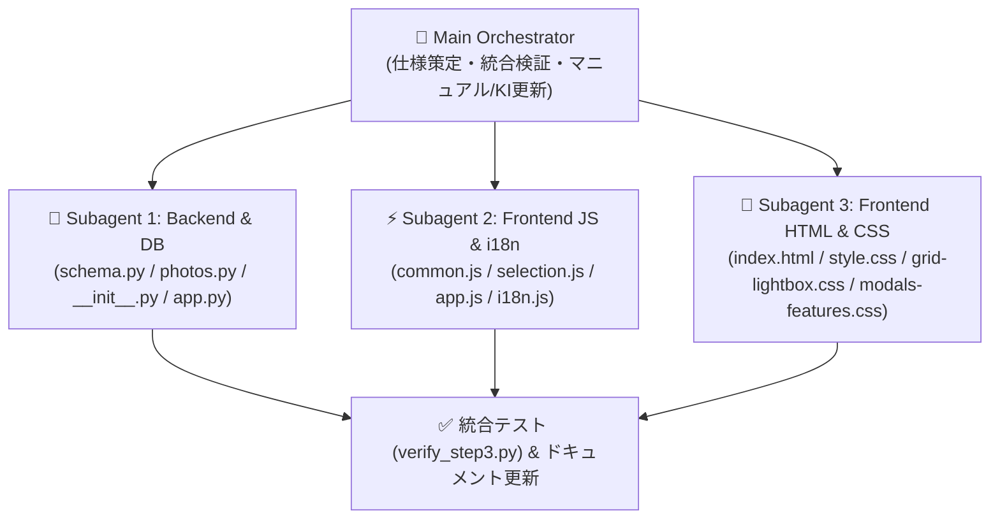

# 実装計画書：ステップ3 残作業6項目の一括完遂（サブエージェント並列オーケストレーション）

[ui-ux-diagnosis-and-roadmap.md](file:///c:/Users/zony0/Documents/photo-manager/docs/knowledge/ui-ux-diagnosis-and-roadmap.md) に記録した未実施の残作業6項目を、ファイル競合ゼロの **3つの専門サブエージェント（Backend / Frontend JS / Frontend HTML&CSS）** に分割して並列実装し、メインエージェントが統合検証・ドキュメント同期を行います。

---

## 1. オーケストレーション構成（ファイル責務の完全分離）

---

## 2. 実装する6項目と共通インターフェース仕様

1. **【残作業1】「取り込み / storage / take_out / スマート・テイクアウト」の4重構造整理**
   - `POST /api/upload` のデフォルト保存先を `uploads/` から `storage/` へ一本化。
   - 「📤 テイクアウト」ポップオーバー＆右クリックサブメニューで「⚡ スマート・テイクアウト」と「🎞️ ベタ焼きHTML」を主役にし、旧 `take_out/` 単純コピー欄を `
`（折りたたみ）へ格納。
2. **【残作業2】カメラ時計の「撮影日時の一括シフト補正（±日・時・分・秒 ＆ 元日時リセット）」**
   - `photos` テーブルに `original_date_taken TEXT` を追加し、元ファイルを一切書き換えない完全非破壊のDB日時シフト（`POST /api/photos/batch-shift-date`）と「元のEXIF日時に戻す」復元機能を実装。
   - 「⋯ その他」ポップオーバーおよび右クリックメニューから `#dateShiftModal` を呼び出し、プリセット（`±15分` / `±1時間` / `±9時間`）と先頭5件のリアルタイムプレビューを提供。
3. **【残作業3】左サイドバー「🧪 ラボ」と「🗺️ ジオタグ」の機能仕分け**
   - 「🗺️ ジオタグ」ツールバーに `🗾 制覇マップ` ボタンを配置し、ラボ内の重複ボタンを整理して「📊 撮影カルテ・発掘」と「🔭 光線・露出・記念日スマート抽出」に明確化。
4. **【残作業4】上部メインヘッダー（`.app-header`）と `.view-header` の省スペース・レスポンシブ最適化**
   - 1280px〜1440px のノートPC画面幅でも1行に美しく収まるメディアクエリ最適化。
5. **【残作業5】シャッター速度順ソート（`shutter_fast`: 高速→低速 / `shutter_slow`: 低速→高速）**
   - `_shutter_speed_seconds_sql()` を活用したSQL数値換算ソートを追加し、ソート順を計14種へ拡充。
6. **【残作業6】属性フィルタの細分化（`jpeg`: JPEG/一般のみ / `raw_pair`: RAW+JPGペア / `xmp`: 📄 XMPあり）**
   - `.view-header` の属性ピル横に高さ26px統一のコンパクトな詳細属性セレクト（`#attrSubFilterSelect`）を追加。
